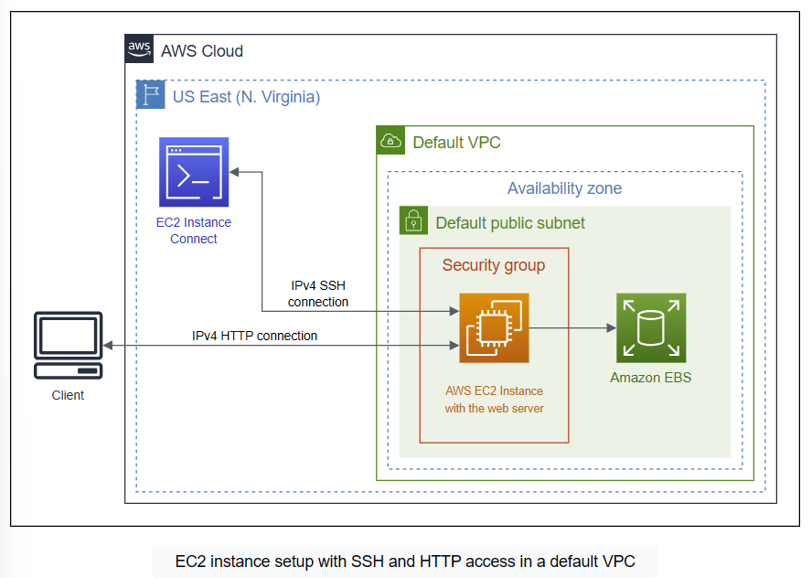
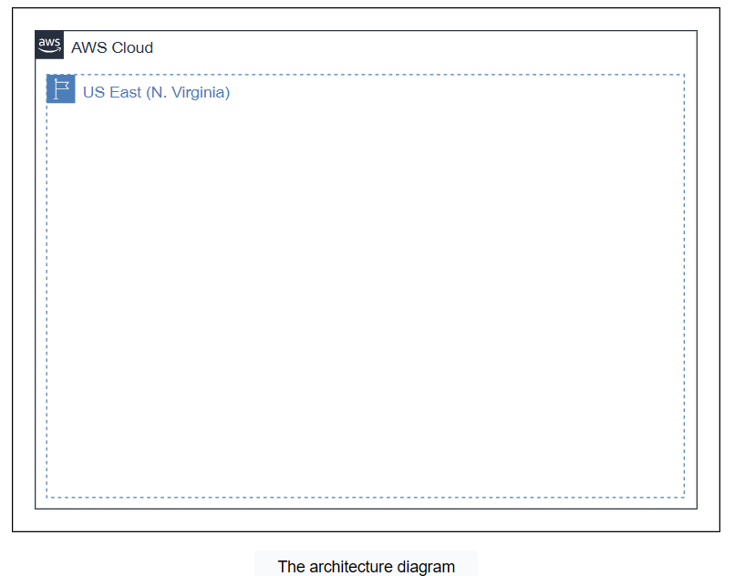
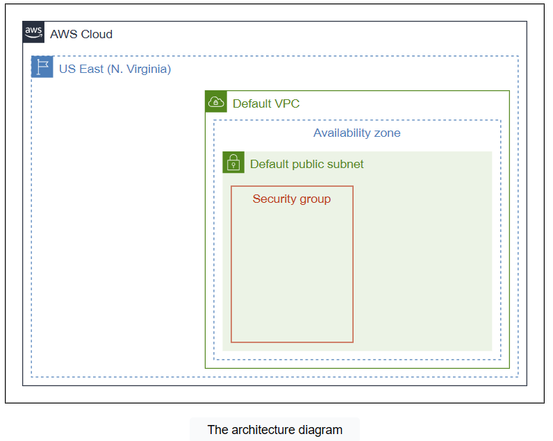
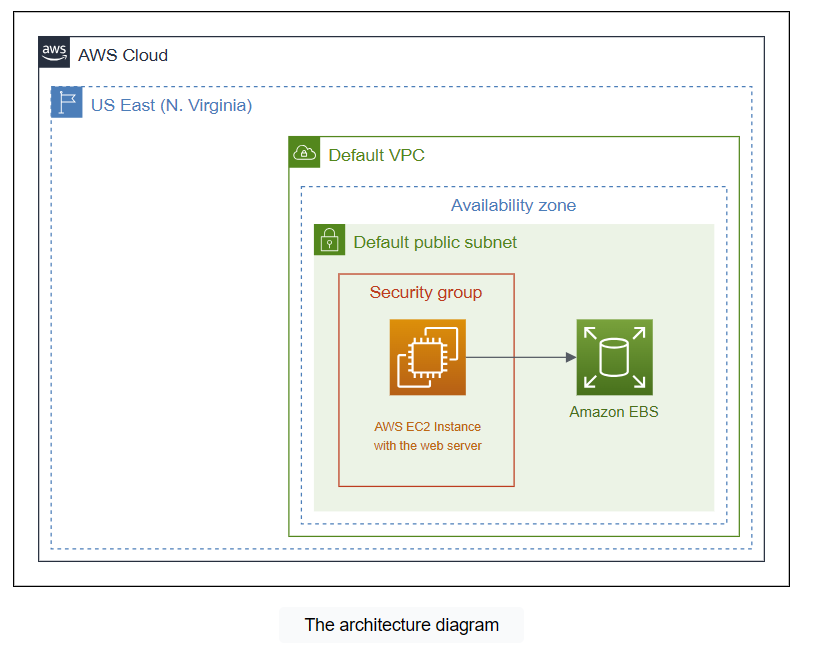
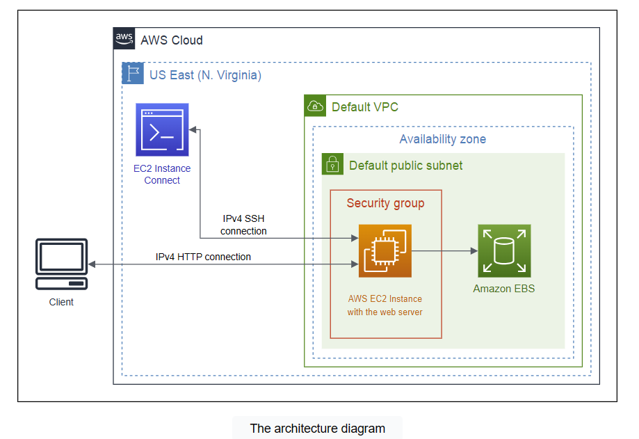
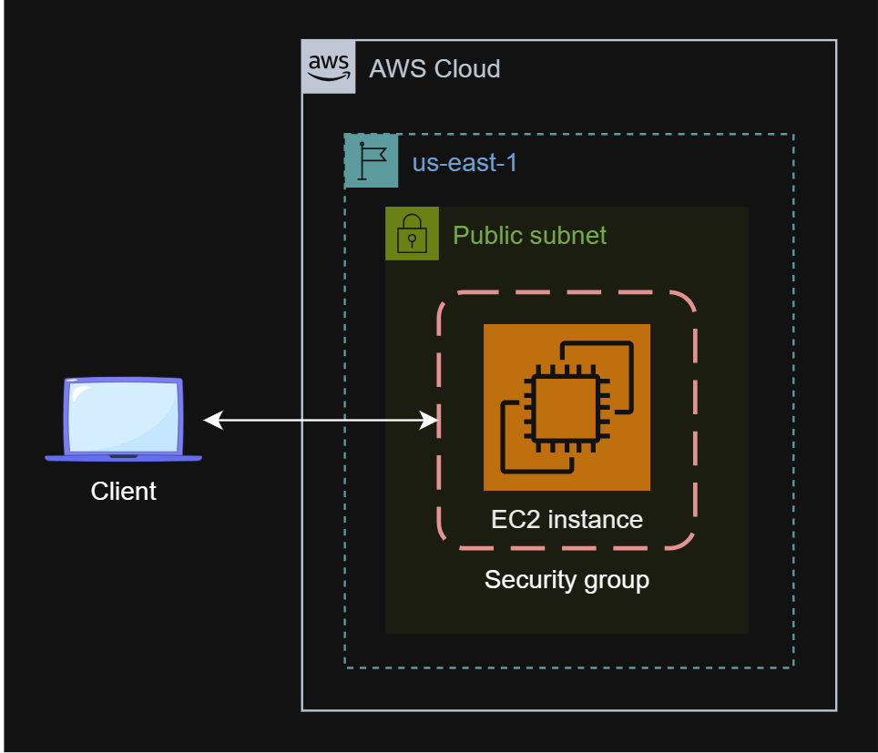

# Cloud Lab 1 — Amazon EC2 (Hands-on)

| Item | Details |
|---|---|
| Work | Individual, in your own AWS Academy Learner Lab |
| Region | US East (N. Virginia) `us-east-1` |
| Parts | **1.1** An Amazon EC2 walkthrough (guided) · **1.2** Set up an EC2 web solution (challenge, no step-by-step instructions) |
| Submit | `cc-lab-YOUR_ID/lab1/` in your GitHub repository `CC-GIC-YOUR_ID`: `README.md` and 10 screenshots |
| Before you start | Do the [student setup](../SETUP.md) once: Learner Lab, GitHub repository and course folder |

> **Overview:** Amazon Elastic Compute Cloud (Amazon EC2) launches instances, also known as virtual servers, on which we can host web pages and other applications. In this lab you create an EC2 instance, bootstrap a web server on it, and test it through the browser and over SSH. Then you build a similar web server on your own.

## Lab Objectives

After this lab, you can:

1. Create a security group that allows SSH and HTTP traffic.
2. Create a key pair and use it to connect to an instance over SSH.
3. Launch an EC2 instance with an AMI, an instance type, storage and a user data script.
4. Test a web server hosted on an EC2 instance.
5. Provision and configure a secure EC2 web server without step-by-step instructions.

## Screenshots in this lab

Take each screenshot **when the lab tells you to**, before the Clean Up section deletes the resources. Save them with these names; you put them in `lab1/images/` at the end.

| File | Part | What it shows |
|---|---|---|
| `01-security-group.png` | 1.1 | Inbound rules for SSH (22) and HTTP (80) |
| `02-key-pair.png` | 1.1 | Key pair `aws-bootstrap-key-pair` in the console |
| `03-instance-details.png` | 1.1 | Instance name, type `t2.micro`, public IP/DNS, state *Running* |
| `04-browser-test.png` | 1.1 | Browser showing the *Hello World from Educative* page |
| `05-ssh-connection.png` | 1.1 | Your terminal connected to the instance (`ec2-user@...` prompt) |
| `06-challenge-launch.png` | 1.2 | Your instance name and the Linux AMI selected |
| `07-challenge-security-group.png` | 1.2 | Inbound HTTP and SSH rules you configured |
| `08-challenge-instance.png` | 1.2 | Instance state *Running* and its public IP |
| `09-challenge-terminal.png` | 1.2 | Your commands installing Apache or Nginx and creating `index.html` |
| `10-challenge-browser.png` | 1.2 | *Welcome to the EC2 Challenge* loaded from the public IP |

Every console screenshot must show your Learner Lab user name at the top-right.

# Part 1.1 — An Amazon EC2 Walkthrough

The Amazon EC2 service provides customizable computing on the AWS cloud that is easy to scale. Its most basic resource is the **instance**: a virtual machine on the AWS cloud, configurable for everyday computing needs such as processing data, running applications or hosting websites. In this part you launch an instance, configure its security settings, and connect to it in different ways.

The final infrastructure of this part:



The starting infrastructure, which you build on:



## Getting Started

Select the correct Region before you start:

1. In the top-right of the AWS navigation bar, click the Region drop-down menu (to the left of the account menu).
2. Select **US East (N. Virginia) `us-east-1`**. Work in this Region for the whole lab; access to other Regions is restricted.

## Task 1 — Create a Security Group

**Security groups** are rules that manage the inbound and outbound traffic of an instance. They act as a firewall at the instance level. In this task you create a security group that allows SSH and HTTP connections to the instance you attach it to later.



1. In the AWS console, search for **EC2** and click the EC2 service. This opens the EC2 dashboard.
2. In the sidebar, click **Security Groups** under **Network & Security**.
3. Click **Create security group** and configure it:
   - **Basic details**
     - Security group name: `aws-bootstrap-security-group`
     - Description: `Security group for aws-bootstrap`
     - VPC: the **default VPC**
   - **Inbound rules**
     - Click **Add rule**. Type **SSH**, source **Anywhere-IPv4**. This allows SSH access from any IPv4 address.
     - Click **Add rule**. Type **HTTP**, source **Anywhere-IPv4**. This allows web traffic on port 80.
   - **Outbound rules:** keep the default rule, which allows all outbound traffic.
   - **Tags:** click **Add new tag**, key `Name`, value `aws-bootstrap-security-group`.
4. Click **Create security group**.

> **Note:** The SSH rule lets you use EC2 Instance Connect and your own SSH client. The HTTP rule lets you reach the instance from a browser.

> 📸 **Screenshot `01-security-group.png`:** the security group's **Inbound rules** tab showing SSH (port 22) and HTTP (port 80).

## Task 2 — Create a Key Pair

Linux instances are not secured by passwords. AWS uses **public-key cryptography**: a key pair secures the login to an instance. You name the key pair when you launch the instance, and then use the saved private key to log in over SSH.

1. In the sidebar, click **Key Pairs** under **Network & Security**.
2. Click **Create key pair** and set:
   - Name: `aws-bootstrap-key-pair`
   - Key pair type: **RSA**
   - Private key file format: **.pem** (for OpenSSH)
3. Click **Create key pair**.

Your browser downloads `aws-bootstrap-key-pair.pem`, and the key pair appears in the list.

> ⚠️ The `.pem` file is a private key. Keep it outside your course folder and **never commit it to Git**. The `.gitignore` from the setup already blocks `*.pem` files.

> 📸 **Screenshot `02-key-pair.png`:** the key pair list showing `aws-bootstrap-key-pair`.

## Task 3 — Launch an Instance

You now configure and launch an instance that hosts a simple web application: you choose its AMI, instance type and storage, attach the security group and key pair, and give it a bootstrap script that starts the web server at launch.



From the sidebar, click **Instances**, then **Launch instances**. Check that the Region is still `us-east-1`.

**Step 1 — Name and tags.** Set the name to `aws-bootstrap-instance`. You do not need other tags.

**Step 2 — Amazon Machine Image (AMI).** An AMI is a preconfigured image that holds what an instance needs at launch, such as the operating system and software packages.

- In **Quick Start**, select **Amazon Linux**.
- Select the **Amazon Linux 2023 AMI**, architecture **64-bit (x86)**.

**Step 3 — Instance type.** An instance type is a combination of CPU, memory, storage and network capacity. Select **t2.micro**, a low-cost type for general-purpose tasks.

**Step 4 — Key pair.** Select `aws-bootstrap-key-pair`.

**Step 5 — Network settings.** Choose **Select existing security group** and select `aws-bootstrap-security-group`.

**Step 6 — Storage.** Keep the default **8 GiB gp3** Amazon EBS volume.

**Step 7 — Advanced details.** Change only the metadata and user data options.

- **Metadata** lets you read information about the instance from inside it:
  - Metadata accessible: **Enabled**
  - Metadata version: **V1 and V2 (token optional)**
  - Allow tags in metadata: **Enable**
- **User data** is a script the instance runs at launch (bootstrapping). Paste this script to start a basic web server:

  ```bash
  #!/bin/bash
  sudo su
  yum update -y
  yum install -y httpd.x86_64
  systemctl start httpd.service
  systemctl enable httpd.service
  echo "Hello World from Educative($(hostname))" > /var/www/html/index.html
  ```

  | Line | What it does |
  |---|---|
  | 2 | Gets administrator rights to install packages |
  | 3 | Updates the system and installed packages |
  | 4 | Installs the `httpd` web server |
  | 5–6 | Starts the `httpd` service and enables it at boot |
  | 7 | Creates `index.html`, the page the server displays |

**Step 8 — Launch.** Review the settings and click **Launch instance**. Click **View all instances**. Within a few minutes the instance state changes to **Running**. Wait one or two more minutes so the user data script can finish.

> 📸 **Screenshot `03-instance-details.png`:** the instance selected in the list, with the details panel showing its name, type `t2.micro`, public IPv4 address or DNS, and state *Running*.

## Task 4 — Test the Instance

You now reach the web server that the user data script installed: first over HTTP from a browser, then over SSH.



### Approach 1 — Browser

1. In the sidebar, click **Instances** and select `aws-bootstrap-instance`.
2. In the details panel, copy the **Public IPv4 address** or **Public IPv4 DNS**.
3. Open it in a new browser tab with **`http://`**, not `https://`. The server does not answer HTTPS.

You see the message *Hello World from Educative(...)* with the instance's host name.

> 📸 **Screenshot `04-browser-test.png`:** the browser with the address bar and the Hello World page.

### Approach 2 — SSH from your own computer

1. **Find your key file** `aws-bootstrap-key-pair.pem` (downloaded in Task 2).
2. **Move it to a safe folder**, for example `C:\Users\<YourUsername>\.ssh\` on Windows or `~/.ssh/` on Linux, macOS or WSL. Create the `.ssh` folder if it does not exist.
3. **Protect the key file.** SSH refuses a key that other users can read.
   - Windows: right-click the file → **Properties → Security → Advanced**. Click **Disable inheritance**, then **Remove all inherited permissions**. Click **Add → Select a principal**, type your Windows user name, click **OK**, check **Full control**, and click **OK → Apply → OK**.
   - Linux, macOS or WSL:

     ```bash
     chmod 400 ~/.ssh/aws-bootstrap-key-pair.pem
     ```

4. **Open a terminal:** Command Prompt, PowerShell, Windows Terminal, or WSL (recommended for Linux-style commands).
5. **Connect.** Replace `<INSTANCE_DNS_ADDRESS>` with the instance's Public IPv4 DNS (EC2 console → Instances → Networking):

   ```bash
   ssh -i "C:\Users\<YourUsername>\.ssh\aws-bootstrap-key-pair.pem" ec2-user@<INSTANCE_DNS_ADDRESS>
   ```

   For example:

   ```bash
   ssh -i "C:\Users\pisey\.ssh\aws-bootstrap-key-pair.pem" ec2-user@ec2-13-213-45-102.compute-1.amazonaws.com
   ```

6. **Accept the host.** When SSH asks `Are you sure you want to continue connecting (yes/no/[fingerprint])?`, type `yes` and press Enter.
7. You now see the Linux prompt of your instance. Check the connection:

   ```bash
   whoami
   hostname
   ```

   The output looks like `ec2-user` and `ip-172-31-24-88`.

> 📸 **Screenshot `05-ssh-connection.png`:** your terminal showing the `ssh` command, the `ec2-user@...` prompt and the output of `whoami` and `hostname`.

> **Alternative — EC2 Instance Connect:** select the instance, click **Connect**, keep **EC2 Instance Connect**, and click **Connect**. A terminal opens in the browser. Use this if SSH from your computer is blocked, and say so in your report.

## Clean Up (Part 1.1)

Take all Part 1.1 screenshots **before** you clean up.

**Terminate the instance**

1. Close any Instance Connect or SSH session and return to the EC2 dashboard.
2. Click **Instances**, select `aws-bootstrap-instance`.
3. Click **Instance state → Terminate instance**, then **Terminate**.

**Delete the key pair**

1. Click **Key Pairs**, select `aws-bootstrap-key-pair`.
2. Click **Actions → Delete**, type `Delete`, and click **Delete**.

**Delete the security group**

1. Make sure the instance is terminated; otherwise the security group cannot be deleted.
2. Click **Security Groups**, select `aws-bootstrap-security-group`.
3. Click **Actions → Delete security groups**, then **Delete**.

# Part 1.2 — Set Up an EC2 Web Solution (Challenge)

In this part you provision and configure a secure EC2 instance **on your own**. There are no step-by-step instructions: use what you did in Part 1.1.

Amazon EC2 provides scalable virtual servers in the cloud and lets you choose instance types, storage and network settings. Your task is to set up a virtual server, attach storage, configure secure networking with the right ports, and install a web server that hosts a static web page.



## Requirements

1. **EC2 instance type.** Configure a Linux instance of type **t2.micro**. The instance must have a **public IP** so the web page can be reached.
2. **Security group.** Allow inbound **HTTP** traffic for web page access and **SSH** traffic for remote configuration.
3. **Storage.** The root volume must have **10 GiB** of storage.
4. **Static web page.**
   - Install **Apache** or **Nginx** on the instance.
   - Create an `index.html` file that displays the message **"Welcome to the EC2 Challenge"**.

Test the page at `http://<Public-IP-Address>`.

Keep a note of every command you run on the instance: your report asks for them.

> 📸 **Screenshots `06` to `10`** (see the table at the top): launch configuration, security group, running instance, terminal commands, and the page in the browser.

## Clean Up (Part 1.2)

After your screenshots, terminate the challenge instance, then delete its security group and any key pair you created for it.

# Submission

1. Make the lab folder and copy your 10 screenshots into `images/`:

   ```bash
   mkdir -p ~/cc-gic-YOUR_ID/cc-lab-YOUR_ID/lab1/images
   ```

2. Copy the [report template](README.md) to `cc-lab-YOUR_ID/lab1/README.md` and fill it in.
3. Check the structure. It must look like this, with your own ID:

   ```text
   cc-gic-YOUR_ID/
   ├── .gitignore
   └── cc-lab-YOUR_ID/
       └── lab1/
           ├── README.md
           └── images/
               ├── 01-security-group.png
               ├── 02-key-pair.png
               ├── 03-instance-details.png
               ├── 04-browser-test.png
               ├── 05-ssh-connection.png
               ├── 06-challenge-launch.png
               ├── 07-challenge-security-group.png
               ├── 08-challenge-instance.png
               ├── 09-challenge-terminal.png
               └── 10-challenge-browser.png
   ```

   Your `.pem` key file must **not** be in this folder.

4. Commit and push:

   ```bash
   cd ~/cc-gic-YOUR_ID
   git add .
   git commit -m "Lab 1: EC2 walkthrough and challenge"
   git push
   ```

5. Open `CC-GIC-YOUR_ID` on GitHub and check that `lab1/README.md` shows all 10 screenshots.
