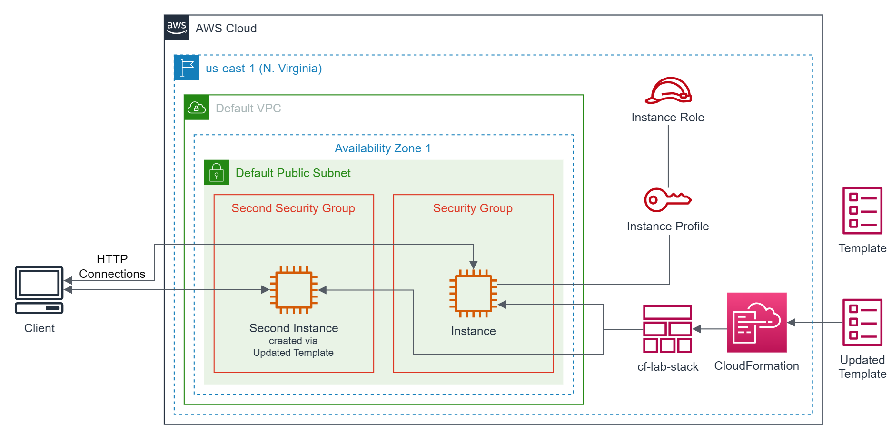
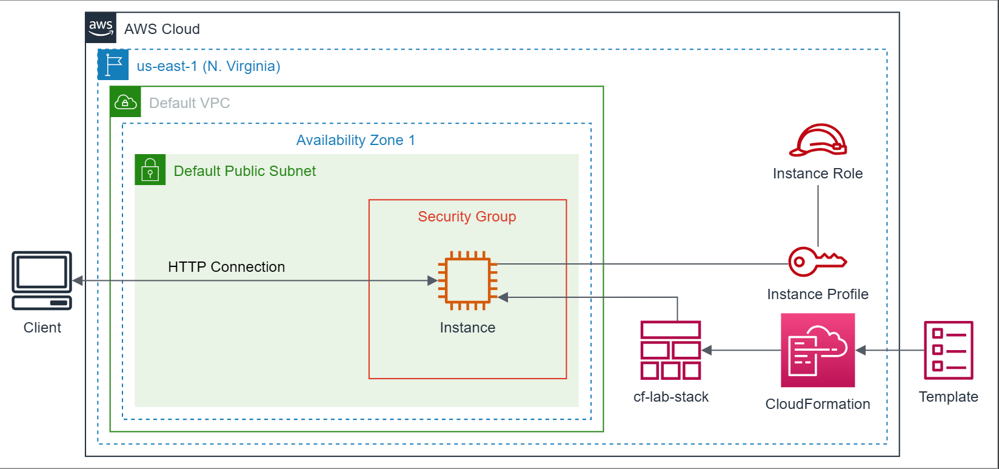
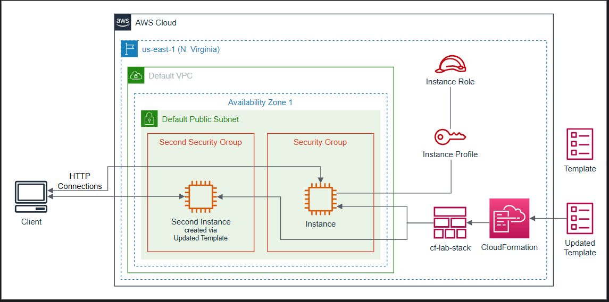
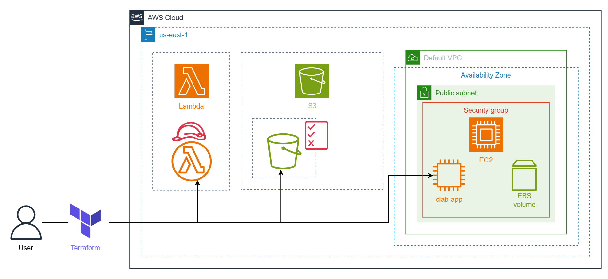
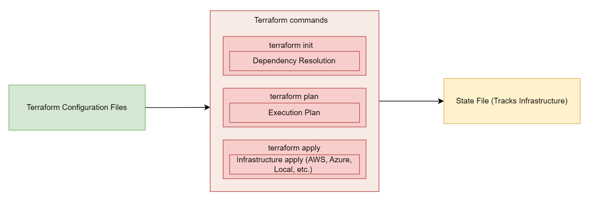
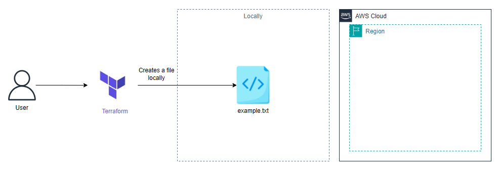
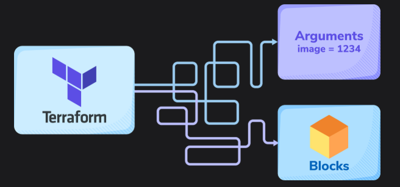
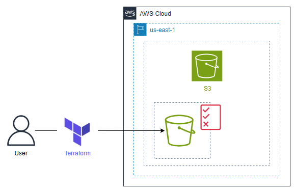
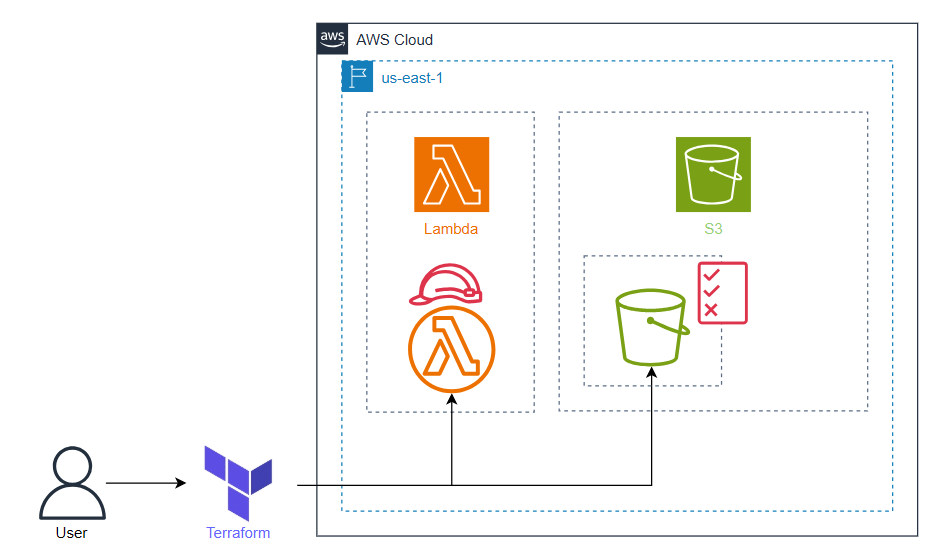
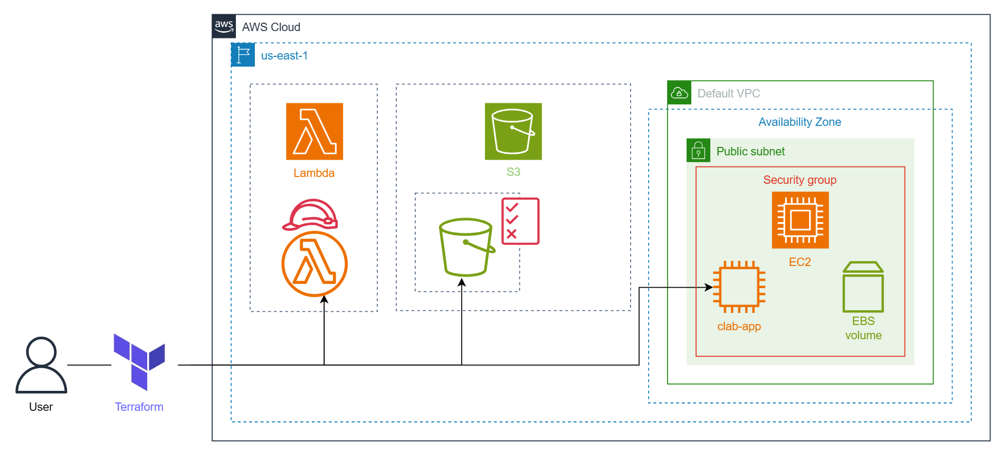

# Cloud Lab 10 — Provisioning AWS with Infrastructure as Code (Hands-on)

| Item | Details |
|---|---|
| Work | Individual, in your own AWS Academy Learner Lab |
| Region | US East (N. Virginia) `us-east-1` |
| Parts | **10.1** AWS CloudFormation · **10.2** Terraform |
| Starter files | [`files/`](files/): the two CloudFormation templates and the Terraform starter files |
| Submit | `cc-lab-YOUR_ID/lab10/` in your GitHub repository `CC-GIC-YOUR_ID`: `README.md`, your templates and Terraform code, and 16 screenshots |

> **Overview:** With **Infrastructure as Code (IaC)**, you describe your infrastructure in text files instead of creating each resource by hand in the console. In Part 10.1 you use an AWS CloudFormation template to create a stack of an EC2 instance and its security group, then update the stack with a second instance. In Part 10.2 you use Terraform to create an S3 bucket, a Lambda function with a function URL, and an EC2 instance that runs a React application.

## Lab Objectives

After this lab, you can:

1. Read a CloudFormation template and name its sections.
2. Create, test and update a CloudFormation stack.
3. Explain the Terraform workflow: `init`, `plan`, `apply`, `destroy`.
4. Write Terraform blocks (provider, resource, data, output) to provision S3, Lambda and EC2 resources.
5. Remove all the resources of a stack or a configuration in one step.

## Screenshots in this lab

| File | Part | What it shows |
|---|---|---|
| `01-cf-resources.png` | 10.1 | Stack `cf-lab-stack` → **Resources** after creation |
| `02-cf-outputs.png` | 10.1 | Stack **Outputs** with `InstanceEndpoint` |
| `03-cf-browser.png` | 10.1 | The `InstanceEndpoint` page: *Hello World from Educative* |
| `04-cf-updated-resources.png` | 10.1 | **Resources** after the update, with `SecondSecurityGroup` and `SecondInstance` |
| `05-cf-updated-outputs.png` | 10.1 | **Outputs** with `InstanceEndpoint` and `SecondInstanceEndpoint` |
| `06-cf-second-browser.png` | 10.1 | The `SecondInstanceEndpoint` page: *Hello World from Second Instance* |
| `07-tf-s3-apply.png` | 10.2 | Terminal after `terraform apply` creating the S3 bucket (*Apply complete*) |
| `08-tf-object-apply.png` | 10.2 | Terminal after `terraform apply` uploading `index.html` |
| `09-tf-s3-ls.png` | 10.2 | `aws s3 ls s3://<BUCKET-NAME>` listing `index.html` (or the bucket in the S3 console) |
| `10-tf-bucket-policy.png` | 10.2 | `terraform apply` adding the bucket policy, or *S3 → bucket → Permissions* with the policy |
| `11-tf-lambda-apply.png` | 10.2 | Terminal after `terraform apply` creating the Lambda function |
| `12-tf-function-url.png` | 10.2 | Terminal showing the output `function_url = ...` |
| `13-tf-function-url-browser.png` | 10.2 | The function URL open in the browser, showing the page |
| `14-tf-security-group.png` | 10.2 | Inbound rule TCP 3000 from `0.0.0.0/0` (console), or your security group code |
| `15-tf-public-ip.png` | 10.2 | Terminal showing the output `public_ip = ...` |
| `16-tf-react-app.png` | 10.2 | The React app at `http://<Public_IP_Address>:3000` |

Every console screenshot must show your Learner Lab user name at the top-right.

# Part 10.1 — AWS CloudFormation

**CloudFormation** creates and manages a collection of related AWS resources called a **stack**. A stack is managed as a single unit: you describe its resources and their dependencies in a JSON or YAML **template**, and you create, update or delete them all together.

CloudFormation follows the practice of infrastructure as code. It simplifies deployment, reduces human error, and keeps infrastructure consistent with an organization's standards, so you spend less time creating resources and more on the applications that run on them.

The infrastructure you build in this part:



## Task 1 — Get Introduced to the CloudFormation Template

A **CloudFormation template** is a text file in JSON or YAML that describes the AWS resources of a stack and their dependencies. A YAML template has these sections:

```yaml
AWSTemplateFormatVersion: "version date"
Description:
  String
Metadata:
  template metadata
Parameters:
  set of parameters
Rules:
  set of rules
Mappings:
  set of mappings
Conditions:
  set of conditions
Transform:
  set of transforms
Resources:
  set of resources
Outputs:
  set of outputs
```

| Section | Required? | Purpose |
|---|---|---|
| `AWSTemplateFormatVersion` | optional | The template format version. Defaults to the latest |
| `Description` | optional | A text description. Must follow the format version |
| `Metadata` | optional | Objects with extra information about the template |
| `Parameters` | optional | Input values given when the stack is created or updated, used to customize resources. Example: a parameter whose allowed values are instance types, so the same template creates a large instance for production and a small one for development |
| `Rules` | optional | Checks on the parameters passed at creation or update |
| `Mappings` | optional | Keys linked to named values. Example: map `Development` to `m7g.medium` and `Production` to `m7g.large`, and choose `Development` or `Production` as the parameter |
| `Conditions` | optional | Create a resource or set a property only when a condition is true |
| `Transform` | optional | Macros hosted by CloudFormation, run in the order given |
| `Resources` | **required** | The resources to create. The only required section |
| `Outputs` | optional | Values the stack returns, shown in its **Outputs** tab |

Each resource in `Resources` has:

- a **logical ID**: a unique alphanumeric name used to refer to the resource elsewhere in the template;
- a **Type**, in the form `service-provider::service-name::data-type-name`, for example `AWS::EC2::Instance`;
- **Properties**: the settings of the resource.

## Task 2 — Set Up a CloudFormation Template

Download [`files/CloudFormation_Lab_Template.yaml`](files/CloudFormation_Lab_Template.yaml) and open it. It launches an EC2 instance with a web server.

| Part of the template | What it does |
|---|---|
| `AWSTemplateFormatVersion: 2010-09-09` | The template format version |
| `Parameters` | `EC2InstanceType` defaults to `t2.micro`, a basic low-cost instance. `EC2AMI` defaults to the SSM parameter `/aws/service/ami-amazon-linux-latest/amzn2-ami-hvm-x86_64-gp2`: the latest Amazon Linux 2 AMI |
| `Resources → SecurityGroup` | A security group with two inbound rules: port 22 (SSH) and port 80 (HTTP) |
| `Resources → InstanceRole`, `InstanceProfile` | **Commented out** (lines starting with `#`). They would create an IAM role and an instance profile for the instance, but the Learner Lab does not allow creating IAM roles |
| `Resources → Instance` | The EC2 instance, using the parameters and the security group. Its user data installs and starts `httpd` and writes an `index.html` page |
| `Outputs → InstanceEndpoint` | The instance's public DNS name as a URL, so you can open it |

## Task 3 — Create a Stack



**Step 1 — Create a stack**

1. Search for **CloudFormation** and open it. Click **Stacks**.
2. Click **Create stack → With new resources (standard)**.
3. **Prepare template:** keep **Choose an existing template**.
4. **Specify template:** **Upload a template file**, click **Choose file**, and select `CloudFormation_Lab_Template.yaml`.
5. Click **Next**.

**Step 2 — Specify stack details**

1. Stack name: `cf-lab-stack`.
2. Keep the default parameters: `EC2InstanceType` = `t2.micro`, and `EC2AMI` = `/aws/service/ami-amazon-linux-latest/amzn2-ami-hvm-x86_64-gp2`.
3. Click **Next**.

**Step 3 — Configure stack options**

1. Change nothing. If CloudFormation asks you to acknowledge that it may create IAM resources, check the box.
2. Click **Next**.

> **Note:** If a *Failed to retrieve sns topics* warning appears, ignore it.

**Step 4 — Review and create**

1. Review the settings.
2. Click **Submit**.

Creation takes five to ten minutes. When the status is **CREATE_COMPLETE**, open the **Resources** tab to see every resource the stack created.

> 📸 **Screenshot `01-cf-resources.png`:** the stack's **Resources** tab.

## Task 4 — Test and Update the Stack

You test the stack, then update it to add a second security group and a second instance.



### Test the stack

1. **Check the outputs.** Select `cf-lab-stack` and open the **Outputs** tab. Click the link under **Value** of `InstanceEndpoint`. The page shows *Hello World from Educative*.

   > **Note:** Wait a few minutes after the stack is created, so the instance can finish its user data script.

   > 📸 **Screenshots:** `02-cf-outputs.png` (the Outputs tab) and `03-cf-browser.png` (the page in the browser).

2. **Check the application from inside the instance.**
   1. Open **EC2 → Instances**, select the instance named `cf-lab-stack`, and click **Connect**.
   2. With **EC2 Instance Connect** selected, click **Connect**.
   3. Ask the web server running on port 80 for its page:

      ```bash
      curl localhost
      ```

      It prints *Hello World from Educative*.

### Update the stack

Download [`files/CloudFormation_Lab_Updated_Template.yaml`](files/CloudFormation_Lab_Updated_Template.yaml). It is the same template with three additions:

- a resource `SecondSecurityGroup`, with ports 80 and 22 open;
- a resource `SecondInstance`, whose user data writes *Hello World from Second Instance*;
- an output `SecondInstanceEndpoint`.

The first instance's page now also shows its host name.

1. In **CloudFormation**, select `cf-lab-stack` and click **Update**.
2. **Step 1:** **Replace existing template**, **Upload a template file**, choose `CloudFormation_Lab_Updated_Template.yaml`, and click **Next**.
3. **Step 2:** keep the parameters and click **Next**.
4. **Step 3:** change nothing (acknowledge IAM resources if asked) and click **Next**.
5. **Step 4:** review the settings. Look at the **Changeset preview**: it lists exactly which resources will be added or changed. Click **Submit**.

### Test the updated stack

1. When the status is **UPDATE_COMPLETE**, open the **Resources** tab: `SecondSecurityGroup` and `SecondInstance` are listed.
2. Open the **Outputs** tab and click the value of `SecondInstanceEndpoint`. The page shows *Hello World from Second Instance*.

   > **Note:** Wait a few minutes after the update for the instance to be ready.

> 📸 **Screenshots:** `04-cf-updated-resources.png`, `05-cf-updated-outputs.png` (both outputs visible) and `06-cf-second-browser.png`.

## Clean Up (Part 10.1)

One action deletes everything the stack created:

1. In **CloudFormation**, select `cf-lab-stack` and click **Delete**, then **Delete** again.
2. Wait until the stack disappears from the list (or shows **DELETE_COMPLETE**). Both instances and both security groups are gone.

# Part 10.2 — Terraform

**Terraform** is a tool for provisioning infrastructure as code. It builds, changes and versions infrastructure safely and efficiently, on your own machine or on any cloud provider, from code and without manual steps.

The infrastructure you build in this part:



## Set Up Your Terraform Workspace

You run Terraform on your own computer, in your submission folder, so your code is ready to commit.

1. **Install Terraform** by following [the official instructions](https://developer.hashicorp.com/terraform/install) for your system. On Windows, WSL (Ubuntu) is the easiest. Check it works:

   ```bash
   terraform -version
   ```

2. **Give Terraform your Learner Lab credentials.** In the Learner Lab, open **AWS Details → AWS CLI: Show**. Copy the whole block (`[default]`, `aws_access_key_id`, `aws_secret_access_key`, `aws_session_token`) into the file `~/.aws/credentials`:

   ```bash
   mkdir -p ~/.aws
   nano ~/.aws/credentials
   ```

   Terraform's AWS provider reads this file by itself. The credentials expire when the Learner Lab session ends: when you start a new session, copy them again.

   > ⚠️ `~/.aws/credentials` is in your home folder, outside your repository. Never copy keys into `main.tf` or any file you commit.

3. **Install the AWS CLI** (optional, for the `aws s3 ls` check) from [the AWS CLI page](https://aws.amazon.com/cli/). Without it, you check the bucket in the S3 console instead.
4. **Create the working folder** and copy the starter files [`files/terraform/`](files/terraform/) (`main.tf`, `lambda.py`, `index.html`) into it:

   ```bash
   mkdir -p ~/cc-gic-YOUR_ID/cc-lab-YOUR_ID/lab10/terraform
   cd ~/cc-gic-YOUR_ID/cc-lab-YOUR_ID/lab10/terraform
   ```

   Run every Terraform command in this folder. The `.gitignore` from the setup keeps Terraform's working files (`.terraform/`, `*.tfstate`, `*.zip`) out of Git.

General guidelines:

- Work in **`us-east-1`**.
- Use the **resource names** given in the lab.
- Your permissions are limited. Some console pages may show *insufficient privileges* messages; you can ignore them.

## Task 5 — The Terraform Workflow

**Infrastructure as Code (IaC)** provisions infrastructure from machine-readable code files. Terraform is **declarative**: you describe **what** you want, and Terraform works out **how** to create it.

**Why Terraform?** It builds the infrastructure from code without manual steps. Manual configuration is error-prone; Terraform reduces the work and can rebuild the infrastructure whenever needed. It works with many providers, including AWS, GCP and Azure, and also with your local machine.

**How does Terraform work?** You write **configuration files** that describe the infrastructure. Terraform **initializes** the working directory, downloading what the configuration needs, analyses the files to resolve dependencies, and then calls the provider's API (AWS, Azure, local, ...) to create the resources. It keeps a **state file** with the current state, resource IDs and other metadata.



**Configuration files** are written in the HashiCorp Configuration Language (HCL) or JSON, as a set of **blocks**.

**CLI commands:**

| Command | What it does |
|---|---|
| `terraform init` | Initializes the working directory: resolves dependencies and installs the provider plugins. Creates `.terraform.lock.hcl`, which records the provider versions |
| `terraform plan` | Shows the execution plan: what will be created, changed or destroyed to match the configuration |
| `terraform apply` | Applies the changes, after you type `yes`. Creates or updates `terraform.tfstate`, the state of the infrastructure |
| `terraform destroy` | Destroys everything the configuration created |

## Task 6 — Terraform in Action

You start with a configuration that only works on your own machine: it creates a text file.



The starter `main.tf` contains this:

```hcl
provider "local" {
  # This provider is used for local operations.
}

resource "null_resource" "create_txt_file" {

  provisioner "local-exec" {
    command = "echo 'Congratulations!' > example.txt"
  }
}
```

| Lines | Block |
|---|---|
| 1–3 | A **provider** block. A provider lets Terraform talk to a cloud provider, a SaaS service or another API, and configures access to it. The `local` provider works on the machine that runs Terraform |
| 5–10 | A **resource** block of type `null_resource`, named `create_txt_file`. A `null_resource` is not real infrastructure; it is a placeholder for local actions or a trigger for other processes |
| 7–9 | A **provisioner** of type `local-exec`: it runs a command on the local machine |

In your `terraform` folder, run:

```bash
terraform init
terraform plan
terraform apply
```

Type `yes` when `apply` asks for confirmation. Then read the file Terraform created:

```bash
cat example.txt
```

It contains `Congratulations!`.

## Task 7 — Blocks and Arguments

The two main parts of Terraform syntax are **arguments** and **blocks**.



An **argument** assigns a value to a name:

```hcl
image_id = "134"
```

`image_id` is the argument name and `"134"` its value.

A **block** is a container for configuration. Each block describes one part of the infrastructure; this structure makes the code readable and reusable. Common blocks:

**Terraform block:** settings for Terraform itself, such as the required version. It accepts only constant values.

```hcl
terraform {
  # ...
}
```

**Provider block:** the provider to use and its settings. Here, the AWS provider and the Region where resources are created:

```hcl
provider "aws" {
  region = "us-east-1"
}
```

**Resource block:** one resource of the infrastructure. Line 1 gives the resource type (`aws_instance`, an EC2 instance) and the local name (`example`) used to refer to it elsewhere:

```hcl
resource "aws_instance" "example" {
  ami           = "ami-0c94855ba95c71c99"
  instance_type = "t2.micro"
}
```

**Data block:** reads data from outside the configuration. It needs a data source and a local name. This one reads the existing IAM role `LabRole`; you use it in Task 9:

```hcl
data "aws_iam_role" "lab_role" {
  name = "LabRole"
}
```

**Module block:** a container for several resources that can be reused by calling the module. A module can call other modules (child modules). Every module needs a `source`: a local folder or a remote module that Terraform downloads.

```hcl
module "application" {
  source = "./module" # configuration file path
  # module input arguments
}
```

**Variable blocks:** an **input variable** gives a value to a module or a configuration; an **output** returns a value after `apply` and shows it in the terminal.

```hcl
variable "Sid" {
  type        = number
  description = "Roll number"
}

output "instance_ip_addr" {
  value = aws_instance.server.private_ip
}
```

**Locals block:** gives a name to an expression, so you can reuse the name instead of repeating the expression.

```hcl
locals {
  service_name = "forum"
  owner        = "Dev Team"
}
```

## Task 8 — Provision an S3 Bucket

You create a public S3 bucket, upload an object to it, and attach a bucket policy, all with Terraform.



### Create the bucket

**Replace** the content of `main.tf` with the code below. On line 8, replace `<Unique_Number/Text_Here>` with something unique, for example your student ID: bucket names are globally unique.

```hcl
# Specify the AWS provider and set the region to us-east-1
provider "aws" {
  region = "us-east-1"
}

# Create an S3 bucket with a unique name
resource "aws_s3_bucket" "my_bucket" {
  bucket = "my-bucket-<Unique_Number/Text_Here>"
}

# Set the ownership controls for the S3 bucket to prefer the bucket owner
resource "aws_s3_bucket_ownership_controls" "my_bucket" {
  bucket = aws_s3_bucket.my_bucket.id
  rule {
    object_ownership = "BucketOwnerPreferred"
  }
}

# Configure the S3 bucket's public access settings
resource "aws_s3_bucket_public_access_block" "my_bucket" {
  bucket = aws_s3_bucket.my_bucket.id

  block_public_acls       = false
  block_public_policy     = false
  ignore_public_acls      = false
  restrict_public_buckets = false
}

# Set the ACL (Access Control List) for the S3 bucket to allow public read access
resource "aws_s3_bucket_acl" "my_bucket" {
  depends_on = [
    aws_s3_bucket_ownership_controls.my_bucket,
    aws_s3_bucket_public_access_block.my_bucket,
  ]

  bucket = aws_s3_bucket.my_bucket.id
  acl    = "public-read"
}
```

| Block | What it does |
|---|---|
| `provider "aws"` | Use AWS, in `us-east-1` |
| `aws_s3_bucket` | Create and name the bucket |
| `aws_s3_bucket_ownership_controls` | Object ownership `BucketOwnerPreferred`: the bucket owner owns uploaded objects |
| `aws_s3_bucket_public_access_block` | Turn off the four Block Public Access settings so the bucket can be public |
| `aws_s3_bucket_acl` | Set the bucket ACL to `public-read`. `depends_on` makes Terraform wait for the two blocks above first |

Run:

```bash
terraform init
terraform apply
```

You run `init` again because the configuration now uses a new provider, `aws`. Type `yes` to confirm.

> 📸 **Screenshot `07-tf-s3-apply.png`:** the terminal showing *Apply complete* and the bucket being created.

### Upload an object

**Append** this block to the end of `main.tf`. It uploads the `index.html` file from your folder:

```hcl
# Upload an object (index.html) to the S3 bucket
resource "aws_s3_object" "my_object" {
  bucket       = aws_s3_bucket.my_bucket.bucket # The S3 bucket where the object will be stored
  key          = "index.html"                   # The key (object name) in the bucket
  source       = "index.html"                   # The local file to upload
  content_type = "text/html"                    # The content type of the object
}
```

Run `terraform apply` and type `yes`.

> 📸 **Screenshot `08-tf-object-apply.png`:** the terminal after this apply.

List the bucket's content (replace `<BUCKET-NAME>`):

```bash
aws s3 ls s3://<BUCKET-NAME>
```

`index.html` is listed. Without the AWS CLI, open the bucket in the S3 console instead.

> 📸 **Screenshot `09-tf-s3-ls.png`:** the output showing `index.html`.

### Attach a bucket policy

To let anyone read the bucket's objects, **append** a policy. A **data** block builds the policy document and a resource attaches it:

```hcl
# Define an IAM policy document to allow public read access to the S3 bucket
data "aws_iam_policy_document" "allow_access" {
  statement {
    # The principals the policy applies to (here, all users)
    principals {
      type        = "*"
      identifiers = ["*"]
    }

    actions = [
      "s3:GetObject"
    ]

    resources = [
      aws_s3_bucket.my_bucket.arn,
      "${aws_s3_bucket.my_bucket.arn}/*",
    ]
  }
}

# Attach the policy to the S3 bucket to allow public read access
resource "aws_s3_bucket_policy" "allow_access" {
  bucket = aws_s3_bucket.my_bucket.id
  # Use the IAM policy document defined above
  policy = data.aws_iam_policy_document.allow_access.json
}
```

The data block allows `s3:GetObject` to everyone (`*`) on the bucket and its objects. The resource attaches the JSON form of this document to the bucket as its bucket policy.

Run `terraform apply` and type `yes`.

> 📸 **Screenshot `10-tf-bucket-policy.png`:** the terminal after this apply, or *S3 → your bucket → Permissions* showing the bucket policy.

## Task 9 — Provision a Lambda Function

You create a Lambda function that reads `index.html` from the bucket and returns it as a web page, and a **function URL** to call it from a browser.



### Create the Lambda function

1. In `lambda.py`, replace `<BUCKET_NAME>` on line 7 with your bucket name.
2. **Append** this code to `main.tf`:

   ```hcl
   # Use the existing LabRole: the Learner Lab does not allow creating IAM roles
   data "aws_iam_role" "LambdaRole" {
     name = "LabRole"
   }

   data "archive_file" "lambda" {
     type        = "zip"
     source_file = "lambda.py"
     output_path = "lambda_function_payload.zip"
   }

   resource "aws_lambda_function" "LambdaFunction" {
     filename         = "lambda_function_payload.zip"
     function_name    = "LambdaFunction"
     role             = data.aws_iam_role.LambdaRole.arn
     handler          = "lambda.lambda_handler"
     source_code_hash = data.archive_file.lambda.output_base64sha256
     runtime          = "python3.11"
   }
   ```

   | Block | What it does |
   |---|---|
   | `data "aws_iam_role"` | Reads the existing role `LabRole`, which lets the function read from S3 |
   | `data "archive_file"` | Zips `lambda.py` into `lambda_function_payload.zip`, the function's deployment package |
   | `aws_lambda_function` | Creates the function `LambdaFunction` from the zip, with the role, the handler (`lambda.lambda_handler`: the function `lambda_handler` in `lambda.py`) and the runtime Python 3.11 |

3. Run:

   ```bash
   terraform init
   terraform plan
   terraform apply
   ```

   Your report asks why `terraform init` is needed again here.

> 📸 **Screenshot `11-tf-lambda-apply.png`:** the terminal showing *Apply complete* with the function created.

### Create a function URL

A **function URL** is a dedicated HTTP(S) endpoint that invokes the function. **Append**:

```hcl
resource "aws_lambda_function_url" "LambdaFunction" {
  function_name      = aws_lambda_function.LambdaFunction.function_name
  authorization_type = "NONE"
}

# Allow anyone to call the function URL
resource "aws_lambda_permission" "allow_function_url" {
  statement_id           = "AllowPublicFunctionUrl"
  action                 = "lambda:InvokeFunctionUrl"
  function_name          = aws_lambda_function.LambdaFunction.function_name
  principal              = "*"
  function_url_auth_type = "NONE"
}

output "function_url" {
  value = aws_lambda_function_url.LambdaFunction.function_url
}
```

| Block | What it does |
|---|---|
| `aws_lambda_function_url` | Creates the URL, with no authorization (`NONE`) |
| `aws_lambda_permission` | Adds a resource-based policy that lets anyone invoke the function through its URL. The console adds it for you; with Terraform you write it |
| `output "function_url"` | Prints the URL after `apply` |

Run `terraform apply` and type `yes`. Open the printed `function_url` in your browser: it shows the *Welcome to the sample website* page from your bucket.

> **If the URL answers `403 Forbidden`:** your account may also require the `lambda:InvokeFunction` permission for function URLs. Add a second `aws_lambda_permission` block like the one above, with `statement_id = "AllowPublicInvoke"`, `action = "lambda:InvokeFunction"`, and without the `function_url_auth_type` line, then apply again.

> 📸 **Screenshots:** `12-tf-function-url.png` (the `function_url = ...` output) and `13-tf-function-url-browser.png` (the page in the browser).

## Task 10 — Provision an EC2 Instance

You create a security group and an EC2 instance that runs a React application. The security group opens only port 3000, the application's port.



### Create a security group

**Append**:

```hcl
resource "aws_security_group" "instance_sg" {
  name        = "allow-port-3000"
  description = "Allow incoming traffic on port 3000"

  ingress {
    from_port   = 3000
    to_port     = 3000
    protocol    = "tcp"
    cidr_blocks = ["0.0.0.0/0"] # Allow traffic from any source IP
  }

  egress {
    from_port   = 0
    to_port     = 0
    protocol    = "-1" # Allow all outbound traffic
    cidr_blocks = ["0.0.0.0/0"]
  }
}
```

The security group `allow-port-3000` allows incoming TCP traffic on port 3000 from any IP address, and all outgoing traffic. Run `terraform apply` and type `yes`.

> 📸 **Screenshot `14-tf-security-group.png`:** *EC2 → Security Groups → allow-port-3000 → Inbound rules* showing TCP 3000 from `0.0.0.0/0`.

### Create the EC2 instance

**Append** this code. The user data script installs Git and Node.js, clones a React application from GitHub, and starts it:

```hcl
# Look up the latest Amazon Linux 2023 AMI in this Region
data "aws_ssm_parameter" "al2023" {
  name = "/aws/service/ami-amazon-linux-latest/al2023-ami-kernel-default-x86_64"
}

resource "aws_instance" "my_app" {
  ami             = data.aws_ssm_parameter.al2023.value
  instance_type   = "t2.micro"
  key_name        = null
  security_groups = [aws_security_group.instance_sg.name]
  user_data       = <<-EOF
    #!/bin/bash
    sudo yum -y update &&\
    sudo yum -y install git &&\
    sudo yum install https://rpm.nodesource.com/pub_16.x/nodistro/repo/nodesource-release-nodistro-1.noarch.rpm -y &&\
    sudo yum install nodejs -y --setopt=nodesource-nodejs.module_hotfixes=1 &&\
    git clone https://github.com/Educative-Content/my-reactapp.git &&\
    cd my-reactapp &&\
    npm install &&\
    npm start
  EOF

  tags = {
    Name = "clab-app"
  }
}

output "public_ip" {
  value = aws_instance.my_app.public_ip
}
```

| Block | What it does |
|---|---|
| `data "aws_ssm_parameter"` | Reads the ID of the latest Amazon Linux 2023 AMI, so the code does not depend on a fixed AMI ID |
| `aws_instance "my_app"` | The instance: AMI, type, security group, user data and a `Name` tag |
| `output "public_ip"` | Prints the instance's public IP address |

Run `terraform apply` and type `yes`.

> 📸 **Screenshot `15-tf-public-ip.png`:** the terminal showing `public_ip = ...`.

> **Note:** The application can take a few minutes to be available after the instance starts, while it installs Node.js and the app's packages.

Open `http://<Public_IP_Address>:3000` in your browser.

> 📸 **Screenshot `16-tf-react-app.png`:** the React application in the browser, with the address visible.

## Clean Up (Part 10.2)

One command destroys everything this configuration created: the instance, the security group, the function and its URL, the bucket policy, the object and the bucket.

```bash
terraform destroy
```

Type `yes`. Check that it ends with *Destroy complete*.

# Submission

1. In `~/cc-gic-YOUR_ID/cc-lab-YOUR_ID/lab10/`, make an `images/` folder and copy your 16 screenshots into it. Copy the two CloudFormation templates into `cloudformation/`. Your Terraform code is already in `terraform/`.

   ```bash
   mkdir -p ~/cc-gic-YOUR_ID/cc-lab-YOUR_ID/lab10/images ~/cc-gic-YOUR_ID/cc-lab-YOUR_ID/lab10/cloudformation
   ```

2. Copy the [report template](README.md) to `cc-lab-YOUR_ID/lab10/README.md` and fill it in.
3. Check what Git will commit. Run `git status` from the top folder: **no** `.tfstate`, `.terraform/` or `.zip` file and **no credentials** may appear.

   ```text
   cc-lab-YOUR_ID/
   └── lab10/
       ├── README.md
       ├── cloudformation/
       │   ├── CloudFormation_Lab_Template.yaml
       │   └── CloudFormation_Lab_Updated_Template.yaml
       ├── terraform/
       │   ├── main.tf
       │   ├── lambda.py
       │   └── index.html
       └── images/
           ├── 01-cf-resources.png
           ├── ...
           └── 16-tf-react-app.png
   ```

4. Commit and push:

   ```bash
   cd ~/cc-gic-YOUR_ID
   git status
   git add .
   git commit -m "Lab 10: CloudFormation and Terraform"
   git push
   ```
