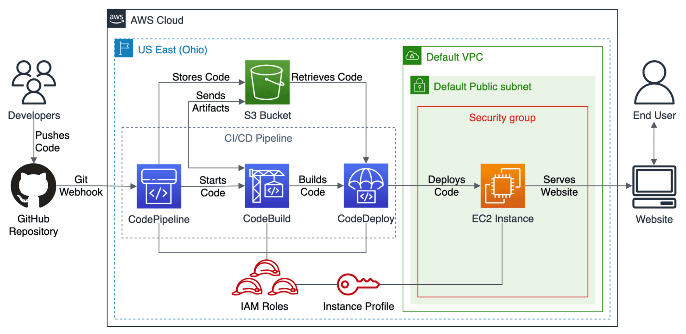

# Cloud Lab 11 — CI/CD with AWS CodePipeline (Hands-on)

| Item | Details |
|---|---|
| Work | Individual, in your own AWS Academy Learner Lab and your own GitHub account |
| Region | US East (N. Virginia) `us-east-1` |
| Technologies | AWS CodePipeline, AWS CodeBuild, AWS CodeDeploy, Amazon EC2, Amazon S3, GitHub |
| Submit | `cc-lab-YOUR_ID/lab11/` in your GitHub repository `CC-GIC-YOUR_ID`: `README.md` with the link to your public `cicd-node-app` repository, and 6 screenshots |

> **Overview:** A **CI/CD** (continuous integration and continuous deployment) pipeline is a series of automated steps that build, test and deploy code changes. In this lab you build one on AWS: every push to a GitHub repository makes **CodePipeline** fetch the code, **CodeBuild** install and test it, and **CodeDeploy** deploy it to an **EC2 instance** that serves a Node.js website.

The final infrastructure:



```text
GitHub → CodePipeline (Source) → CodeBuild (Build) → CodeDeploy (Deploy) → EC2
```

## Lab Objectives

After this lab, you can:

1. Prepare the resources a pipeline needs: an artifact bucket, a security group, and an EC2 instance with the CodeDeploy agent.
2. Write the files CodeBuild and CodeDeploy need: `buildspec.yml`, `appspec.yml` and deployment scripts.
3. Create a CodeBuild project, a CodeDeploy application and deployment group, and a pipeline that connects them.
4. Deploy a change automatically by pushing to GitHub.

## Screenshots in this lab

| File | Task | What it shows |
|---|---|---|
| `01-ec2-agent.png` | 2.4 | Terminal on the instance: `node -v` and `sudo systemctl status codedeploy-agent` *active (running)* |
| `02-pipeline-success.png` | 3.5 | `cicd-lab-pipeline` with the **Source**, **Build** and **Deploy** stages *Succeeded* |
| `03-codebuild-tests.png` | 3.5 | The CodeBuild build log with the test `should return status ok` passing |
| `04-codedeploy-success.png` | 3.5 | The CodeDeploy deployment *Succeeded*, with its lifecycle events |
| `05-website-v1.png` | 3.5 | The website at `http://<EC2_PUBLIC_IP>/` |
| `06-website-v2.png` | 3.5 | The website after your change was pushed and deployed automatically |

Every console screenshot must show your Learner Lab user name at the top-right.

## Prerequisites

- Your AWS Academy Learner Lab, and a GitHub account.
- Git and Node.js (version 18 or later) on your computer, to create the app and push it.
- Use **one name prefix** for everything, for example `cicd-lab-yourname`.

# Task 1 — Getting Started

**Cost and clean up.** This lab uses billable services (EC2, CodeBuild minutes, ...). Do the **Clean Up** at the end.

**Region.** Select **US East (N. Virginia) `us-east-1`** and keep every service in it.

# Task 2 — Configure Prerequisite Resources

## 2.1 Create an S3 bucket for artifacts

This bucket stores the pipeline's **artifacts**: the zipped outputs that one stage passes to the next.

1. Open **S3 → Create bucket**.
2. Bucket name: `cicd-lab-yourname-artifacts` (globally unique).
3. Region: **us-east-1**.
4. **Block Public Access:** keep it enabled (the default).
5. Bucket versioning: **Enable** (recommended).
6. Click **Create bucket**.

## 2.2 IAM roles: use the existing LabRole

In the Learner Lab you **cannot create IAM roles**. Use the roles that already exist:

| Where | Role to select |
|---|---|
| EC2 instance (IAM instance profile) | **`LabInstanceProfile`** (linked to `LabRole`) |
| CodeBuild service role | **`LabRole`** |
| CodeDeploy service role | **`LabRole`** |
| CodePipeline service role | **`LabRole`** |

Check that the role exists: open **IAM → Roles**, search for `LabRole`, and look at its permissions (S3, CodePipeline, CodeBuild, CodeDeploy, EC2, CloudWatch Logs).

## 2.3 Create a security group

The instance needs SSH for administration from your IP only, and HTTP for the website from anywhere.

1. Open **EC2 → Security Groups → Create security group**.
2. Name: `cicd-lab-web-sg`. VPC: the **default VPC**.
3. Inbound rules:
   - **SSH** (22), source **My IP**
   - **HTTP** (80), source **Anywhere-IPv4** (`0.0.0.0/0`)
4. Keep the default outbound rule and click **Create security group**.

## 2.4 Launch an EC2 instance

### Launch

1. Open **EC2 → Instances → Launch instances**.
2. Name: `cicd-lab-web-ec2`.
3. AMI: **Amazon Linux 2023**.
4. Instance type: **t2.micro** (or **t3.micro**).
5. Key pair: create or select one; you need it for SSH. Keep the `.pem` file outside your repositories.
6. Network: default VPC, a public subnet, **Auto-assign public IP: Enable**.
7. Security group: **`cicd-lab-web-sg`**.
8. **Advanced details → IAM instance profile:** **`LabInstanceProfile`**. The CodeDeploy agent uses it to download your application from S3.
9. Keep the default storage and click **Launch instance**.

### Connect and install the prerequisites

Connect with SSH (see Lab 1, Approach 2):

```bash
ssh -i /path/to/your-key.pem ec2-user@<EC2_PUBLIC_IP>
```

Update the system and install the tools the CodeDeploy agent needs (`ruby`, `wget`), and Node.js:

```bash
sudo dnf update -y
sudo dnf install -y ruby wget nodejs
node -v
npm -v
```

### Install the CodeDeploy agent

```bash
cd /home/ec2-user
wget https://aws-codedeploy-us-east-1.s3.us-east-1.amazonaws.com/latest/install
chmod +x ./install
sudo ./install auto
sudo systemctl status codedeploy-agent
```

The status must be **active (running)**. The URL contains the Region: it must match your Region.

> 📸 **Screenshot `01-ec2-agent.png`:** the terminal with `node -v` and the agent status.

# Task 3 — Create the CI/CD Pipeline

## 3.1 Source: create the GitHub repository

1. On GitHub, create a new **public** repository named **`cicd-node-app`**. (A private repository also works with the pipeline, but your instructor must be able to read it.)
2. Clone it on your computer, outside your course folder:

   ```bash
   git clone https://github.com/<your-username>/cicd-node-app.git
   cd cicd-node-app
   ```

3. Create the application files given in [the sample application](#sample-application) at the end of this page, then push them:

   ```bash
   npm install              # creates package-lock.json, which `npm ci` needs
   chmod +x scripts/*.sh
   git add .
   git commit -m "Initial commit: Node app + CodeBuild + CodeDeploy files"
   git branch -M main
   git push origin main
   ```

   `node_modules/` must not be committed: add a `.gitignore` file with the line `node_modules/` before `git add`.

## 3.2 Build: create a CodeBuild project

1. Open **CodeBuild → Create build project**.
2. Project name: `cicd-lab-node-build`.
3. **Source:** provider **GitHub** (connect your account and choose `cicd-node-app`), or **No source / CodePipeline** if you prefer the pipeline to provide the source.
4. **Environment:**
   - Managed image, OS **Ubuntu**, runtime **Standard**
   - Image: `aws/codebuild/standard:7.0` (or the latest)
   - Privileged: off
5. **Service role:** existing role **`LabRole`**.
6. **Buildspec:** **Use a buildspec file** (`buildspec.yml` in the repository).
7. **Artifacts:** type **CodePipeline** (or **No artifacts** if the console does not offer it; the pipeline handles the artifacts).
8. **Logs:** CloudWatch logs enabled.
9. Click **Create build project**.

## 3.3 Deploy: set up CodeDeploy

### Create the application

1. Open **CodeDeploy → Applications → Create application**.
2. Name: `cicd-lab-codedeploy-app`. Compute platform: **EC2/On-premises**.
3. Click **Create application**.

### Check the instance's tag

CodeDeploy finds its target instances by **tag**. Open **EC2 → Instances → cicd-lab-web-ec2 → Tags** and check that it has the tag `Name` = `cicd-lab-web-ec2` (the name you gave at launch). You could also use a dedicated tag such as `CodeDeploy` = `lab`.

### Create a deployment group

1. In your application, click **Create deployment group**.
2. Name: `cicd-lab-deploy-group`.
3. Service role: **`LabRole`**.
4. Deployment type: **In-place**.
5. Environment configuration: **Amazon EC2 instances**, tag group `Name` = `cicd-lab-web-ec2`. The console shows *1 unique matched instance*.
6. Agent configuration: you installed the agent yourself, so choose **Never**.
7. Deployment settings: `CodeDeployDefault.AllAtOnce`.
8. Load balancer: **off**.
9. Click **Create deployment group**.

## 3.4 Pipeline: create the CodePipeline

1. Open **CodePipeline → Create pipeline** (build a custom pipeline).
2. Name: `cicd-lab-pipeline`. Service role: existing role **`LabRole`**.
3. **Advanced settings → Artifact store:** **Custom location**, bucket `cicd-lab-yourname-artifacts`.
4. **Source stage:**
   - Provider: **GitHub (via GitHub App)**
   - Click **Connect to GitHub**, create a connection, authorize it and install the app on your `cicd-node-app` repository
   - Repository: `cicd-node-app`. Branch: `main`.
   - Output artifact: `SourceOutput` (default name)
5. **Build stage:** provider **AWS CodeBuild**, project `cicd-lab-node-build`. Input artifact: `SourceOutput`; output: `BuildOutput`.
6. **Deploy stage:** provider **AWS CodeDeploy**, application `cicd-lab-codedeploy-app`, deployment group `cicd-lab-deploy-group`. Input artifact: `BuildOutput`.
7. Review and click **Create pipeline**.

The pipeline starts right away. If your repository did not have all the files yet, the first run may fail; push them and the pipeline runs again.

## 3.5 Test the CI/CD pipeline

### Check the deployment

1. Wait until the three stages are **Succeeded**.

   > 📸 **Screenshot `02-pipeline-success.png`:** the pipeline with three green stages.

2. In the Build stage, click **View details** to open the CodeBuild log, and find the test result.

   > 📸 **Screenshot `03-codebuild-tests.png`:** the log lines with `Health Check` and `should return status ok` passing.

3. In the Deploy stage, open the CodeDeploy deployment.

   > 📸 **Screenshot `04-codedeploy-success.png`:** the deployment *Succeeded* with its lifecycle events (`BeforeInstall`, `AfterInstall`, `ApplicationStart`, `ValidateService`).

4. Open `http://<EC2_PUBLIC_IP>/` in your browser. You see the app page.

   > 📸 **Screenshot `05-website-v1.png`:** the page with the address bar.

### Make a change and push

1. In `public/index.html`, change a line of text, for example add your name to the title.
2. Commit and push:

   ```bash
   git add .
   git commit -m "Update homepage text"
   git push origin main
   ```

3. Watch the pipeline start by itself and run the three stages.
4. Refresh the website: your change is live.

   > 📸 **Screenshot `06-website-v2.png`:** the updated page.

# Task 4 — Clean Up

Take all screenshots **before** you clean up. Delete in this order:

1. **CodePipeline:** delete `cicd-lab-pipeline`.
2. **CodeBuild:** delete `cicd-lab-node-build`.
3. **CodeDeploy:** delete the deployment group, then the application.
4. **EC2:** terminate `cicd-lab-web-ec2`.
5. **Security group:** delete `cicd-lab-web-sg` (after the instance is terminated).
6. **S3:** empty, then delete `cicd-lab-yourname-artifacts`.

Keep your `cicd-node-app` repository on GitHub: your report links to it.

# Sample Application

A small Node.js (Express) app, written for this lab. Create these files in `cicd-node-app`:

```text
cicd-node-app/
├── server.js
├── package.json
├── package-lock.json          # created by `npm install`
├── .gitignore                 # node_modules/
├── public/
│   └── index.html
├── test/
│   └── app.test.js
├── buildspec.yml
├── appspec.yml
├── scripts/
│   ├── stop_server.sh
│   ├── install_dependencies.sh
│   ├── start_server.sh
│   └── validate_service.sh
└── README.md
```

## 1) `package.json`

```json
{
  "name": "cicd-node-app",
  "version": "1.0.0",
  "description": "Simple Node.js app for AWS CodePipeline/CodeBuild/CodeDeploy lab",
  "main": "server.js",
  "scripts": {
    "start": "node server.js",
    "test": "mocha --reporter spec"
  },
  "dependencies": {
    "express": "^4.19.2"
  },
  "devDependencies": {
    "chai": "^4.4.1",
    "mocha": "^10.4.0",
    "supertest": "^6.3.4"
  }
}
```

## 2) `server.js`

```javascript
const express = require("express");
const path = require("path");

const app = express();
const PORT = process.env.PORT || 80;

// Serve static files
app.use(express.static(path.join(__dirname, "public")));

// Health check
app.get("/health", (req, res) => {
  res.status(200).json({ status: "ok" });
});

// Fallback route
app.get("*", (req, res) => {
  res.sendFile(path.join(__dirname, "public", "index.html"));
});

app.listen(PORT, () => {
  console.log(`Server running on port ${PORT}`);
});
```

## 3) `public/index.html`

```html
<!doctype html>
<html lang="en">
<head>
  <meta charset="utf-8" />
  <meta name="viewport" content="width=device-width, initial-scale=1" />
  <title>AWS CI/CD Lab</title>
  <style>
    body { font-family: Arial, sans-serif; margin: 40px; }
    .card { max-width: 720px; padding: 24px; border: 1px solid #ddd; border-radius: 12px; }
    code { background: #f6f8fa; padding: 2px 6px; border-radius: 6px; }
  </style>
</head>
<body>
  <div class="card">
    <h1>✅ AWS CI/CD Pipeline Deployed Successfully</h1>
    <p>This page is served from an <code>EC2 instance</code> deployed via:</p>
    <ul>
      <li>GitHub (Source)</li>
      <li>AWS CodePipeline (Orchestration)</li>
      <li>AWS CodeBuild (Build/Test)</li>
      <li>AWS CodeDeploy (Deploy to EC2)</li>
    </ul>
    <p>Try editing this file, pushing to <code>main</code>, then watch the pipeline deploy your changes.</p>
    <p><strong>Health endpoint:</strong> <code>/health</code></p>
  </div>
</body>
</html>
```

## 4) `test/app.test.js`

The test calls the health endpoint of a server running on port 3000. In CodeBuild, `buildspec.yml` starts the server in the background before the tests.

```javascript
const request = require("supertest");
const { expect } = require("chai");

// This test checks that the health endpoint of the running server returns ok.
// In CodeBuild, we run the server in the background for testing.

describe("Health Check", function () {
  it("should return status ok", async function () {
    const res = await request("http://localhost:3000").get("/health");
    expect(res.status).to.equal(200);
    expect(res.body).to.have.property("status", "ok");
  });
});
```

## 5) `buildspec.yml` (CodeBuild)

The build installs the dependencies, starts the app on port 3000, runs the tests, and packages everything CodeDeploy needs into the output artifact.

```yaml
version: 0.2

phases:
  install:
    runtime-versions:
      nodejs: 18
    commands:
      - npm ci
  pre_build:
    commands:
      # Run app on port 3000 for tests
      - export PORT=3000
      - node server.js &
      - sleep 2
  build:
    commands:
      - npm test
  post_build:
    commands:
      - echo "Build completed on $(date)"

artifacts:
  files:
    - "**/*"
  discard-paths: no
```

> **Important:** CodeDeploy needs `appspec.yml` and the `scripts/` folder in the build artifact. `"**/*"` includes them.

## 6) `appspec.yml` (CodeDeploy)

This tells CodeDeploy where to copy the files and which script to run at each step of the deployment.

```yaml
version: 0.0
os: linux

files:
  - source: /
    destination: /home/ec2-user/nodeapp
    overwrite: true

hooks:
  BeforeInstall:
    - location: scripts/stop_server.sh
      timeout: 300
      runas: root
  AfterInstall:
    - location: scripts/install_dependencies.sh
      timeout: 300
      runas: root
  ApplicationStart:
    - location: scripts/start_server.sh
      timeout: 300
      runas: root
  ValidateService:
    - location: scripts/validate_service.sh
      timeout: 300
      runas: root
```

## 7) Deployment scripts (`scripts/`)

### 7.1 `scripts/stop_server.sh`

```bash
#!/usr/bin/env bash
set -e

# Stop service if exists
if systemctl list-units --full -all | grep -Fq "nodeapp.service"; then
  sudo systemctl stop nodeapp.service || true
fi
```

### 7.2 `scripts/install_dependencies.sh`

```bash
#!/usr/bin/env bash
set -e

# Ensure destination exists
mkdir -p /home/ec2-user/nodeapp
chown -R ec2-user:ec2-user /home/ec2-user/nodeapp

# Install Node.js if not installed (Amazon Linux 2023)
if ! command -v node >/dev/null 2>&1; then
  dnf install -y nodejs
fi

# Install production dependencies
cd /home/ec2-user/nodeapp
sudo -u ec2-user npm ci --omit=dev
```

### 7.3 `scripts/start_server.sh`

```bash
#!/usr/bin/env bash
set -e

SERVICE_FILE="/etc/systemd/system/nodeapp.service"

# Create systemd service file if missing
if [ ! -f "$SERVICE_FILE" ]; then
  cat > "$SERVICE_FILE" <<'EOF'
[Unit]
Description=Node App Service (AWS CI/CD Lab)
After=network.target

[Service]
Type=simple
User=ec2-user
WorkingDirectory=/home/ec2-user/nodeapp
Environment=PORT=80
AmbientCapabilities=CAP_NET_BIND_SERVICE
ExecStart=/usr/bin/node /home/ec2-user/nodeapp/server.js
Restart=always
RestartSec=3

[Install]
WantedBy=multi-user.target
EOF
fi

# Reload systemd and start
systemctl daemon-reload
systemctl enable nodeapp.service
systemctl start nodeapp.service
systemctl status nodeapp.service --no-pager
```

The service runs as `ec2-user` on port 80. Ports below 1024 normally need root; `AmbientCapabilities=CAP_NET_BIND_SERVICE` gives the service just this right.

### 7.4 `scripts/validate_service.sh`

```bash
#!/usr/bin/env bash
set -e

# Basic health check (give the server a moment to start)
sleep 3
curl -sSf http://localhost/health >/dev/null
echo "Health check passed."
```

Make the scripts executable before committing:

```bash
chmod +x scripts/*.sh
```

## 8) `README.md` of the app

````markdown
# AWS CI/CD Lab — Node App

This repo is a simple Node.js (Express) app designed for an AWS CI/CD lab:
- Source: GitHub
- Pipeline: CodePipeline
- Build: CodeBuild
- Deploy: CodeDeploy to EC2

## Local Run

```bash
npm install
PORT=3000 node server.js
# open http://localhost:3000
```

## Endpoints

- `/` → HTML page
- `/health` → JSON health check
````

## Troubleshooting

If the pipeline fails, check:

- the **CodeBuild logs** (for example a `buildspec.yml` syntax error, or a missing `package-lock.json` for `npm ci`);
- the **CodeDeploy deployment events** in the console;
- the CodeDeploy agent log on the instance: `/var/log/aws/codedeploy-agent/codedeploy-agent.log`.

| Problem | Fix |
|---|---|
| CodeDeploy agent not running | `sudo systemctl restart codedeploy-agent` |
| Instance not targeted by the deployment group | Check that the instance's tags match the deployment group's tag filter |
| *Permission denied* on the scripts | Run `chmod +x scripts/*.sh` before pushing |
| Website not reachable on port 80 | Check that the security group allows inbound HTTP 80 |
| Node not found during deployment | Check that `install_dependencies.sh` ran successfully |

## Optional enhancements

- Send the application logs to CloudWatch Logs.
- Add a load balancer and use blue/green deployments.
- Add a linting and code coverage stage.

# Submission

1. Make the lab folder and copy your 6 screenshots into `images/`:

   ```bash
   mkdir -p ~/cc-gic-YOUR_ID/cc-lab-YOUR_ID/lab11/images
   ```

2. Copy the [report template](README.md) to `cc-lab-YOUR_ID/lab11/README.md`, fill it in, and put the link to your **`cicd-node-app`** repository in it. The app's code stays in that repository; do not copy it into your course repository.
3. Check the structure:

   ```text
   cc-lab-YOUR_ID/
   └── lab11/
       ├── README.md          # includes the link to github.com/<you>/cicd-node-app
       └── images/
           ├── 01-ec2-agent.png
           ├── 02-pipeline-success.png
           ├── 03-codebuild-tests.png
           ├── 04-codedeploy-success.png
           ├── 05-website-v1.png
           └── 06-website-v2.png
   ```

4. Commit and push:

   ```bash
   cd ~/cc-gic-YOUR_ID
   git add .
   git commit -m "Lab 11: CI/CD pipeline"
   git push
   ```
