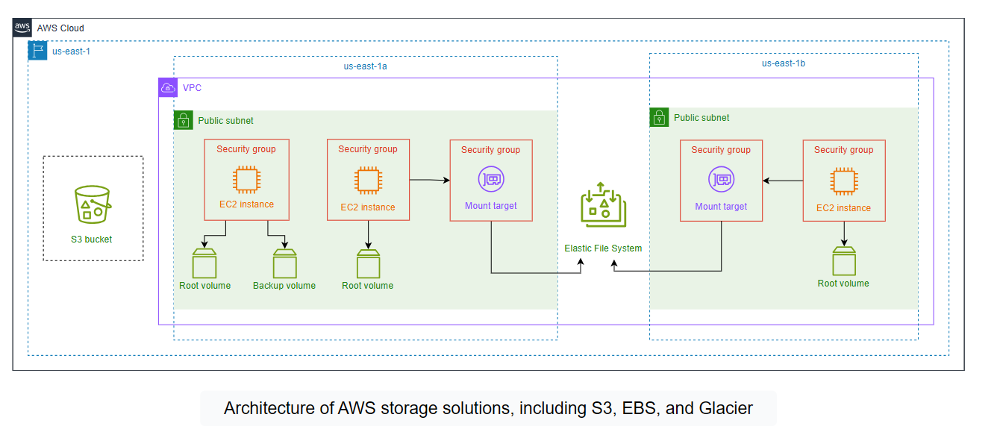
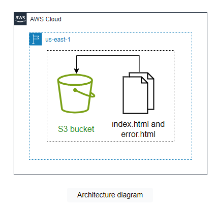
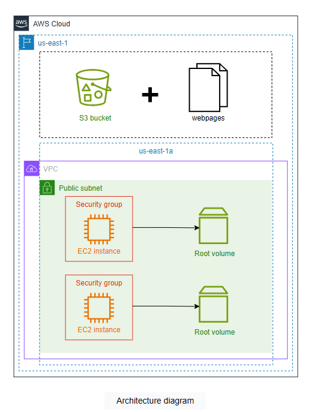
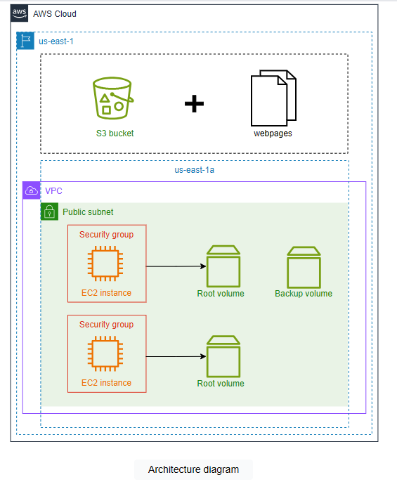
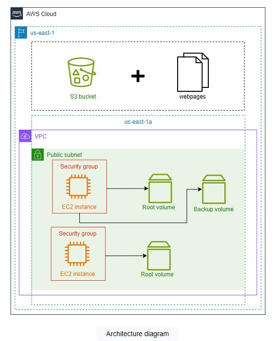
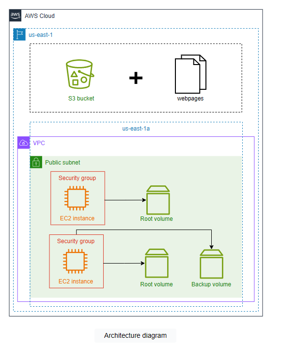
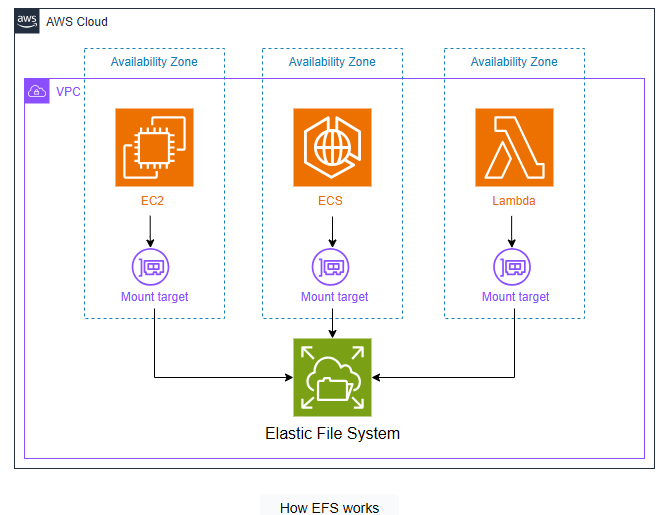
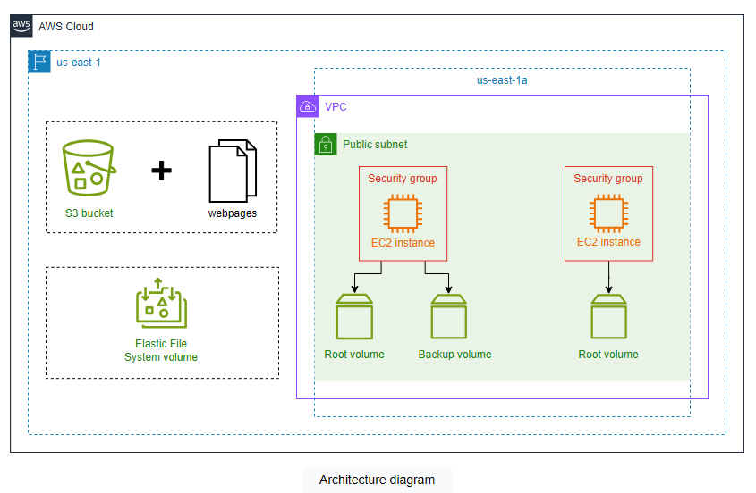
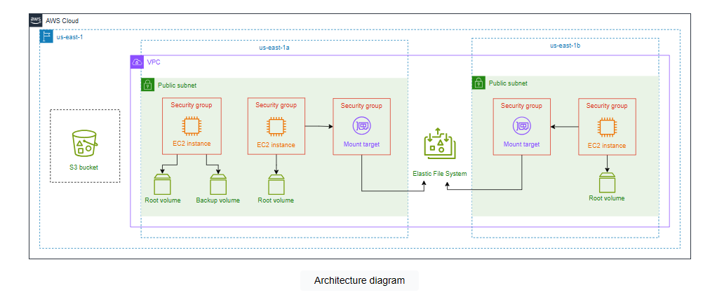
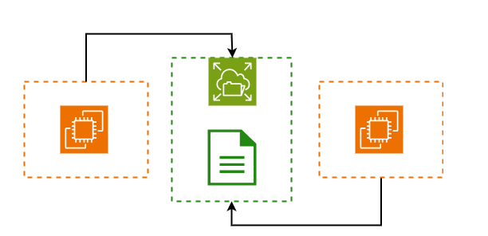

# Cloud Lab 2 — Understanding AWS Storage Options (Hands-on)

| Item | Details |
|---|---|
| Work | Individual, in your own AWS Academy Learner Lab |
| Region | US East (N. Virginia) `us-east-1` |
| Parts | **2.1** Amazon S3 · **2.2** Amazon EBS · **2.3** Amazon EFS |
| Submit | `cc-lab-YOUR_ID/lab2/` in your GitHub repository `CC-GIC-YOUR_ID`: `README.md` and 9 screenshots |
| Challenge | [S3 challenge lab](lab2-challenge.md), submitted separately in `cc-lab-YOUR_ID/lab2-challenge/` |

> **Overview:** AWS storage services store and retrieve data over the network. They differ in scalability, payment plans and the type of data they store. In this lab you work with three of them: you create an **S3** bucket, upload files and host a static website; you create an **EBS** volume and mount it to an EC2 instance; and you mount one **EFS** file system to two instances to see that it is shared. Along the way you meet security groups and resource-based policies.

## Lab Objectives

After this lab, you can:

1. Create an S3 bucket, upload objects, and host a static website with a bucket policy.
2. Create an EBS volume, attach it to an EC2 instance, format and mount it, and move it to another instance.
3. Create an EFS file system with mount targets and mount it on two instances at the same time.
4. Compare S3, EBS and EFS and choose one for a given need.

The infrastructure you build in this lab:



## Screenshots in this lab

| File | Part | What it shows |
|---|---|---|
| `01-s3-bucket-list.png` | 2.1 | The S3 bucket list with your `static-web-bucket...` bucket |
| `02-s3-objects.png` | 2.1 | `index.html` and `error.html` inside your bucket |
| `03-s3-website.png` | 2.1 | The static website endpoint open in the browser |
| `04-ebs-volumes.png` | 2.2 | The Volumes page with **Backup Volume** *In-use* |
| `05-ebs-lsblk.png` | 2.2 | Instance Connect terminal with `lsblk` listing the attached volume |
| `06-ebs-second-instance.png` | 2.2 | `cat testfile.txt` on **instance-2** after moving the volume |
| `07-efs-file-system.png` | 2.3 | The EFS console with `clab-efs` and its mount targets |
| `08-efs-write.png` | 2.3 | Terminal on **instance-1** creating the file in the EFS mount |
| `09-efs-read.png` | 2.3 | Terminal on **instance-3** listing the same file with `ls` |

Every console screenshot must show your Learner Lab user name at the top-right.

## Getting Started

AWS storage services provide on-demand, scalable and customizable storage. Individuals and companies keep their data in the cloud, while the cloud provider provisions and maintains the infrastructure. Common uses are backup and recovery, data lakes, analysis of large amounts of data, and access to data over the network.

General guidelines:

- Work in **`us-east-1`**. On the console, click the Region menu at the top-right next to your user name and select **US East (N. Virginia)**.
- Use the **resource names** given in the lab. Other names may not be allowed.
- Your permissions are limited. Some console pages may show *insufficient privileges* messages; you can ignore them.

# Part 2.1 — Amazon Simple Storage Service (S3)

**Amazon S3** stores data as **objects** in **buckets**. A bucket can store any data: images, videos, files and more. S3 is used to host data for cloud-native applications, keep data lake backups, save log files, and host static websites.

**Structure of a bucket.** A bucket has a flat structure, not a hierarchy: all data is stored at the same level. Each bucket has a unique name and each object a unique key, so the content can be reached by a unique URL. Objects hold both the data and metadata, such as the last-modified date, size and content type. A single object can be up to 5 TB.

**Security and access management.** Access to a bucket is controlled with access control lists (ACLs), Block Public Access, and resource-based policies.

- **ACLs** set read and write authorization for objects.
- **Block Public Access** prevents accidental exposure of data. It is on by default and applies whatever the other settings are. Turning it off is **not enough** to make a bucket public: you also need a bucket policy that allows public access.
- A **resource-based policy**, such as a bucket policy, works like an IAM policy: it lists allowed and denied actions on resources, for which users.

**Static website hosting.** You upload the website's files to a bucket and turn on static website hosting; S3 gives you a URL for the site. The bucket must contain an `index.html` document, and every folder must contain its own `index.html`. If `www.my-site.com` is the endpoint, it shows the root `index.html`; `www.my-site.com/movies/` shows `movies/index.html`.

## Task 1 — Create an S3 Bucket and Upload Files



### Create a bucket

1. Search for **S3** in the console and open it.
2. Click **Create bucket**.
3. Check that the Region is **US East (N. Virginia) us-east-1**.
4. Enter a bucket name that starts with `static-web-bucket`. Bucket names are globally unique, so add allowed characters, for example your AWS account ID: `static-web-bucket-123456789012`.
5. Uncheck **Block all public access**, and check the box that acknowledges the warning. You restrict access with a bucket policy later.
6. Keep the default settings for the rest, scroll down and click **Create bucket**.

### Upload files to the bucket

Create two files on your computer with this content.

**`index.html`**

```html
<!DOCTYPE html>
<html>
<head>
  <title>Educative Webpage</title>
  <style>
    /* Add CSS for image resizing */
    .flex-container {
      display: flex;
      background-color: #F2F2F2;
    }
    .flex-item {
      flex: 1;
      padding: 20px;
      text-align: center;
    }
    .image {
      max-width: 100%;
      max-height: 150px;
    }
  </style>
</head>
<body>
  <header style="background-color: #E05243; color: #fff; padding: 20px; text-align: center;">
    <h2>Understanding AWS Storage Options - From Zero to Hero</h2>
  </header>
  <div style="padding: 20px;">
    <h3 style="font-size: 16px;">Hello from Educative!</h3>
  </div>
  <h2>AWS Storage Options</h2>
  <div class="flex-container">
    <div class="flex-item">
      <h3>Simple Storage Service (S3)</h3>
      
    </div>
    <div class="flex-item">
      <h3>Elastic Block Storage (EBS)</h3>
      
    </div>
    <div class="flex-item">
      <h3>Elastic File System (EFS)</h3>
      
    </div>
  </div>
  <footer style="background-color: #E05243; color: #fff; padding: 10px; text-align: center;">
    &copy; 2023 Educative
  </footer>
</body>
</html>
```

**`error.html`**

```html
<!DOCTYPE html>
<html>
<head>
  <title>Educative Webpage</title>
</head>
<body>
  <header style="background-color: #1F1E63; color: #fff; padding: 20px; text-align: center;">
    <h1>Understanding AWS Storage Options - From Zero to Hero</h1>
  </header>
  <div style="padding: 20px;">
    <p style="font-size: 16px;">Oops Error!</p>
  </div>
  <footer style="background-color: #1F1E63; color: #fff; padding: 10px; text-align: center;">
    &copy; 2023 Educative
  </footer>
</body>
</html>
```

1. Open your bucket. In **Files and folders**, click **Add files** and select `index.html` and `error.html`.
2. Click **Upload**. When the upload status page shows success, click **Close**.

> 📸 **Screenshots:** `01-s3-bucket-list.png` (the bucket list showing your bucket) and `02-s3-objects.png` (the two files inside the bucket).

## Task 2 — Enable Static Website Hosting

In this task you turn on static website hosting and add a bucket policy.


### Enable static website hosting

1. Open your bucket and choose the **Properties** tab.
2. Scroll to **Static website hosting** and click **Edit**.
3. Choose **Enable**. Keep the hosting type **Host a static website**.
4. Index document: `index.html`. Error document: `error.html`. File names are case-sensitive.
5. Click **Save changes**.
6. Back in **Properties → Static website hosting**, open the **bucket website endpoint** in a new tab.

You get **403 Forbidden**: the bucket is not public yet. Turning off Block Public Access is not enough; the bucket also needs a policy.

### Configure the bucket policy

1. Open the bucket's **Permissions** tab. It shows **Block public access (bucket settings)** and **Bucket policy**.
2. Under **Bucket policy**, click **Edit**.
3. Paste this policy. Replace `<your-bucket-arn>` with your bucket's ARN, which is shown above the policy editor:

   ```json
   {
       "Version": "2012-10-17",
       "Statement": [
           {
               "Sid": "Statement1",
               "Principal": "*",
               "Effect": "Allow",
               "Action": [
                   "s3:GetObject"
               ],
               "Resource": "<your-bucket-arn>/*"
           }
       ]
   }
   ```

4. Click **Save changes**.

What the policy says:

| Element | Meaning here |
|---|---|
| `Sid` | A unique ID for the statement |
| `Principal` | Who may act: `*` means everyone |
| `Effect` | `Allow` the action (the other value is `Deny`) |
| `Action` | `s3:GetObject`: read objects from the bucket |
| `Resource` | Every object (`/*`) in your bucket, given by the bucket ARN |

Go back to **Properties → Static website hosting**, copy the endpoint URL and open it. You now see the `index.html` page.

> 📸 **Screenshot `03-s3-website.png`:** the browser showing your page, with the website endpoint in the address bar.

# Part 2.2 — Amazon Elastic Block Store (EBS)

**Amazon EBS** stores data in **blocks**. An EBS volume is unformatted, raw disk storage that can be attached to an EC2 instance, like a hard disk.

Every EC2 instance gets a root EBS volume at launch, which is deleted when the instance is terminated. You can create **additional** volumes and attach them to instances. Additional volumes **persist independently** of the instance: if you terminate the instance, the data stays on the volume, and you can attach the volume to another instance to read it. An instance can have several volumes.


An EBS volume can only be used in the Availability Zone where it was created. To use the data elsewhere, you create a **snapshot**, a backup that holds what is needed to restore the volume, and copy it.

| Type of volume | Use case |
|---|---|
| General Purpose SSD (gp2, gp3) | A balance of performance and price; the most common choice |
| Provisioned IOPS SSD (io1, io2) | Intensive input/output workloads |
| Throughput Optimized HDD (st1) | Low-cost magnetic storage for sequential access |
| Cold HDD (sc1) | Data that is accessed infrequently |

## Task 3 — Launch Two EC2 Instances

An instance needs a **security group**, a virtual firewall that controls inbound and outbound traffic, for example to allow SSH.



The diagram shows a VPC and a public subnet. A **Virtual Private Cloud (VPC)** is an isolated virtual network in AWS in which you control IP address ranges, subnets and gateways. A **subnet** is a range of IP addresses inside a VPC, placed in one Availability Zone.

### Create a security group

1. Open **EC2** and click **Security Groups**, then **Create security group**.
2. Name: `ec2instances-sg`. Description: `Allows inbound SSH Traffic`.
3. Under **Inbound rules**, click **Add rule**: type **SSH**, source **Anywhere-IPv4**.
4. Review and click **Create security group**.

### Launch the instances

1. Click **Instances → Launch instances**.
2. Name: `instance-1`.
3. AMI: in **Quick Start**, select **Ubuntu**, then **Ubuntu Server 24.04 LTS (HVM), SSD Volume Type**, architecture **64-bit (x86)**.
4. Instance type: **t3.medium**.
5. Key pair: **Proceed without a key pair**.
6. **Network settings → Edit:** keep the default VPC and select the default subnet in **us-east-1a**.
7. **Select existing security group:** `ec2instances-sg`.
8. Storage: **8 GiB gp3**. Keep the default **Advanced details**.
9. Click **Launch instance**, then **View all instances**. Within a few minutes the state is **Running**. Refresh the page if you do not see the instance.

Repeat these steps to launch a second instance named **`instance-2`**, also in **us-east-1a**.

## Task 4 — Create an EBS Volume



1. In the EC2 sidebar, click **Volumes** under **Elastic Block Store**.
2. You see the root volumes of `instance-1` and `instance-2`. They are deleted when their instances are terminated. Rename them so you can tell them apart: hover over the **Name** cell, click the pencil, and name them `Root Volume 1` and `Root Volume 2`.
3. Click **Create volume** and set:
   - Volume type: **General Purpose SSD (gp3)**
   - Size: **8 GiB**
   - Availability Zone: **us-east-1a**, the same as your instances
   - No tags are needed.
4. Click **Create volume**.

After a moment the new volume appears with the state **Available**. Name it **`Backup Volume`**.

## Task 5 — Attach and Mount the EBS Volume



### Attach the volume

1. On the **Volumes** page, check that **Backup Volume** is **Available**. Select it and click **Actions → Attach volume**.
2. Instance: `instance-1`. Device name: choose **Specify a custom device name** and enter `/dev/sdf`.
3. Click **Attach volume**. The state changes to **In-use**.

### Connect with EC2 Instance Connect

1. Select `instance-1` and click **Connect**.
2. Keep **Connect using EC2 Instance Connect** and click **Connect**. A terminal opens.

### Find the volume

List the block devices of the instance:

```bash
lsblk
```

The output looks like this:

```text
NAME     MAJ:MIN RM   SIZE RO TYPE MOUNTPOINTS
loop0      7:0    0  24.6M  1 loop /snap/amazon-ssm-agent/7528
...
xvda     202:0    0     8G  0 disk
├─xvda1  202:1    0   7.9G  0 part /
├─xvda14 202:14   0     4M  0 part
└─xvda15 202:15   0   106M  0 part /boot/efi
xvdf     202:80   0     8G  0 disk
```

The root volume is `xvda`. Your **Backup Volume** is the 8 GiB disk with no partitions and no mount point, here `xvdf`: Linux renames `/dev/sdf` to `/dev/xvdf`.

> **Note:** On newer instance types such as **t3**, EBS volumes appear as NVMe devices: the root volume is `nvme0n1` and your volume is probably **`nvme1n1`**. Use the name that **your** `lsblk` shows in the commands below.

> 📸 **Screenshot `05-ebs-lsblk.png`:** the terminal with the `lsblk` output showing the attached volume.

### Format and mount the volume

The new volume has no file system yet. Create an `ext4` file system on it, make a mount point, and mount it (replace `xvdf` if your device name is different):

```bash
sudo mkfs -t ext4 /dev/xvdf
sudo mkdir /mnt/my-ebs-volume
sudo mount /dev/xvdf /mnt/my-ebs-volume
```

You could also add the volume to `/etc/fstab` so it is mounted automatically at boot.

### Add data to the volume

```bash
sudo su
cd /mnt/my-ebs-volume
echo "This is a test file" > testfile.txt
```

The file stays on the volume even if `instance-1` is terminated.

> 📸 **Screenshot `04-ebs-volumes.png`:** the **Volumes** page showing **Backup Volume** *In-use*.

## Task 6 — Attach the Volume to Another EC2 Instance

Data on an EBS volume persists independently of the instance. You now unmount the volume, detach it from `instance-1`, attach and mount it on `instance-2`, and read the file.



### Unmount and detach

1. On `instance-1`, leave the mount folder and unmount it:

   ```bash
   cd ~
   sudo umount -l /mnt/my-ebs-volume
   ```

2. In the EC2 console, open **Volumes**, select **Backup Volume** and click **Actions → Detach volume**. Type `detach` and click **Detach**.
3. Wait until the state is **Available**. Refresh the page if it does not change.

### Attach and mount on instance-2

1. Attach **Backup Volume** to **`instance-2`** with device name `/dev/sdf`, as in Task 5.
2. Connect to `instance-2` with EC2 Instance Connect and run `lsblk` to find the device name.
3. Mount the volume and read the file. **Do not run `mkfs` again**: it would erase the volume.

   ```bash
   sudo mkdir /mnt/my-ebs-volume
   sudo mount /dev/xvdf /mnt/my-ebs-volume
   cd /mnt/my-ebs-volume
   cat testfile.txt
   ```

The file and its contents survived the move.

> 📸 **Screenshot `06-ebs-second-instance.png`:** the `instance-2` terminal showing `cat testfile.txt` and its output.

# Part 2.3 — Amazon Elastic File System (EFS)

**Amazon EFS** is a file storage service: AWS provides the file system, so you do not build and manage your own. It uses the **Network File System (NFS)** protocol.

EFS allows **parallel access**: EC2 instances, ECS tasks and Lambda functions can use the same EFS file system at the same time. It uses file locking and synchronous reads and writes to keep data consistent. It scales to petabytes and charges only for the storage used, with no setup fee. EFS is serverless and Regionally resilient, with options to replicate data within and across Availability Zones.

**How EFS works.** Instances connect to an EFS file system through **mount targets**. A mount target gives an IP address for the NFS endpoint. Each instance connects through the mount target in its own Availability Zone.



In this part you create an EFS file system, mount it on two instances, write a file from one and read it from the other.

## Task 7 — Create an EFS File System



### Create a security group for NFS

All inbound traffic to a mount target is blocked by default. This security group allows NFS traffic.

1. Open **EC2 → Security Groups → Create security group**.
2. Name: `efs-sg`. Description: `Allows inbound NFS Traffic`. VPC: the **default VPC**.
3. **Add rule:** type **NFS**, source **Anywhere-IPv4**.
4. Click **Create security group**.

### Create the file system

1. Search for **EFS** and open it. Click **Create file system**.
2. Name: `clab-efs`. VPC: the **default VPC**.
3. Click **Customize** and set the file system settings:
   - **File system type:** **Regional**. Regional keeps data in several Availability Zones for durability and availability; One Zone keeps it in one zone and costs less.
   - **Automatic backups:** uncheck **Enable automatic backups**. You delete this file system at the end of the lab.
   - **Lifecycle management:** this moves files that are rarely used to cheaper storage classes after a number of days. Set **Transition into Archive** to **None**.
   - **Encryption:** keep the default (encrypted).
   - **Performance settings:** *Bursting* scales throughput with the amount stored, for simple needs; *Enhanced* gives more flexibility and higher throughput. Select **Enhanced** with **Elastic (Recommended)**.
4. Click **Next** to open **Network access**. Keep only **two** mount targets, in **us-east-1a** and **us-east-1b**. For both, remove the default security group and select **`efs-sg`**.
5. Click **Next**. Leave the **File system policy** empty and click **Next**.
6. Review and click **Create**.

Copy the **File system ID** of `clab-efs` (it looks like `fs-0123456789abcdef0`) and keep it: you need it to mount the file system.

> 📸 **Screenshot `07-efs-file-system.png`:** the EFS console with `clab-efs` and its two mount targets (open the file system and its **Network** tab).

## Task 8 — Launch a Third EC2 Instance

The instances must be in the same subnets as the mount targets. `instance-1` and `instance-2` are in us-east-1a; you now launch `instance-3` in **us-east-1b**.


1. Open **EC2 → Instances → Launch instances**.
2. Name: `instance-3`.
3. AMI: **Ubuntu**, architecture **64-bit (x86)**. Instance type: **t3.medium**.
4. Key pair: **Proceed without a key pair**.
5. **Network settings → Edit:** default VPC, and the default subnet in **us-east-1b**.
6. **Select existing security group:** `ec2instances-sg`.
7. Storage: **8 GiB gp3**.
8. Click **Launch instance**, then **View all instances**, and wait for **Running**.

## Task 9 — Mount the EFS File System

You install the Amazon EFS client on the instances, create a mount point and mount the file system on it.



1. Connect to `instance-1` with EC2 Instance Connect.
2. Install the Amazon EFS client (`amazon-efs-utils`) by building it from source:

   ```bash
   sudo apt-get update
   sudo apt-get -y install git binutils rustc cargo pkg-config libssl-dev
   git clone https://github.com/aws/efs-utils
   cd efs-utils
   ./build-deb.sh
   sudo apt-get -y -q install ./build/amazon-efs-utils*deb
   ```

   | Line | What it does |
   |---|---|
   | 1 | Updates the package lists |
   | 2 | Installs Git (to clone the source) and the tools needed to build the package |
   | 3 | Clones `efs-utils` from GitHub. The Amazon EFS client simplifies mounting EFS, adds encryption in transit, and improves performance on Linux |
   | 4 | Moves into the `efs-utils` folder |
   | 5 | Builds the `amazon-efs-utils` package |
   | 6 | Installs the package |

   The build takes a few minutes.

3. Create a mount point:

   ```bash
   sudo mkdir /home/ubuntu/efsmount/
   ```

4. Mount the file system. Replace `<fs-id>` with your file system ID:

   ```bash
   cd .. && sudo mount -t efs <fs-id> efsmount/
   ```

5. Repeat steps 1 to 4 on **`instance-3`**.

## Task 10 — Share a File Between Instances



1. On `instance-1`, go into the mount, become root, and create a file:

   ```bash
   cd ~/efsmount
   sudo su
   echo "Creating a sample file from instance 1" >> file_from_1.txt
   ```

   > 📸 **Screenshot `08-efs-write.png`:** the `instance-1` terminal showing these commands.

2. On `instance-3`, list the files in the mount:

   ```bash
   cd ~/efsmount
   ls
   cat file_from_1.txt
   ```

   You see `file_from_1.txt`, created on `instance-1`: both instances share the same file system.

   > 📸 **Screenshot `09-efs-read.png`:** the `instance-3` terminal showing the file.

# Clean Up

Take all screenshots **before** you clean up.

**Terminate the instances**

1. Close the Instance Connect terminals and open **EC2 → Instances**.
2. Select `instance-1`, `instance-2` and `instance-3`.
3. Click **Instance state → Terminate instance**, then **Terminate**.

**Delete the EFS file system**

1. Open **EFS**, select `clab-efs` and click **Delete**.
2. Enter the file system ID and click **Confirm**.

**Delete the EBS volume**

1. Open **EC2 → Volumes** and select **Backup Volume**.
2. Click **Actions → Delete volume** and confirm.

**Delete the security groups**

1. Wait until the instances are terminated and the file system is deleted.
2. Open **Security Groups**, select `efs-sg` and `ec2instances-sg`.
3. Click **Actions → Delete security groups**, then **Delete**.

**Delete the S3 bucket**

1. Open **S3 → Buckets** and select your bucket.
2. Click **Empty**, type `permanently delete`, and click **Empty**. Click **Exit**.
3. Select the bucket again, click **Delete**, type the bucket name, and click **Delete bucket**.

# Submission

1. Make the lab folder and copy your 9 screenshots into `images/`:

   ```bash
   mkdir -p ~/cc-gic-YOUR_ID/cc-lab-YOUR_ID/lab2/images
   ```

2. Copy the [report template](README.md) to `cc-lab-YOUR_ID/lab2/README.md` and fill it in.
3. Check the structure:

   ```text
   cc-lab-YOUR_ID/
   └── lab2/
       ├── README.md
       └── images/
           ├── 01-s3-bucket-list.png
           ├── 02-s3-objects.png
           ├── 03-s3-website.png
           ├── 04-ebs-volumes.png
           ├── 05-ebs-lsblk.png
           ├── 06-ebs-second-instance.png
           ├── 07-efs-file-system.png
           ├── 08-efs-write.png
           └── 09-efs-read.png
   ```

4. Commit and push:

   ```bash
   cd ~/cc-gic-YOUR_ID
   git add .
   git commit -m "Lab 2: AWS storage options"
   git push
   ```

5. Check on GitHub that `lab2/README.md` shows all 9 screenshots.
