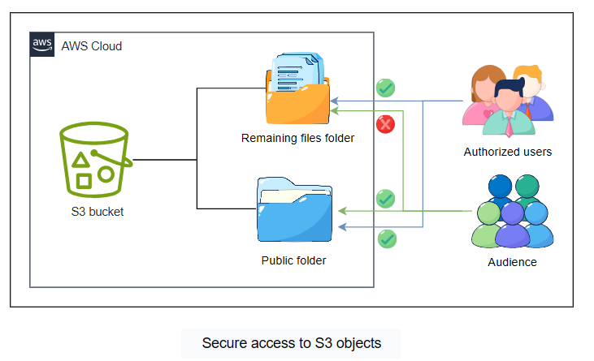

# Cloud Lab 3 Challenge — Secure and Manage an Amazon S3 Bucket for Public Content

| Item | Details |
|---|---|
| Work | Individual, in your own AWS Academy Learner Lab |
| Region | US East (N. Virginia) `us-east-1` |
| Format | Challenge: requirements only, **no step-by-step instructions** |
| Submit | `cc-lab-YOUR_ID/lab3-challenge/` in your GitHub repository `CC-GIC-YOUR_ID`: `README.md`, `bucket-policy.json` and 6 screenshots (a 7th is recommended) |
| Before you start | Finish [Lab 3](lab3-instruction.md), Part 2.1 |

> **Scenario:** A tourism board wants to publish its travel offers on Amazon S3. Only the offers in the `public/` folder may be visible to the world; everything else in the bucket stays private. The content team updates pages often and wants old versions kept, but cheaply.

Amazon S3 is a scalable object storage service for storing and retrieving data at any scale. Managing access to buckets is critical to keep data private, meet compliance rules, and share the right content. In this challenge you configure and enforce bucket-level access policies that meet security, access and data life cycle requirements, to show that you can secure and optimize a bucket for production use.



## Tasks

1. Provision the S3 bucket.
2. Configure bucket ownership and security.
3. Implement a public access policy.
4. Enable object versioning.
5. Set up a lifecycle policy for object management.

## Requirements

### 1. Provision the S3 bucket

To host the tourism board's promotional content, create a central, uniquely named storage location: an Amazon S3 bucket whose name **begins with `clab-datastore`**.

> **Note:** Bucket names must be globally unique.

> 📸 **Screenshot `01-bucket.png`:** the S3 bucket list showing your bucket name (for example `clab-datastore-12345`) and its Region.

### 2. Configure bucket ownership and security

To simplify permissions and prepare for secure public access, control over all objects in the bucket must be centralized. Configure the bucket's **object ownership** so the **bucket owner** manages all objects, with **ACLs enabled**.

> 📸 **Screenshot `02-object-ownership.png`:** *S3 → your bucket → Permissions → Object Ownership*, showing **Bucket owner preferred** and **ACLs enabled**.

### 3. Implement a public access policy

Only the travel offers in the `public/` folder are accessible worldwide; all other data remains private:

- The bucket must contain a folder named **`public`**.
- A **bucket policy** must allow public read access **only** to objects in the `public` folder.
- Every other prefix, and every object at the bucket's root, must remain private.

To test, upload an `index.html` file into the `public` folder and open it through its **object URL**. Then upload any file to the bucket's root and check that its object URL is **denied**.

Save your final bucket policy as `bucket-policy.json` in your submission folder.

> 📸 **Screenshots:**
> - `03a-bucket-policy.png`: the bucket policy editor with the whole JSON policy visible.
> - `03b-public-object.png`: `public/index.html` with its object URL, and a browser window loading the page through that URL.
> - `03c-private-object.png` (recommended): a browser showing *AccessDenied* for an object outside `public/`.

### 4. Enable object versioning

The content team uploads updated web pages and needs to track changes. Enable **versioning** so previous versions of objects are kept when they are modified or overwritten.

> 📸 **Screenshot `04-versioning.png`:** *S3 → your bucket → Properties → Bucket Versioning* showing **Enabled**.

### 5. Set up a lifecycle policy

To reduce cost, automatically move older versions to a cheaper storage class. Create a **lifecycle rule** that applies to **all objects** and transitions **noncurrent versions** to **S3 Standard-IA** **30 days** after they become noncurrent.

> 📸 **Screenshot `05-lifecycle.png`:** *S3 → your bucket → Management → Lifecycle rules*, showing a rule that applies to all objects and transitions noncurrent versions to S3 Standard-IA after 30 days.

## Clean Up

After your screenshots, empty the bucket (including all object versions: turn on **Show versions** or use **Empty**) and delete it.

## Submission

1. Make the folder and add your files:

   ```bash
   mkdir -p ~/cc-gic-YOUR_ID/cc-lab-YOUR_ID/lab3-challenge/images
   ```

2. Copy the [challenge report template](challenge-README.md) to `cc-lab-YOUR_ID/lab3-challenge/README.md` and fill it in.
3. Check the structure:

   ```text
   cc-lab-YOUR_ID/
   └── lab3-challenge/
       ├── README.md
       ├── bucket-policy.json
       └── images/
           ├── 01-bucket.png
           ├── 02-object-ownership.png
           ├── 03a-bucket-policy.png
           ├── 03b-public-object.png
           ├── 03c-private-object.png     # recommended
           ├── 04-versioning.png
           └── 05-lifecycle.png
   ```

4. Commit and push:

   ```bash
   cd ~/cc-gic-YOUR_ID
   git add .
   git commit -m "Lab 3 challenge: secure S3 bucket"
   git push
   ```
