# Cloud Lab 3 — Amazon VPC with Public and Private Subnets (Hands-on)

| Item | Details |
|---|---|
| Work | Individual, in your own AWS Academy Learner Lab |
| Region | US East (N. Virginia) `us-east-1` |
| Submit | `cc-lab-YOUR_ID/lab3/` in your GitHub repository `CC-GIC-YOUR_ID`: `README.md` and 11 screenshots |

> **Overview:** Amazon Virtual Private Cloud (Amazon VPC) is a virtual network that you define, in which you launch AWS resources such as EC2 instances. You decide its address space and configuration to limit access to your resources. In this lab you create a VPC, secure it with a public and a private subnet, manage routing between subnets, and give internet access to EC2 instances in both subnets.

## Lab Objectives

After this lab, you can:

1. Create a VPC and attach an internet gateway to it.
2. Create public and private subnets and explain the difference.
3. Edit route tables and subnet associations to send traffic to an internet gateway or a NAT gateway.
4. Create a NAT gateway so instances in a private subnet can reach the internet.
5. Run commands on an instance with AWS Systems Manager to test its internet access.

The infrastructure you build in this lab:

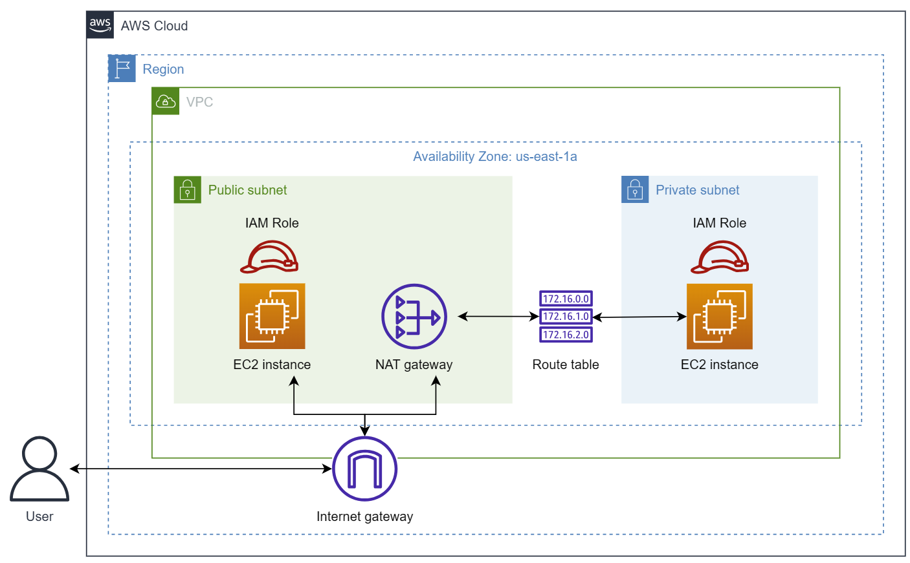

| Part | Tasks |
|---|---|
| Create a VPC with an internet gateway | 1. Create a VPC · 2. Create an internet gateway and attach it |
| Test the internet via a public subnet | 3. Create a public subnet · 4. Update the route table · 5. Create an EC2 instance · 6. Run a test command |
| Test the internet via a private subnet | 7. Create a private subnet · 8. Create a NAT gateway · 9. Create a route table · 10. Launch an EC2 instance · 11. Run a test command |
| Conclusion | 12. Clean up |

## Screenshots in this lab

| File | Task | What it shows |
|---|---|---|
| `01-vpc.png` | 1 | `lab3-vpc` with CIDR `10.0.0.0/24` |
| `02-internet-gateway.png` | 2 | `lab3-internet-gateway` *Attached* to `lab3-vpc` |
| `03-public-subnet.png` | 3 | `lab3-public-subnet` with CIDR `10.0.0.0/25` |
| `04-public-route-table.png` | 4 | Route `0.0.0.0/0` → `lab3-internet-gateway` |
| `05-ec2-public.png` | 5 | `lab3-ec2-01` running in `lab3-public-subnet` with a public IP |
| `06-test-public.png` | 6 | Run Command *Success* for `sudo yum update -y` on `lab3-ec2-01` |
| `07-private-subnet.png` | 7 | `lab3-private-subnet` with CIDR `10.0.0.128/25` |
| `08-nat-gateway.png` | 8 | `lab3-nat-gateway` in `lab3-public-subnet` with an Elastic IP |
| `09-private-route-table.png` | 9 | `lab3-custom-route-table` with route `0.0.0.0/0` → `lab3-nat-gateway` |
| `10-ec2-private.png` | 10 | `lab3-ec2-02` running in `lab3-private-subnet`, no public IP |
| `11-test-private.png` | 11 | Run Command *Success* for `sudo yum update -y` on `lab3-ec2-02` |

Every console screenshot must show your Learner Lab user name at the top-right.

## Getting Started

**Amazon VPC** creates virtual networks in the cloud to isolate and secure AWS resources. Inside a VPC you launch resources such as EC2 instances and configure public and private subnets, route tables, and internet access.

The plan: create a VPC and attach an internet gateway. Create a public subnet and route its traffic to the internet gateway. Launch an instance in the public subnet and check that it reaches the internet. Then create a private subnet and a NAT gateway in the public subnet, route the private subnet's traffic through the NAT gateway, launch an instance in the private subnet and check its internet access.

General guidelines:

- Work in **`us-east-1`**. Click the Region menu at the top-right next to your user name and select **US East (N. Virginia) us-east-1**.
- Use the **resource names** given in the lab. Other names may not be allowed.
- Your permissions are limited. Some console pages may show *insufficient privileges* messages; you can ignore them.

## Task 1 — Create a VPC

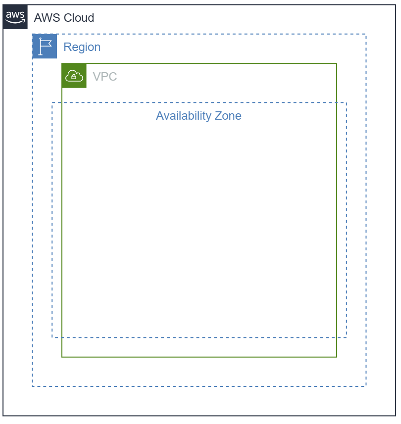

1. In the console, search for **VPC** and open the VPC dashboard.
2. In the left menu, under **Virtual private cloud**, click **Your VPCs**, then **Create VPC**.
3. Under **VPC settings**:
   - Resources to create: **VPC only**. You create the other network resources yourself later.
   - Name tag: **`lab3-vpc`**
   - IPv4 CIDR block: **IPv4 CIDR manual input**, `10.0.0.0/24`
   - IPv6 CIDR block: **No IPv6 CIDR block**
   - Tenancy: **Default**
4. Leave **Tags** as they are and click **Create VPC**.

> 📸 **Screenshot `01-vpc.png`:** `lab3-vpc` with its IPv4 CIDR `10.0.0.0/24`.

## Task 2 — Create an Internet Gateway and Attach It to the VPC

An **internet gateway** is the VPC component that lets resources in the VPC connect to the internet. It passes both IPv4 and IPv6 traffic.

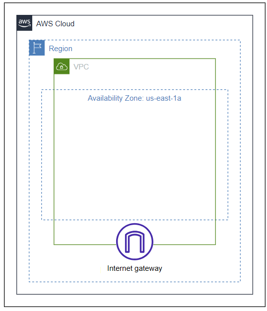

1. In the left menu, click **Internet gateways**, then **Create internet gateway**.
2. Name tag: `lab3-internet-gateway`. Click **Create internet gateway**.
3. Click **Actions → Attach to VPC**, select `lab3-vpc`, and click **Attach internet gateway**.

> 📸 **Screenshot `02-internet-gateway.png`:** `lab3-internet-gateway` with state *Attached* and VPC `lab3-vpc`.

## Task 3 — Create a Public Subnet

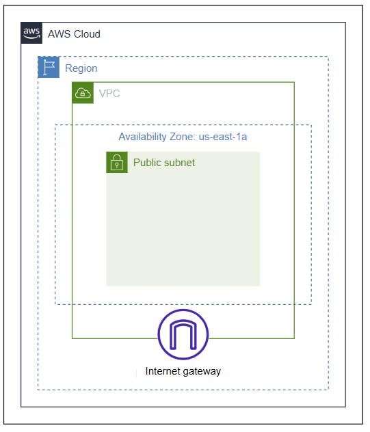

1. In the left menu, click **Subnets**, then **Create subnet**.
2. VPC ID: `lab3-vpc`.
3. Subnet settings:
   - Subnet name: `lab3-public-subnet`
   - Availability Zone: **US East (N. Virginia) / us-east-1a**
   - IPv4 CIDR block: `10.0.0.0/25`
4. Click **Create subnet**.

> 📸 **Screenshot `03-public-subnet.png`:** `lab3-public-subnet` with CIDR `10.0.0.0/25`.

## Task 4 — Update Route Table and Subnet Associations

You now send all traffic of the public subnet that is not for the VPC to the internet gateway. This gives the subnet's instances internet access, and is what makes the subnet **public**.


1. In the left menu, click **Route tables**. Type `lab3-vpc` in the search bar to find the route table of your VPC. Click the refresh icon if it does not appear.
2. Click the route table ID. Under **Routes**, click **Edit routes**.

   There is one route: destination `10.0.0.0/24`, target `local`. This default route lets instances in the VPC talk to each other with private IP addresses.

3. Click **Add route**:
   - Destination: `0.0.0.0/0`
   - Target: **Internet Gateway**, then `lab3-internet-gateway`
4. Click **Save changes**.
5. Now associate the route table with the public subnet explicitly. Open the **Subnet associations** tab and click **Edit subnet associations** under **Explicit subnet associations**.
6. Select `lab3-public-subnet` and click **Save associations**.

> 📸 **Screenshot `04-public-route-table.png`:** the route table's **Routes** tab with `0.0.0.0/0` → `lab3-internet-gateway`.

To test internet access in the next tasks, you use the instance profile **`LabInstanceProfile`** (role `LabRole`). It allows **AWS Systems Manager (SSM)** to run commands on the instance.

## Task 5 — Create an EC2 Instance in the Public Subnet

An **EC2 instance** is a virtual server in the AWS cloud that you configure for your needs.

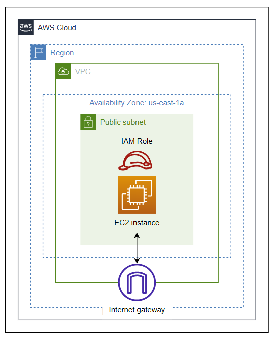

1. Search for **EC2** and open it. Click **Instances → Launch instances**.
2. Name: `lab3-ec2-01`.
3. AMI: **Amazon Linux 2 AMI (HVM) - Kernel 5.10, SSD Volume Type**, architecture **64-bit (x86)**.
4. Instance type: **t2.micro**.
5. Key pair: **Proceed without a key pair (Not recommended)**.
6. **Network settings → Edit:**
   - VPC: `lab3-vpc`
   - Subnet: `lab3-public-subnet`
   - Auto-assign public IP: **Enable**, so the instance gets a public IP address and can talk to the internet
   - Firewall (security groups): **Create security group**
   - Click **Remove** under **Inbound security group rules** to remove the existing rule. SSM does not need any inbound rule.
7. Storage: **8 GiB gp2**.
8. Expand **Advanced details**. IAM instance profile: **`LabInstanceProfile`**.
9. Leave the rest and click **Launch instance**.

> 📸 **Screenshot `05-ec2-public.png`:** `lab3-ec2-01` *Running*, with its subnet `lab3-public-subnet` and its public IPv4 address visible.

## Task 6 — Run a Command to Test the Internet

**AWS Systems Manager (SSM)** manages AWS resources such as EC2 instances by automating operational tasks from one place. Its **Run Command** feature runs commands on an instance remotely, for example to install software or updates.

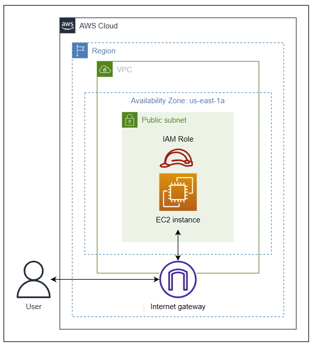

You use SSM to download security patches and updates to the instance. If the download succeeds, the instance has internet access.

1. Search for **Systems Manager** and open it.
2. In the left menu, under **Node Management**, click **Run Command**, then **Run command**.
3. Under **Command document**, search for `runshellscript` and select **AWS-RunShellScript**.
4. Under **Command parameters**, type:

   ```bash
   sudo yum update -y
   ```

5. Under **Target selection**: choose **Choose instances manually** and select `lab3-ec2-01`.

   > **Note:** The instance can take around 10 minutes to appear in this list.

6. Under **Output options**, uncheck **Enable an S3 bucket**.
7. Click **Run**.

The status shows *In Progress*. After a while, click the refresh icon: **Status** and **Detailed Status** show **Success**. The instance reached the internet to download the updates.

> 📸 **Screenshot `06-test-public.png`:** the Run Command page with *Success* for `lab3-ec2-01`.

## Task 7 — Create a Private Subnet

You now create a private subnet with its own instance, and a NAT gateway in the public subnet. The private subnet sends its internet traffic to the NAT gateway, which sends it on to the internet gateway.

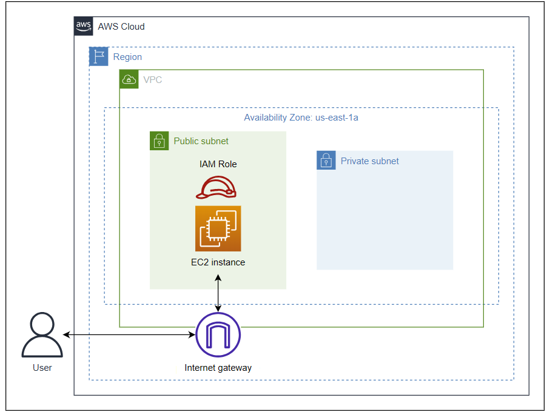

1. Open the **VPC** dashboard and click **Subnets → Create subnet**.
2. VPC ID: `lab3-vpc`.
3. Subnet settings:
   - Subnet name: `lab3-private-subnet`
   - Availability Zone: **US East (N. Virginia) / us-east-1a**
   - IPv4 CIDR block: `10.0.0.128/25`
4. Click **Create subnet**.

> 📸 **Screenshot `07-private-subnet.png`:** `lab3-private-subnet` with CIDR `10.0.0.128/25`.

## Task 8 — Create a NAT Gateway

The NAT gateway lets the instance in the private subnet reach the internet. The instance sends traffic to the NAT gateway, and the NAT gateway sends it through the internet gateway.

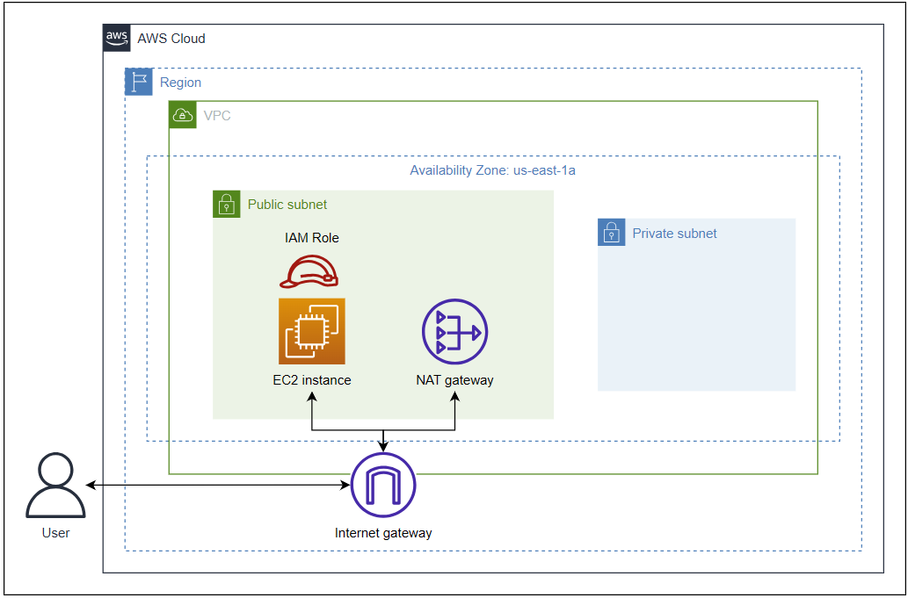

1. In the left menu, click **NAT gateways**, then **Create NAT gateway**.
2. Under **NAT gateway settings**:
   - Name: `lab3-nat-gateway`
   - Subnet: **`lab3-public-subnet`**
   - Connectivity type: **Public**
   - Elastic IP allocation ID: click **Allocate Elastic IP**
3. Click **Create NAT gateway**.

> **Note:** The NAT gateway starts in the state *Pending*. You can use it only when it is *Available*.

> 📸 **Screenshot `08-nat-gateway.png`:** `lab3-nat-gateway` *Available*, in `lab3-public-subnet`, with its Elastic IP.

## Task 9 — Create a Route Table and Update Routes and Subnet Associations

Both subnets currently use the same route table (check the **Route table** column on the **Subnets** page). The private subnet needs its own route table, because its traffic goes to the NAT gateway, while the public subnet's traffic goes to the internet gateway.

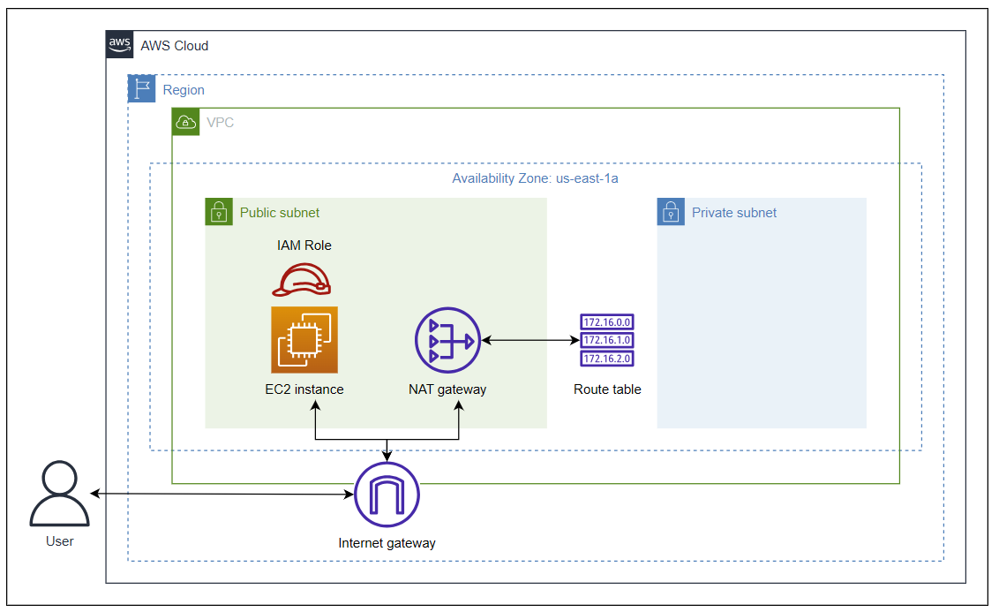

1. Click **Route tables → Create route table**.
2. Name: `lab3-custom-route-table`. VPC: `lab3-vpc`. Click **Create route table**.
3. Under **Routes**, click **Edit routes**. The default `10.0.0.0/24` → `local` route is already there.
4. Click **Add route**:
   - Destination: `0.0.0.0/0`
   - Target: **NAT Gateway**, then `lab3-nat-gateway`
5. Click **Save changes**.
6. Open **Subnet associations → Edit subnet associations**, select `lab3-private-subnet`, and click **Save associations**.

> 📸 **Screenshot `09-private-route-table.png`:** `lab3-custom-route-table` with `0.0.0.0/0` → `lab3-nat-gateway`.

## Task 10 — Launch an EC2 Instance in the Private Subnet

AWS does not move an existing instance to another subnet, so you launch a new one.

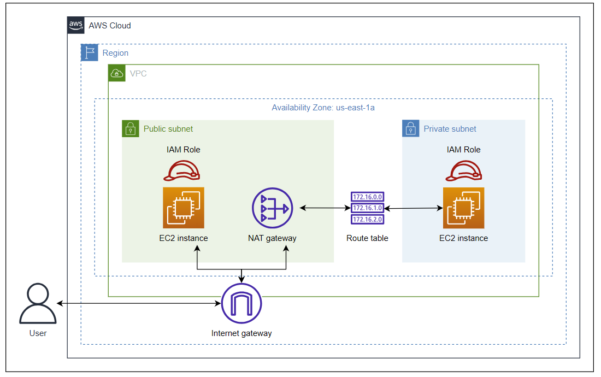

1. Open **EC2 → Instances → Launch instances**.
2. Name: `lab3-ec2-02`.
3. AMI: **Amazon Linux 2 AMI (HVM) - Kernel 5.10, SSD Volume Type**, **64-bit (x86)**. Instance type: **t2.micro**.
4. Key pair: **Proceed without a key pair (Not recommended)**.
5. **Network settings → Edit:**
   - VPC: `lab3-vpc`
   - Subnet: **`lab3-private-subnet`**
   - Auto-assign public IP: **Disable**. This instance must not get a public IP address.
   - Firewall: **Create security group**, and **Remove** the existing inbound rule.
6. Storage: **8 GiB gp2**.
7. **Advanced details → IAM instance profile:** **`LabInstanceProfile`**.
8. Click **Launch instance**.

> 📸 **Screenshot `10-ec2-private.png`:** `lab3-ec2-02` *Running*, in `lab3-private-subnet`, with no public IPv4 address.

## Task 11 — Run a Command to Test the Internet

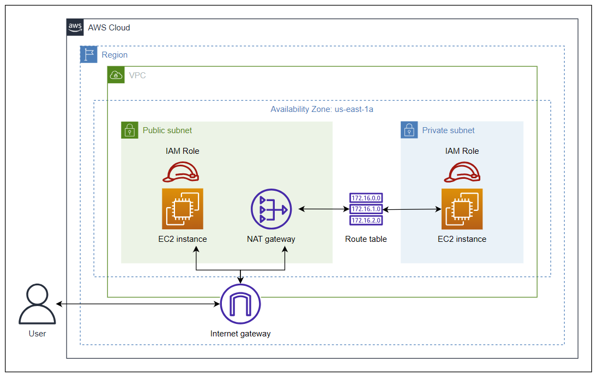

Repeat Task 6 for the private instance:

1. Open **Systems Manager → Run Command → Run command**.
2. Document: **AWS-RunShellScript**. Command: `sudo yum update -y`.
3. Target: **Choose instances manually**, select `lab3-ec2-02`.
4. Uncheck **Enable an S3 bucket** and click **Run**.

After a while, refresh: **Status** and **Detailed Status** show **Success**. The private instance reached the internet through the NAT gateway in the public subnet, without having a public IP address.

> 📸 **Screenshot `11-test-private.png`:** the Run Command page with *Success* for `lab3-ec2-02`.

## Task 12 — Clean Up

Take all screenshots **before** you clean up. A NAT gateway costs money every hour it exists, so do not skip this.

**Terminate the EC2 instances**

1. Open **EC2 → Instances**, select `lab3-ec2-01` and `lab3-ec2-02`.
2. Click **Instance state → Terminate instance**, then **Terminate**.

**Delete the routes**

The gateways can only be deleted when no route uses them.

1. Open **VPC → Route tables** and search for `lab3-vpc`.
2. For each route table found: click its ID, click **Edit routes**, click **Remove** next to the `0.0.0.0/0` route, and click **Save changes**.

**Delete the NAT gateway**

1. Click **NAT gateways**, select `lab3-nat-gateway`.
2. Click **Actions → Delete NAT gateway**, type `delete`, and click **Delete**.

**Release the Elastic IP address**

1. When the NAT gateway is *Deleted*, click **Elastic IPs**.
2. Select the address that was allocated for the NAT gateway and click **Actions → Release Elastic IP addresses → Release**.

**Detach and delete the internet gateway**

1. Click **Internet gateways**, select `lab3-internet-gateway`.
2. Click **Actions → Detach from VPC**, then **Detach internet gateway**.
3. Select it again, click **Actions → Delete internet gateway**, type `delete`, and confirm.

**Delete the VPC**

1. Click **Your VPCs**, select `lab3-vpc`.
2. Click **Actions → Delete VPC**, type `delete`, and click **Delete**. This also deletes its subnets, route tables and security groups.

# Submission

1. Make the lab folder and copy your 11 screenshots into `images/`:

   ```bash
   mkdir -p ~/cc-gic-YOUR_ID/cc-lab-YOUR_ID/lab3/images
   ```

2. Copy the [report template](README.md) to `cc-lab-YOUR_ID/lab3/README.md` and fill it in.
3. Check the structure:

   ```text
   cc-lab-YOUR_ID/
   └── lab3/
       ├── README.md
       └── images/
           ├── 01-vpc.png
           ├── 02-internet-gateway.png
           ├── 03-public-subnet.png
           ├── 04-public-route-table.png
           ├── 05-ec2-public.png
           ├── 06-test-public.png
           ├── 07-private-subnet.png
           ├── 08-nat-gateway.png
           ├── 09-private-route-table.png
           ├── 10-ec2-private.png
           └── 11-test-private.png
   ```

4. Commit and push:

   ```bash
   cd ~/cc-gic-YOUR_ID
   git add .
   git commit -m "Lab 3: VPC with public and private subnets"
   git push
   ```

5. Check on GitHub that `lab3/README.md` shows all 11 screenshots.
