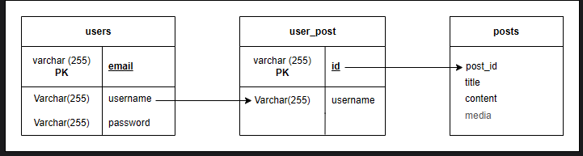
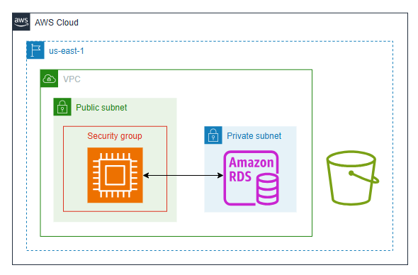
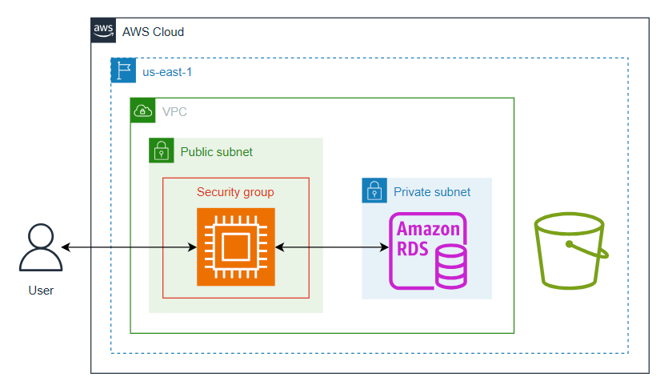
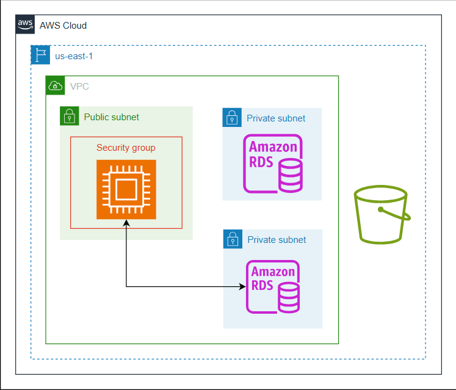
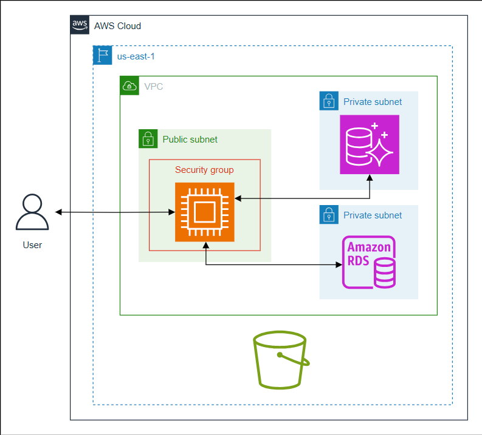
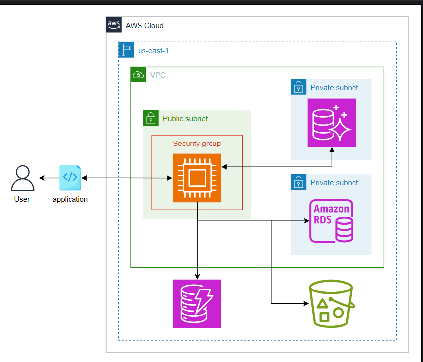

# Cloud Lab 5 — Build a Social Posts Microservice with AWS Databases (Hands-on)

| Item | Details |
|---|---|
| Work | Individual, in your own AWS Academy Learner Lab |
| Region | US East (N. Virginia) `us-east-1` |
| Technologies | FastAPI, Vite, Amazon EC2, RDS for MySQL, Aurora MySQL, DynamoDB, Amazon S3 |
| Submit | `cc-lab-YOUR_ID/lab5/` in your GitHub repository `CC-GIC-YOUR_ID`, with `README.md` and 9 screenshots |

> **Overview:** Build and run a FastAPI microservice on EC2. It creates accounts, signs users in, and publishes and retrieves social posts. Use the Vite web app from the handout to test the service. The backend uses Aurora MySQL for accounts, RDS for MySQL for the post index, DynamoDB for post content, and S3 for optional images.


## Lab Objectives

After this lab, you can:

1. Configure EC2 to run a web client and a FastAPI service.
2. Create tables in RDS and Aurora MySQL, and connect to the Aurora writer and reader endpoints.
3. Create a DynamoDB table and use its partition key to retrieve a post.
4. Connect the microservice to the databases and S3, then verify signup, login, and posting.
5. Trace a post from its RDS row to its DynamoDB item and S3 object.

## Screenshots in this lab

| File | Task | What it shows |
|---|:---:|---|
| `01-security-group.png` | 1 | The EC2 security group and the SSH inbound rule |
| `02-ec2-running.png` | 2 | The running instance and its attached security group |
| `03-s3-media-bucket.png` | 3 | The media bucket with Block Public Access enabled |
| `04-rds-mysql.png` | 4 | The available RDS instance and its endpoint |
| `05-aurora-endpoints.png` | 6 | The Aurora writer and reader endpoints |
| `06-dynamodb-table.png` | 8 | The active `posts` table and its String partition key `post_id` |
| `07-app-start.png` | 9 | The terminal showing the FastAPI service listening on port 8000 and Vite on port 5173. Use a single capture of both terminal windows. |
| `08-app-post.png` | 10 | The Vite app in your browser showing the post you published with its image |
| `09-post-item.png` | 10 | The matching DynamoDB item with its `post_id` and `media` object key |

Keep your Learner Lab user name visible in console screenshots. Keep commands visible in the terminal screenshot and the address bar visible in the browser screenshot. Use a fictional email, a throwaway password, and a small PNG or JPEG you can share. Keep credentials and signed URLs out of your submission.

## Getting Started

Complete the [student setup](../SETUP.md), start your Learner Lab, and use **US East (N. Virginia)**. Follow the resource names given in the tasks and finish the cleanup in the same session to preserve your lab budget.

The task sequence and figures come from the course handout, *Lab 5 New - AWS Database*, adapted from [Educative's DatabaseOptions lab](https://github.com/Educative-Content/DatabaseOptions). This walkthrough uses an SSH tunnel for the browser, temporary credentials from AWS Academy Learner Lab, and a private media bucket.

### How the microservice stores data



| Service | Table or bucket | Data |
|---|---|---|
| Aurora MySQL | `users` | Email (primary key), display name and password hash. The handout's diagram labels the password field `password`. This version names it `password_hash`. |
| RDS for MySQL | `user_post` | Post ID (primary key) and the author's display name |
| DynamoDB | `posts` | Post ID (partition key), title, content and optional `media` object key |
| Amazon S3 | Your `clab-imagestore-…` bucket | Optional images under `posts/`. The service returns a short-lived signed URL when the browser needs an image. |

# Part A — Prepare the EC2 Host and Media Bucket

## Task 1 — Create a Security Group


1. Open **EC2 → Security Groups → Create security group**.
2. Name it `aws-database-options-security-group`, add a description, and select the **default VPC**.
3. Add an inbound **SSH (TCP 22)** rule with **My IP** as the source. Keep the default outbound rule and create the group.

> 📸 **Screenshot `01-security-group.png`:** the security group name and its SSH rule.

## Task 2 — Launch an EC2 Instance


1. Open **EC2 → Instances → Launch instances**. Name the instance `aws-database-options-lab-instance`.
2. Choose **Ubuntu Server 24.04 LTS**, 64-bit (x86), `t2.micro` if permitted by your Learner Lab, and an **8 GiB gp3** root volume.
3. Select a key pair you can use from your computer. Under **Network settings**, use the default VPC, enable **Auto-assign public IP**, and select the security group from Task 1.
4. Launch the instance. Wait for the state to show **Running**, then note its public IPv4 address. You will configure the AWS credentials for DynamoDB and S3 in Task 9.

> 📸 **Screenshot `02-ec2-running.png`:** the running instance and its attached security group.

From your **own computer**, open an SSH session with a tunnel for Vite. Replace the key path and public IP with yours. Leave the tunnel open while you use the app.

```bash
ssh -i ~/path/to/your-key.pem -L 127.0.0.1:5173:127.0.0.1:5173 ubuntu@YOUR_EC2_PUBLIC_IP
```

The browser reaches Vite through SSH. Vite forwards API calls to FastAPI on EC2. Ports 5173 and 8000 stay closed in the security group.

## Task 3 — Create the S3 Media Bucket


1. Open **S3 → Create bucket** and choose a **General purpose** bucket in `us-east-1`.
2. Name it `clab-imagestore-YOUR_UNIQUE_SUFFIX`. Use a unique lowercase suffix.
3. Keep **Block all public access** and the default encryption enabled. Create the bucket and open its **Permissions** tab.

> 📸 **Screenshot `03-s3-media-bucket.png`:** the bucket name and **Block all public access** enabled.

# Part B — Create and Connect the Databases

## Task 4 — Create an RDS for MySQL Instance



1. Open **RDS → Databases → Create database**. Select **Standard create** and **MySQL**. Choose a MySQL 8.0 version offered in the console, **Dev/Test** if shown, and **Single DB instance**.
2. Set the identifier to `aws-dbo-sql` and the master username to `admin`. Select **Self managed** and set a lab password.
3. Choose `db.t3.small` or the smallest instance class permitted in your Learner Lab. Use `gp3` at the console minimum or the storage option your lab requires.
4. Under **Connectivity**, select **Connect to an EC2 compute resource** and choose `aws-database-options-lab-instance`. Keep public access off.
5. Under **Additional configuration**, set **Initial database name** to `educative_db` and create the database.
6. When the instance is **Available**, save its endpoint hostname from **Connectivity & security**.

> 📸 **Screenshot `04-rds-mysql.png`:** the RDS instance identifier, status and endpoint.

For manual connectivity, use the same VPC and allow MySQL (TCP 3306) into the database security group only from the EC2 security group. If a required class is unavailable, ask your instructor which lab setting to use before selecting a larger one. [RDS connection guide](https://docs.aws.amazon.com/AmazonRDS/latest/UserGuide/ec2-rds-connect.html)

## Task 5 — Connect to RDS and Create the Post Index



In the SSH session on EC2, install the MySQL client and download the RDS certificate bundle. Use the endpoint hostname without `https://` or `:3306`.

```bash
sudo apt-get update
sudo apt-get install -y mysql-client python3-venv git curl nodejs npm nano
curl -fsSLo "$HOME/rds-us-east-1.pem" \
  https://truststore.pki.rds.amazonaws.com/us-east-1/us-east-1-bundle.pem
export LAB_RDS_CA="$HOME/rds-us-east-1.pem"
export LAB_RDS_HOST='YOUR_RDS_ENDPOINT'
mysql -h "$LAB_RDS_HOST" -u admin -p --ssl-mode=VERIFY_IDENTITY --ssl-ca="$LAB_RDS_CA" educative_db
```

Enter the RDS password at the prompt. Then create `user_post` in the MySQL shell. The microservice inserts a row here when you publish a post.

```sql
CREATE TABLE IF NOT EXISTS user_post (
    id CHAR(32) PRIMARY KEY,
    username VARCHAR(80) NOT NULL,
    created_at TIMESTAMP NOT NULL DEFAULT CURRENT_TIMESTAMP
);
EXIT;
```

## Task 6 — Create the Aurora MySQL Cluster



1. Return to **RDS → Databases → Create database**. Select **Standard create** and **Aurora (MySQL Compatible)**. Use an offered engine version and **Dev/Test** if shown.
2. Name the cluster `aws-dbo-aurora`. Set the master username to `admin`, choose **Self managed**, and set a distinct lab password.
3. Choose `db.t3.medium` or the smallest provisioned class your Learner Lab permits. Use **Aurora Standard** if shown. Choose a single writer and **Don't create an Aurora Replica**.
4. Under **Connectivity**, connect to the same EC2 instance and keep public access off.
5. Under **Additional configuration**, set **Initial database name** to `educative_db` and create the cluster.
6. When the cluster and its writer are **Available**, open the cluster's **Connectivity & security → Endpoints** and save both hostnames.

> 📸 **Screenshot `05-aurora-endpoints.png`:** the **Writer** and **Reader** endpoints and their status.

## Task 7 — Connect to Aurora and Create the Users Table



From EC2, set the two Aurora hostnames and connect to the **writer** endpoint. Enter the Aurora password when prompted.

```bash
export LAB_AURORA_WRITER='YOUR_AURORA_WRITER_ENDPOINT'
export LAB_AURORA_READER='YOUR_AURORA_READER_ENDPOINT'
mysql -h "$LAB_AURORA_WRITER" -u admin -p --ssl-mode=VERIFY_IDENTITY --ssl-ca="$LAB_RDS_CA" educative_db
```

Create `users` in the MySQL shell.

```sql
CREATE TABLE IF NOT EXISTS users (
    email VARCHAR(254) PRIMARY KEY,
    username VARCHAR(80) NOT NULL,
    password_hash VARCHAR(255) NOT NULL
);
EXIT;
```

The service writes new accounts to the writer and checks logins through the reader endpoint. Both endpoints lead to the same DB instance in this lab because the cluster has no replica. [Aurora reader endpoints](https://docs.aws.amazon.com/AmazonRDS/latest/AuroraUserGuide/Aurora.Endpoints.Reader.html)

## Task 8 — Create the DynamoDB Posts Table


1. Open **DynamoDB → Tables → Create table**.
2. Set **Table name** to `posts` and the **partition key** to `post_id` with type **String**. Leave the sort key empty.
3. Use on-demand capacity, create the table and wait for **Active**.

> 📸 **Screenshot `06-dynamodb-table.png`:** the active `posts` table and its String partition key.

# Part C — Build and Test the Microservice

## Task 9 — Connect the FastAPI Service and Vite Client



### Set up the backend

On EC2, get the [FastAPI starter](files/backend.py) and install its dependencies. Use the same SSH shell as Tasks 5 and 7 so the endpoint and certificate variables are available.

```bash
cd ~
git clone --depth 1 https://github.com/RathpiseyAlpha/ITC-I5GIC-CC.git
cd ~/ITC-I5GIC-CC/labs/lab5/files
python3 -m venv .venv
source .venv/bin/activate
python -m pip install -r requirements.txt
```

The FastAPI routes combine the components you created in Part B. Open `backend.py` and find each route and its database connection before starting the service.

| Route | Work performed |
|---|---|
| `POST /signup` | Hash the password and write the new account through the Aurora writer endpoint. |
| `POST /login` | Read the account through the Aurora reader endpoint, verify the password, and start a session. |
| `POST /create_post` | Make a post ID, upload the optional image to S3, write the DynamoDB item, and insert the same ID into the RDS post index. |
| `GET /get_posts` | Read the RDS post IDs, load their content from DynamoDB, and sign short-lived URLs for S3 images. |
| `POST /logout` | End the session. |

### Copy the AWS Academy credentials

1. In **AWS Academy Learner Lab**, open **AWS Details → Show** next to **AWS CLI**. Copy the block containing the access key ID, secret access key, and session token.
2. In your **EC2 SSH terminal**, open the credentials file outside the course repository:

   ```bash
   install -d -m 700 "$HOME/.aws"
   (umask 077; touch "$HOME/.aws/credentials")
   chmod 600 "$HOME/.aws/credentials"
   nano "$HOME/.aws/credentials"
   ```

3. Paste the Learner Lab block into the file. Replace the old `[default]` block if there is one. It should have this shape, with the values copied from **Show CLI**:

   ```ini
   [default]
   aws_access_key_id = YOUR_LEARNER_LAB_ACCESS_KEY_ID
   aws_secret_access_key = YOUR_LEARNER_LAB_SECRET_ACCESS_KEY
   aws_session_token = YOUR_LEARNER_LAB_SESSION_TOKEN
   ```

4. Save with **Ctrl+O**, press **Enter**, then exit with **Ctrl+X**. Boto3 reads all three values from this file for DynamoDB and S3. Keep the file contents out of your code, Git repository, and screenshots. [Boto3 credentials guide](https://docs.aws.amazon.com/boto3/latest/guide/credentials.html#shared-credentials-file)

### Start the backend

Set your bucket name, enter the two database passwords at the hidden prompts, and start the API on port 8000. The command generates `LAB_SESSION_KEY` for the app's login sessions. The AWS session token stays in the credentials file.

```bash
export AWS_REGION=us-east-1
export LAB_MEDIA_BUCKET='clab-imagestore-YOUR_UNIQUE_SUFFIX'
export LAB_SESSION_KEY="$(python -c 'import secrets; print(secrets.token_urlsafe(32))')"
read -rsp 'RDS MySQL password: ' LAB_RDS_PASSWORD; printf '\n'
read -rsp 'Aurora password: ' LAB_AURORA_PASSWORD; printf '\n'
export LAB_RDS_PASSWORD LAB_AURORA_PASSWORD
python -m uvicorn backend:app --host 127.0.0.1 --port 8000
```

### Set up the frontend

Keep the backend running. Open a **second SSH session** to the same EC2 instance, using the key and public IP from Task 2. In this session, fetch the reference Vite client from the handout. The sparse checkout downloads the project files used by the client.

```bash
cd ~
git clone --filter=blob:none --no-checkout https://github.com/Educative-Content/DatabaseOptions.git
git -C DatabaseOptions sparse-checkout set --no-cone --stdin <<'PATHS'
/package.json
/package-lock.json
/socialmedia/*
!/socialmedia/node_modules/
PATHS
git -C DatabaseOptions checkout --detach 8d19a38751ad52f6e2a44350607ec0767a0ecdf7

python3 ~/ITC-I5GIC-CC/labs/lab5/files/configure_frontend.py ~/DatabaseOptions
cd ~/DatabaseOptions
npm ci --no-audit --no-fund
cd socialmedia
npm ci --no-audit --no-fund
./node_modules/.bin/vite --host 127.0.0.1 --port 5173 --strictPort
```

The setup script changes the client's Axios base URL to `/api` and routes those requests through Vite to the local FastAPI service. It also wires log out to the API. Keep both processes running for the test.

> 📸 **Screenshot `07-app-start.png`:** capture the FastAPI and Vite startup output with ports 8000 and 5173 visible.

## Task 10 — Sign Up, Sign In, and Trace a Social Post

1. While the SSH tunnel is open, visit [http://127.0.0.1:5173/](http://127.0.0.1:5173/) from your computer.
2. Create a demo account and sign in. Use a fictional email and a password of at least 12 characters.
3. Click **Create a Post**. Enter a distinctive title and some text, attach a PNG or JPEG up to 2 MiB, and publish. Confirm the post, author, and image appear in the feed.

> 📸 **Screenshot `08-app-post.png`:** the browser address bar and your published post with its image.

4. In **DynamoDB → Explore table items**, open the `posts` table and find your item by its title. Record `post_id` and the `media` key. In your S3 bucket, confirm that the same key exists under `posts/`.

> 📸 **Screenshot `09-post-item.png`:** the DynamoDB item with your title, `post_id` and `media`.

5. In another EC2 shell, set the RDS hostname and certificate variables from Task 5, then connect using the same MySQL command. Replace `YOUR_POST_ID` with the value you found in DynamoDB.

   ```sql
   SELECT id, username FROM user_post WHERE id = 'YOUR_POST_ID';
   ```

6. Record the matching row, title and image key in your report. Use the EC2, S3, RDS, Aurora and DynamoDB screenshots above as evidence of the final infrastructure.

| Symptom | What to check |
|---|---|
| The browser cannot reach port 5173 | The SSH tunnel is still open and Vite is listening on EC2. |
| Vite responds but signup or login fails | FastAPI is running on port 8000. Check the Aurora hostnames and password. |
| A MySQL connection times out | The database security group allows TCP 3306 from the EC2 security group, and both resources use the same VPC. |
| Posting fails with a storage error | Check that all three Show CLI values are present under `[default]` in `~/.aws/credentials`. If they expired, copy a fresh block from the running Learner Lab, replace the old block, and restart the backend. Also check the S3 bucket name and the active `posts` table in `us-east-1`. |

## Clean Up

1. Stop Vite and FastAPI with **Ctrl+C** in their respective terminals.
2. Delete the RDS instance, the Aurora writer and the Aurora cluster. For these disposable lab databases, skip final snapshots and remove retained backups if prompted.
3. Delete the DynamoDB `posts` table.
4. Empty and delete the S3 bucket.
5. Terminate the EC2 instance. Delete the lab security groups after their resources have been removed.

## Wrap Up

The FastAPI microservice connects the client to several storage services. Signup and login use Aurora. Publishing a post creates one ID that joins the RDS index and the DynamoDB item. The item's `media` key points to the image in S3.

# Submission

1. Create `cc-lab-YOUR_ID/lab5/images/` in your student repository.
2. Copy the [report template](README.md) to `cc-lab-YOUR_ID/lab5/README.md`. Fill it in and save the nine PNGs with the filenames in the screenshot table.
3. Check your folder structure and push from the root of your student repository.

   ```text
   cc-lab-YOUR_ID/
   └── lab5/
       ├── README.md
       └── images/
           ├── 01-security-group.png
           ├── 02-ec2-running.png
           ├── 03-s3-media-bucket.png
           ├── 04-rds-mysql.png
           ├── 05-aurora-endpoints.png
           ├── 06-dynamodb-table.png
           ├── 07-app-start.png
           ├── 08-app-post.png
           └── 09-post-item.png
   ```

   ```bash
   git add cc-lab-YOUR_ID/lab5
   git commit -m "Lab 5: AWS Databases microservice"
   git push
   ```

4. Open your GitHub report and check that every screenshot renders.
