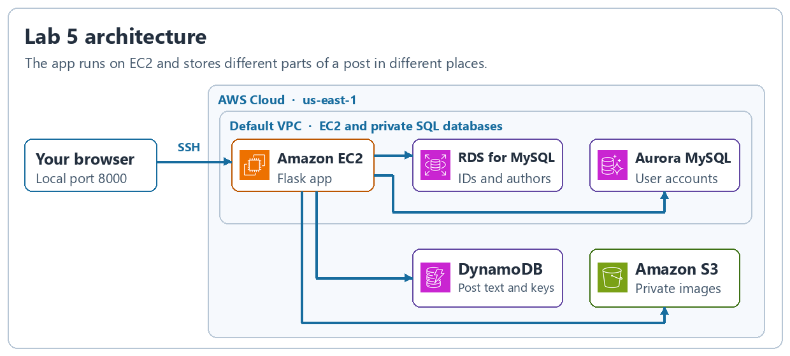
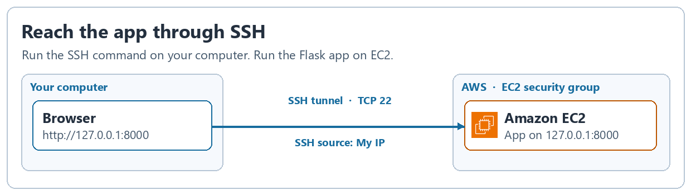
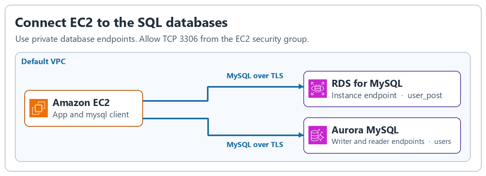
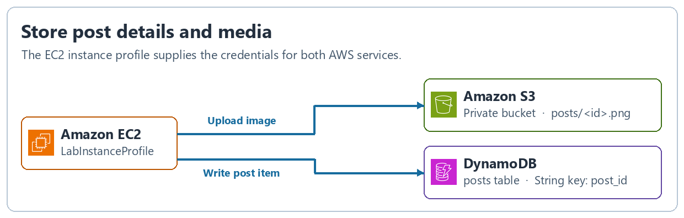
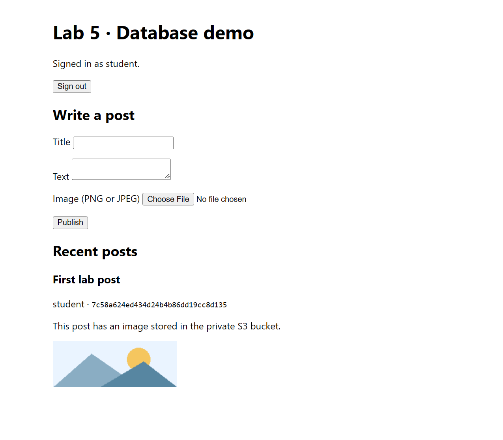
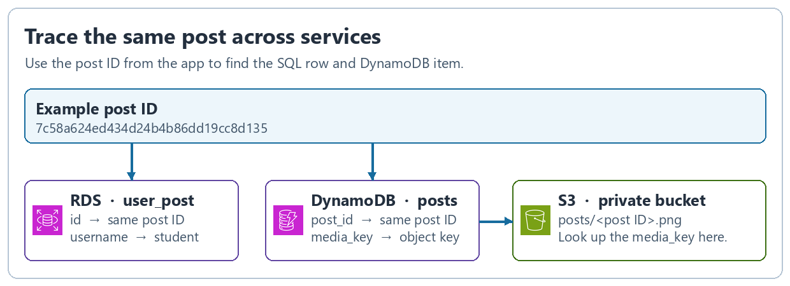

# Cloud Lab 5 — Build a Social App with AWS Databases (Hands-on)

| Item | Details |
|---|---|
| Work | Individual, in your own AWS Academy Learner Lab |
| Region | US East (N. Virginia) `us-east-1` |
| Technologies | Amazon EC2, Amazon RDS for MySQL, Amazon Aurora MySQL, Amazon DynamoDB, Amazon S3 |
| Submit | `cc-lab-YOUR_ID/lab5/` in your GitHub repository `CC-GIC-YOUR_ID`: `README.md` and 9 screenshots |
| Before you start | Complete the [student setup](../SETUP.md). |

> **Overview:** Deploy a small social app on EC2. Amazon Aurora stores demo accounts, Amazon RDS for MySQL links posts to their authors, DynamoDB stores post text, and a private S3 bucket holds attached images. You will sign in, publish a post, and follow its ID across these services.

## Lab Objectives

After this lab, you can:

1. Launch an EC2 instance with an instance profile and reach an app through an SSH tunnel.
2. Connect EC2 to private RDS MySQL and Aurora MySQL endpoints over TLS.
3. Explain the difference between an Aurora writer endpoint and a reader endpoint.
4. Use a DynamoDB partition key to retrieve a post and find its image in a private S3 bucket.
5. Trace a single app operation across relational databases, a NoSQL table, and object storage.



## Screenshots in this lab

| File | Task | What it shows |
|---|:---:|---|
| `01-security-group.png` | 1 | The EC2 security group and its SSH inbound rule |
| `02-ec2-running.png` | 1 | The running EC2 instance with its security group |
| `03-s3-media-bucket.png` | 2 | The bucket's **Permissions** tab with Block Public Access enabled |
| `04-rds-mysql.png` | 3 | The available RDS for MySQL instance and its endpoint |
| `05-aurora-endpoints.png` | 4 | The Aurora cluster's available writer and reader endpoints |
| `06-dynamodb-table.png` | 5 | The active `posts` table with its String partition key `post_id` |
| `07-app-start.png` | 7 | The command starting the app on EC2 and its listening address |
| `08-app-post.png` | 8 | The app at `http://127.0.0.1:8000/` with your demo post, image, and post ID |
| `09-post-item.png` | 8 | The matching DynamoDB item with the same `post_id` and its `media_key` |

Every console screenshot must show your Learner Lab user name at the top right. Keep the command visible in the terminal screenshot and the address bar visible in the browser screenshot. Keep passwords, keys, and signed S3 URLs out of your evidence.

## Getting Started

- Start your **AWS Academy Learner Lab** and switch the console to **US East (N. Virginia) us-east-1**. Use the resource names shown in the tasks.
- Use a fictional email such as `student@example.com`, a throwaway password for the app, and a small PNG or JPEG you can share.
- Plan to finish **Clean Up** in the same session. The databases consume your Learner Lab budget while they run.

The exercise is adapted from Educative's [DatabaseOptions lab](https://github.com/Educative-Content/DatabaseOptions). This walkthrough uses the [course starter app](files/app.py) and an SSH tunnel. The figures use [AWS architecture icons](https://aws.amazon.com/architecture/icons/).

# Part A — Prepare EC2 and S3

## Task 1 — Create a Security Group and Launch an EC2 Instance

A security group controls which connections can reach your instance. You will allow SSH from your computer and forward browser traffic through that connection.



### Create the security group

1. Open **EC2 → Security Groups → Create security group**.
2. Name it `aws-database-options-security-group` and select the **default VPC**.
3. Under **Inbound rules**, add **SSH** on TCP port **22** with **My IP** as the source. Keep the default outbound rules and choose **Create security group**.

> 📸 **Screenshot `01-security-group.png`:** the new security group's name and the SSH inbound rule.

### Launch the instance

1. Open **EC2 → Instances → Launch instances** and set the name to `aws-database-options-lab-instance`.
2. Select **Ubuntu Server 24.04 LTS** (64-bit x86), `t2.micro` if available in your Learner Lab, and an **8 GiB gp3** root volume.
3. Select or create a key pair you can use from your computer.
4. Under **Network settings**, use the same VPC, enable **Auto-assign public IP**, and select the security group from the previous step.
5. Under **Advanced details → IAM instance profile**, choose `LabInstanceProfile`. This gives the app temporary credentials for DynamoDB and S3.
6. Choose **Launch instance**. Wait for the instance to show **Running**.

> 📸 **Screenshot `02-ec2-running.png`:** the instance name, **Running** state, and attached security group.

### Connect from your computer

Replace the key path and public IPv4 address below. Run this command in your **local terminal** and keep the session open for the remaining tasks.

```bash
ssh -i ~/path/to/your-key.pem -L 127.0.0.1:8000:127.0.0.1:8000 ubuntu@YOUR_EC2_PUBLIC_IP
```

Leave port 8000 closed in the security group. The SSH tunnel carries browser traffic through port 22. If the connection fails, check your current IP against the SSH rule and confirm the instance's public IPv4 address. See the [EC2 connection guide](https://docs.aws.amazon.com/AWSEC2/latest/UserGuide/connect.html).

## Task 2 — Create a Private S3 Bucket

The app stores attached images as objects in S3. It will give the browser a short-lived URL to read each image from the private bucket.

1. Open **S3 → Create bucket** and choose a **General purpose** bucket in `us-east-1`.
2. Enter `clab-imagestore-YOUR_UNIQUE_SUFFIX` as the bucket name. Replace the suffix with a unique, lowercase value.
3. Keep **Block all public access** and default encryption enabled. Create the bucket and open its **Permissions** tab.

> 📸 **Screenshot `03-s3-media-bucket.png`:** your bucket name and **Block all public access** enabled.

# Part B — Create the Databases

## Task 3 — Create the RDS for MySQL Instance

The app will store each post ID and its author's display name in a relational table on RDS for MySQL.



1. Open **RDS → Databases → Create database** and select **Standard create**.
2. Select **MySQL** and choose a MySQL 8.0 version offered in the console. Select **Dev/Test** if shown and **Single DB instance** for deployment.
3. Set **DB instance identifier** to `aws-dbo-sql` and **Master username** to `admin`. Select **Self managed** credentials and set a lab password.
4. Choose `db.t3.small` or the smallest instance class your Learner Lab permits. Use `gp3` at the console minimum or the storage option required by your Learner Lab.
5. Under **Connectivity**, select **Connect to an EC2 compute resource** and choose `aws-database-options-lab-instance`. Keep public access off.
6. Expand **Additional configuration**, set **Initial database name** to `educative_db`, and choose **Create database**.
7. When the DB instance is **Available**, open **Connectivity & security** and save the endpoint hostname for Task 6.

> 📸 **Screenshot `04-rds-mysql.png`:** the RDS instance identifier, available status, and endpoint.

If you need to set up connectivity manually, put the database in the same VPC and allow MySQL (TCP 3306) into the database security group only from your EC2 security group. If a required action or instance class is blocked, check with your instructor before using a larger instance. See the [RDS connection guide](https://docs.aws.amazon.com/AmazonRDS/latest/UserGuide/ec2-rds-connect.html).

## Task 4 — Create the Aurora MySQL Cluster

Aurora is a managed relational database with MySQL compatibility. The starter app creates accounts through the writer endpoint and reads them through the reader endpoint.

1. Return to **RDS → Databases → Create database** and select **Standard create**.
2. Choose **Aurora (MySQL Compatible)**, select an offered engine version, and choose **Dev/Test** if shown.
3. Set the cluster identifier to `aws-dbo-aurora` and the master username to `admin`. Choose **Self managed** and set a different lab password.
4. Choose `db.t3.medium` or the smallest provisioned class your Learner Lab permits. Use **Aurora Standard** if shown. Keep a single writer and choose **Don't create an Aurora Replica**.
5. Under **Connectivity**, connect to the same EC2 instance and keep public access off.
6. Set **Initial database name** to `educative_db` under **Additional configuration** and create the cluster.
7. When the cluster and writer instance are **Available**, select the cluster. Find and save both hostnames in **Connectivity & security → Endpoints**.

> 📸 **Screenshot `05-aurora-endpoints.png`:** the cluster's **Writer** and **Reader** endpoints and their status.

With one Aurora instance, both endpoints reach the writer. The reader endpoint balances read connections across replicas if you add them later. See the [Aurora setup guide](https://docs.aws.amazon.com/AmazonRDS/latest/AuroraUserGuide/CHAP_GettingStartedAurora.CreatingConnecting.Aurora.html) and [reader endpoint guide](https://docs.aws.amazon.com/AmazonRDS/latest/AuroraUserGuide/Aurora.Endpoints.Reader.html).

## Task 5 — Create the DynamoDB Table

DynamoDB is a NoSQL database. Each post is stored as an item, and an item with an image includes the S3 object key.



1. Open **DynamoDB → Tables → Create table**.
2. Enter `posts` for the table name. Set the partition key to `post_id` and its type to **String**. Leave the sort key empty.
3. Use on-demand capacity and create the table. Wait for the status to change to **Active**.

> 📸 **Screenshot `06-dynamodb-table.png`:** the table name, **Active** status, and String partition key `post_id`.

## Task 6 — Create the SQL Tables from EC2

### Install the client and set the endpoints

In the SSH session you opened in Task 1, install the MySQL client and download AWS's certificate bundle. Substitute the hostnames from Tasks 3 and 4 without `https://` or `:3306`.

```bash
sudo apt-get update
sudo apt-get install -y mysql-client python3-venv git curl
curl -fsSLo "$HOME/rds-us-east-1.pem" \
  https://truststore.pki.rds.amazonaws.com/us-east-1/us-east-1-bundle.pem
export LAB_RDS_CA="$HOME/rds-us-east-1.pem"
export LAB_RDS_HOST='YOUR_RDS_ENDPOINT'
export LAB_AURORA_WRITER='YOUR_AURORA_WRITER_ENDPOINT'
export LAB_AURORA_READER='YOUR_AURORA_READER_ENDPOINT'
```

### Create the post index on RDS MySQL

Run the command from EC2 and enter the RDS password at the prompt. The `VERIFY_IDENTITY` option verifies the server certificate and hostname.

```bash
mysql -h "$LAB_RDS_HOST" -u admin -p --ssl-mode=VERIFY_IDENTITY --ssl-ca="$LAB_RDS_CA" educative_db
```

In the MySQL prompt, create `user_post` and return to the shell.

```sql
CREATE TABLE IF NOT EXISTS user_post (
    id CHAR(32) PRIMARY KEY,
    username VARCHAR(80) NOT NULL,
    created_at TIMESTAMP NOT NULL DEFAULT CURRENT_TIMESTAMP
);
EXIT;
```

### Create the users table on Aurora MySQL

Connect to the **writer** endpoint and enter the Aurora password when prompted.

```bash
mysql -h "$LAB_AURORA_WRITER" -u admin -p --ssl-mode=VERIFY_IDENTITY --ssl-ca="$LAB_RDS_CA" educative_db
```

Create `users`. The app saves a password hash in this table when you create a demo account.

```sql
CREATE TABLE IF NOT EXISTS users (
    email VARCHAR(254) PRIMARY KEY,
    username VARCHAR(80) NOT NULL,
    password_hash VARCHAR(255) NOT NULL
);
EXIT;
```

# Part C — Run and Test the App

## Task 7 — Configure and Start the App

On EC2, clone the course repository and install the starter app's dependencies in a virtual environment.

```bash
git clone https://github.com/RathpiseyAlpha/ITC-I5GIC-CC.git
cd ITC-I5GIC-CC/labs/lab5/files
python3 -m venv .venv
source .venv/bin/activate
python -m pip install -r requirements.txt
```

In the same SSH shell, substitute your private bucket name, enter both database passwords at the hidden prompts, and start the app. If you started a new shell, set the certificate and endpoint variables from Task 6 again.

```bash
export AWS_REGION=us-east-1
export LAB_MEDIA_BUCKET='clab-imagestore-YOUR_UNIQUE_SUFFIX'
export LAB_SESSION_KEY="$(python -c 'import secrets; print(secrets.token_urlsafe(32))')"
read -rsp 'RDS MySQL password: ' LAB_RDS_PASSWORD; printf '\n'
read -rsp 'Aurora password: ' LAB_AURORA_PASSWORD; printf '\n'
export LAB_RDS_PASSWORD LAB_AURORA_PASSWORD
python app.py
```

> 📸 **Screenshot `07-app-start.png`:** the EC2 terminal showing `python app.py` and the local listening address.

## Task 8 — Create an Account, Publish a Post, and Trace It

### Try the app in your browser

1. On **your computer**, open [http://127.0.0.1:8000/](http://127.0.0.1:8000/) while the SSH tunnel is open.
2. Under **Create a demo account**, enter a fictional email, display name, and password of at least 12 characters. Then use that account to sign in.
3. Write a title and some text. Attach a PNG or JPEG under 2 MiB and click **Publish**.
4. Under **Recent posts**, find your post, its attached image, and the post ID beside your display name.



*Example from the starter app with sample data. Capture your own result.*

> 📸 **Screenshot `08-app-post.png`:** your browser address bar and your published post, including the attached image and post ID.

### Find the same post in the databases and bucket



1. Open **DynamoDB → Explore table items**, select `posts`, and find the item whose `post_id` matches the app.
2. Copy that item's `media_key`. Open your **S3** bucket and check that the same key exists under `posts/`.
3. In a second SSH session to the EC2 instance, set the RDS hostname and certificate variables from Task 6. Connect to RDS with the same `mysql` command, then run:

   ```sql
   SELECT id, username FROM user_post;
   ```

4. Find the row with the same post ID. Record the matching ID, username, and object key in your report.

> 📸 **Screenshot `09-post-item.png`:** the DynamoDB item showing your post's `post_id` and `media_key`.

### Troubleshooting

| Symptom | What to check |
|---|---|
| Browser cannot reach `127.0.0.1:8000` | Keep the local SSH tunnel open and confirm that `python app.py` is running on EC2. |
| MySQL connection times out | Confirm that EC2 and the databases share a VPC and that the database security group allows TCP 3306 from the EC2 security group. |
| An S3 or DynamoDB call returns `AccessDenied` | Check that EC2 has `LabInstanceProfile` and that your Learner Lab permits the action. |
| The post shows a broken image | Check that the `media_key` exists in S3. Reload the page to get a fresh [signed URL](https://docs.aws.amazon.com/AmazonS3/latest/userguide/using-presigned-url.html). |

## Clean Up

1. Stop the app with **Ctrl+C**.
2. In **RDS → Databases**, delete the RDS instance and the Aurora writer instance and cluster. For these disposable lab databases, skip final snapshots and remove retained backups if prompted. Check the console again after deletion finishes.
3. In **DynamoDB**, delete the `posts` table.
4. In **S3**, empty and delete the lab bucket.
5. In **EC2**, terminate the lab instance. Delete the lab security groups once no resources use them.

## Wrap Up

You used Aurora to store and read a user account, RDS for MySQL to index posts by ID, DynamoDB to store each post's content, and a private S3 bucket to hold the image. The post ID and object key let you connect the records you found in each service.

# Submission

1. Create the lab folder in your student repository.

   ```bash
   mkdir -p ~/cc-gic-YOUR_ID/cc-lab-YOUR_ID/lab5/images
   ```

2. Copy the [report template](README.md) to `cc-lab-YOUR_ID/lab5/README.md`, fill it in, and save your nine screenshots under `lab5/images/`.
3. Check the folder structure.

   ```text
   cc-lab-YOUR_ID/
   └── lab5/
       ├── README.md
       └── images/
           ├── 01-security-group.png
           ├── 02-ec2-running.png
           ├── 03-s3-media-bucket.png
           ├── 04-rds-mysql.png
           ├── 05-aurora-endpoints.png
           ├── 06-dynamodb-table.png
           ├── 07-app-start.png
           ├── 08-app-post.png
           └── 09-post-item.png
   ```

4. From the root of your student repository, commit and push.

   ```bash
   cd ~/cc-gic-YOUR_ID
   git add cc-lab-YOUR_ID/lab5
   git commit -m "Lab 5: AWS databases"
   git push
   ```

5. Open the report on GitHub and check that all nine screenshots render.
