# Cloud Lab 5 — AWS Database Lab

Amazon Web Services (AWS) provides database services that allow you to efficiently store, manage, and retrieve data. This Cloud Lab focuses on equipping you with the skills needed to work with various AWS database solutions, including Amazon RDS, Amazon Aurora, and DynamoDB. You’ll learn how to create, configure, and integrate these databases with applications, enabling you to build scalable and reliable data-driven systems.

Firstly, you’ll create an EC2 instance and set it up to host a social media application. Following this, you’ll work on integrating the application with various database services like RDS, Aurora, and DynamoDB. This hands-on experience will provide valuable insights into the seamless interaction between your application and different database systems.

After completing this Cloud Lab, you’ll be well-equipped to leverage your knowledge of database connections in real-world scenarios. This skill set can significantly advance your career, allowing you to take on projects that involve deploying web applications and services on Amazon EC2, thus enhancing your proficiency in cloud-based solutions.

The following is the high-level architecture diagram of the final infrastructure that you will build in this Cloud Lab:

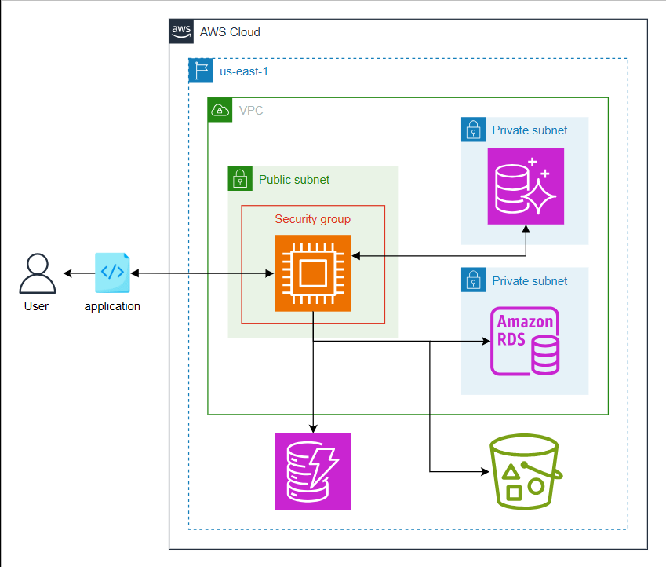

## Getting Started

**Amazon Relational Database Service (RDS)** simplifies database management by automating backups and patch management tasks. It supports various database engines, including MySQL, PostgreSQL, MariaDB, Oracle, and Microsoft SQL server, allowing users to focus on application development rather than database administration.

**Amazon Aurora** is a high-performance, fully managed database service compatible with MySQL and PostgreSQL. It offers the speed of commercial databases and the cost-effectiveness of open-source options. Aurora’s distributed architecture ensures high availability and strong data integrity, making it ideal for demanding workloads.

**Amazon DynamoDB** is a NoSQL database service designed for seamless performance at any scale. It provides fast and predictable response times for reads and writes, making it well-suited for applications that require quick access to large volumes of data. DynamoDB integrates smoothly with other AWS services and offers robust security features.

The **Amazon Elastic Compute Cloud (EC2)** service offers customizable computing solutions that can be scaled on the AWS cloud. One of its key services is instances, or virtual machines, which can be easily configured to meet various computing needs, such as processing big data and running applications or websites.

### General guidelines

Here are some general guidelines that must be followed to complete this lab:

- Before starting this lab, ensure that you’re working within the us-east-1 region because access to resources outside of this region has been restricted for this lab. On the AWS Management Console, click the region drop-down menu at the top-right corner next to your username and select the “US East (N. Virginia)” option. (The menu will drop-down list if you click the arrow next to “Ohio.”)
- Using the same resource names as suggested in the lab is essential. For instance, if you are instructed to name a table as posts, choosing any other name for the table may not be possible.
- There are limited permissions to attempt this lab, and some console pages might display insufficient privilege error messages. These can be safely ignored.

Now that the instructions have been understood, let’s get started.

## Deploy a Social Media Application

In this lab, we will develop and deploy a basic social media web application where users can sign up, sign in to their accounts, and create posts. Each post will include a title, content, and an optional media file. This application will be built with Vite for the frontend and FastAPI for the backend. We will utilize a combination of SQL and NoSQL databases for efficient data storage and retrieval, specifically Amazon RDS, Aurora SQL, and DynamoDB.

### Application features

The application will have the following features:

- **Sign up:** Users can create an account by providing their email, username, and password.
- **Sign in:** Users can log into their accounts using their email and password.
- **Add post:** Authenticated users can create posts with titles, content, and an optional media file attachment.

### Databases

We will use Amazon RDS (Relational Database Service) for our SQL database needs:

- One Aurora SQL database will store user-related information such as email, password, and username.
- Another SQL database will store user and post information.

In addition to this, we’ll store the details of the posts users create in a NoSQL DynamoDB.

### Database design

This is what the database design looks like:


- **User information database (Aurora SQL):**
  - **Table:** We are using Aurora SQL database to store users information as it is a structured database, and all the data should have the relevant fields.
    - email: User’s email, which will also be used as the primary key here.
    - password: User’s password, which the users will use to sign in to their accounts.
    - username: User’s chosen username.
- **Post information database (Additional SQL):**
  - **Table:** We are using an SQL DB database to store user_post here as it is a structured database, and all the data should have the relevant fields.
    - username: Helps to map which user posted a specific post.
    - id: This ID would be generated by merging the username and the post’s timestamp.
- **Post details database (DynamoDB):**
  - **Table:** We are using DynamoDB to store posts here, as the data for posts can vary from post to post; some posts might not have certain fields, while others may have those fields.
    - post_id: This ID will act as the table’s partition key and match the IDs stored in the user_post table.
    - title: Title of the post
    - content: Content of the post
    - media: URL of the attached media file (optional). The media will be stored in an S3 bucket.

Now that we have understood the structure of our social media app let’s start by configuring the required resources to host our application.

## Create a Security Group

**Security groups** are rules that manage the inbound and outbound traffic for an associated instance at the instance level. In other words, they can be considered a firewall for the instance. In this step, we’ll create a security group that will allow SSH and HTTP connections to the instance later.

After completing this task, the provisioned infrastructure will be as follows:

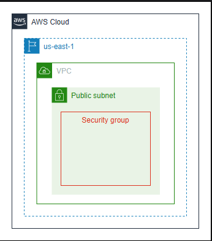

Follow the steps to create a security group:

- On the AWS Management Console, search for “EC2” and click the “EC2” service from the search results. This takes us to the EC2 dashboard.
- In the sidebar, click the “Security Groups” option under the “Network & Security” section.
- Click the “Create security group” button.
- **Basic details:**
  - Enter aws-database-options-security-group as the security group name.
  - Enter Security group for aws database options as the description.
  - Select the default VPC under the “VPC” option.

Our EC2 will host the frontend and backend of the application. The application’s frontend will use port 5173, and the backend will use port 8000. Follow these steps to configure the security group:

> **Note:** The SSH connection will allow us to use “EC2 Instance Connect” on the AWS Management Console, whereas the HTTP connection will allow us to connect to the instance using a browser.

- **Inbound rules:**
  - To allow SSH connections, add the first inbound rule as follows:
    - Click the “Add rule” button under “Inbound rules.”
    - Select SSH as the type.
    - Enter Anywhere-IPv4 as the source.
  - To allow HTTP/TCP connections on port 8000, add the second rule as follows:
    - Click the “Add rule” button under “Inbound rules.”
    - Keep Custom TCP as the type.
    - Enter 8000 as the port range.
    - Enter Anywhere-IPv4 as the source.
  - To allow HTTP/TCP connections on port 5173, add the third rule as follows:
    - Click the “Add rule” button under “Inbound rules.”
    - Keep Custom TCP as the type.
    - Enter 5173 as the port range.
    - Enter Anywhere-IPv4 as the source.
- **Outbound rules:**
  - Keep the existing default rule, as we do not need to change or add any outbound rules.
- **Tags:**
  - Click the “Add new tag” button.
  - Enter Name as the key and aws-database-options-security-group as the value.
- Once you finish the steps above, click the “Create security group” button.

## Launch an EC2 Instance

**Amazon Elastic Compute Cloud (EC2)** provides resizable compute capacity in the cloud. It allows users to run virtual servers, known as instances, for various computing tasks. EC2 offers a secure, flexible, and scalable solution, enabling businesses to easily deploy, manage, and scale applications without investing in physical hardware.

In this task, we’ll create an EC2 instance to host a React web application. We’ll first configure the instance by specifying its AMI, instance type, and storage, attaching the security group we previously created, and then launch it.

In this task, we’ll launch an instance to host a simple web application to which we will connect different databases.

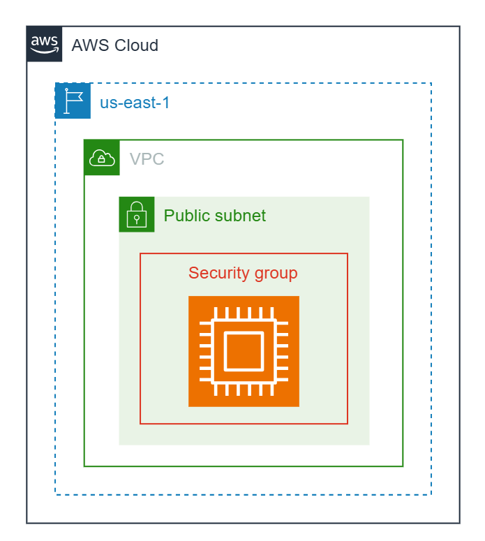

> **Note:** It’s important to keep the region as us-east-1 because access is restricted to resources from other regions.

Follow the steps below to launch an instance:

- On the AWS Management Console, search for “EC2” and click the “EC2” service from the search results. This takes us to the EC2 dashboard.
- From the sidebar, click the “Instances” type under the “Instances” option, and then click the “Launch instances” button.

Now, follow the steps below to configure the instance we’re about to launch:

- Set aws-database-options-lab-instance as the name of the instance.
- We can skip adding additional tags and proceed to the next step.
- In the “Quick Start” section, select the Ubuntu.
- Under the “Amazon Machine Image (AMI)” section, select “Ubuntu Server 24.04 LTS (HVM), SSD Volume Type.”
- Select the 64-bit (x86) architecture.
- For the instance type, select the t2.micro from the list.

> **Note:** Please note that you can only select the t2.micro instance type. You won’t be able to create the EC2 instance otherwise.

- From the “Key pair name” drop-down menu, select the Proceed without a keypair (not recommended) option.
- Under the “Network settings” section, select the “Select existing security group” option.
- From the security groups drop-down menu, select the aws-database-options-security-group that we previously created.
- In the “Configure storage” section, we need to select an 8 GiB Amazon EBS gp3 storage attached to the instance we’re about to launch. We don’t need to add any new storage for this instance.

> **Note:** Please note that you can only add the EBS volume of the gp3 type with a maximum size of 8 GiB. Otherwise, you won’t be able to create the EC2 instance.

- Under the “Advanced details” section:
  - We’ll install the node and the required node packages using user data. Copy the following script and paste it into the “User data” textbox.

```bash
#!/bin/bash
sudo su
apt update
apt -y upgrade
apt -y install mysql-server
curl -sL https://deb.nodesource.com/setup_20.x | sudo -E bash -
sudo apt-get install -y nodejs
sudo apt install npm -y
sudo apt install python3-pip -y
sudo apt install python3-venv -y
apt install git
git clone https://github.com/Educative-Content/DatabaseOptions.git

cd /DatabaseOptions && npm install -g concurrently
cd /DatabaseOptions/socialmedia && npm install
cd /DatabaseOptions && python3 -m venv venv

cd /DatabaseOptions && source venv/bin/activate && pip install fastapi "fastapi[standard]" mysql-connector-python boto3
```

- Review the settings for the new instance before clicking the “Launch instance” button to launch the instance.

Finally, click the “View instances” button to return to the “Instances” page. Wait a few minutes until the “Instance state” of our newly launched instance changes to “Running” before proceeding ahead.

## Create an S3 Bucket

**AWS Simple Storage Service (S3)** is one of the storage services provided by AWS. S3 commonly stores data, including images, web application content, backups, logs, etc. Each S3 bucket has a globally unique name and isn’t publicly accessible by default.

In this lab, we’ll use an S3 bucket to store the media files uploaded to the social media platform. After the completion of this task, the provisioned infrastructure will be as follows:

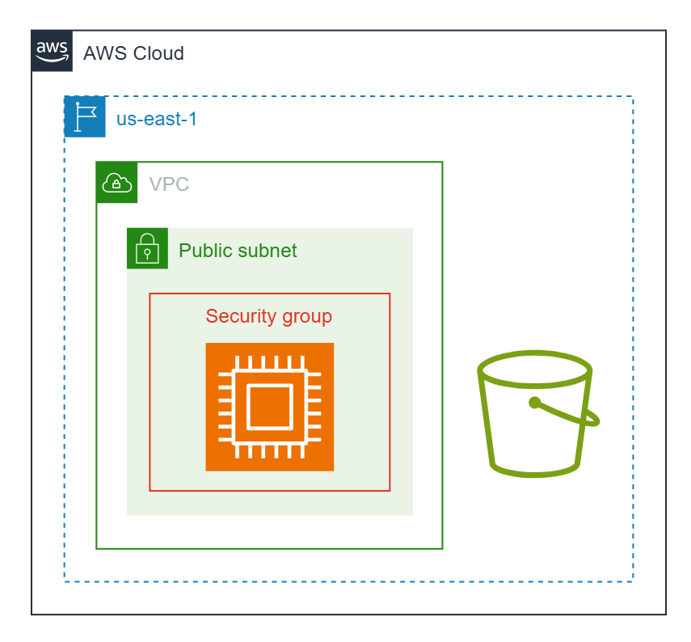

### Create an S3 bucket

Follow the steps below to create an S3 bucket:

- Search “S3” on the AWS Management Console and click “S3” from the search results. This takes us to the S3 dashboard.
- Click the “Create bucket” button.
- Enter a name for the bucket. For this lab, clab-imagestore should be the first letters of the bucket’s name. Append allowed characters with clab-imagestore to make the name globally unique.
- In the “Block Public Access settings for this bucket” section, uncheck the “Block all public access” option.
- Acknowledge the public access warning by checking it.
- Scroll to the end of the page and click the “Create bucket” button. We’ll now be redirected to the S3 buckets page.

We’ve successfully created an S3 bucket. Now, we’ll update the bucket access policy to ensure that the objects in the bucket are accessible to other resources.

### Add a resource-based policy to the bucket

Follow the steps below to create and attach a resource-based policy to the S3 bucket:

- Return to the “Buckets” tab and click your bucket’s name. Click the “Permissions” tab on the bucket page.
- Scroll down and click the “Edit” button in the “Bucket policy” section.
- Copy the policy from the code widget below and paste it into the policy editor window.

```json
{
    "Version": "2012-10-17",
    "Statement": [
        {
            "Sid": "BucketAccess",
            "Action": "s3:GetObject",
            "Effect": "Allow",
            "Resource": "<ARN>/*",
            "Principal": "*"
        }
    ]
}
```

- Replace `<ARN>` in **line 8** with the Amazon Resource Name (ARN) of your bucket. You can find the ARN just above the editor.
- Click the “Save changes” button.

## Create an RDS DB Instance

The basic building block of Amazon RDS is a DB instance. A **DB instance** is a logical database manager environment that can be created and managed using Amazon RDS. It is a virtual machine running a specific database engine dedicated to a particular user or application. Each DB instance can contain the data for one or more databases associated with the specified database engine version and configuration settings.

This task will focus on creating an RDS instance. After completing this task, the provisioned infrastructure will be as follows:


Follow the steps below to create a MySQL DB instance using RDS:

- Use the search bar for “RDS” and select “RDS” from the search results. This redirects you to the Amazon RDS service dashboard.
- Click the “Create database” button and select “Full configuration” from the menu to create a new DB instance.

  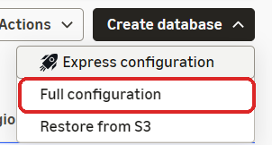

- You’ll have to start by choosing the database creation method. Select the “Full configuration” option, allowing you to customize the instance configurations according to your needs.

  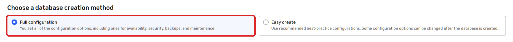

- From the “Engine options” section, select “MySQL” as the database engine, as you’ll work with the MySQL database in this lab.
- In the “Engine version” drop-down menu, keep the default version. In 2026, the default is “MySQL 8.4.11.”

  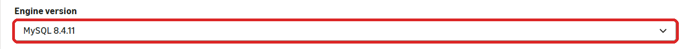

- From the “Templates” section, select the “Dev/Test” option because it’ll allow you to select the deployment options.
- In the “Availability and durability” section, select “Single-AZ DB instance deployment (1 instance)” as the template for the DB instance. This creates a single instance in a single availability zone, whereas the “Multi-AZ DB instance deployment” options create more instances in different availability zones.
- Under the “Settings” section, fill in the information for the DB instance details:
  - Enter aws-dbo-sql as the DB instance identifier.
  - Enter admin as the master username.
  - Select “Self managed” under “Credentials management” and uncheck “Auto generate password.” Enter a password in the “Master password” field that’ll be used for logging in to the database, and rewrite it in the “Confirm master password” field.
- In the “Instance configuration” section, select “Burstable classes (includes t classes)” and then select the db.t4g.small option.

  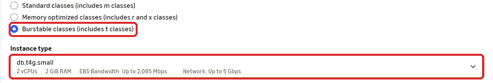

- In the “Storage” section, select General Purpose SSD (gp2) as the “Storage type” and write 20 as the allocated storage.

  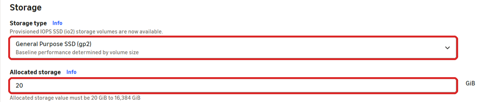

> **Note:** The AWS Academy Learner Lab restricts instance classes and storage. Use exactly db.t4g.small, General Purpose SSD (gp2) and 20 GiB. Other choices can make the database creation fail.

- In the “Connectivity” section, select “Connect to an EC2 compute resource” and choose the “aws-database-options-lab-instance” instance from the EC2 instances drop-down list.
- In the “DB subnet group” section select automatic setup and in the “VPC security group (firewall)” section select “Create new” option.
- In the “New VPC security group name” section set the name to DatabaseSG.
- Keep the “Database authentication” section as they are.
- In the “Monitoring” section, keep “Database Insights - Standard,” expand “Additional monitoring settings” and uncheck the “Enable Enhanced Monitoring” option. Enhanced Monitoring needs a new IAM role, which the Learner Lab cannot create.
- Expand the “Additional configuration” section, and write educative_db in the “Initial database name” field. This is a name that Amazon will give to our database when the DB instance is created. The database will not be created if we don’t name it.
- Make sure the “Enable deletion protection” and the “Enable encryption” options are unchecked. Leave everything else as it is in this section.
- Click the “Create database” button to launch the DB instance. Wait for the instance to be created, which may take a few minutes.
- Click the name of the newly created instance. Copy the endpoint from the “Connectivity & security” section and save it for later use when connecting to this instance.

## Connect to the Database and Create a Table

Now that everything is set up, we’ll look at how to connect to the DB instance using EC2 and create a table to store users and their posts. After completing this task, the provisioned infrastructure will be as follows:


### Connect to the terminal

Follow the steps below to connect to the database:

- On the AWS Management Console, search for “EC2” and select the “EC2” service from the search results.
- Select “Instances” from the left panel, select aws-database-options-lab-instance, and click the “Connect” button.
- On the “Connect to instance” page, under the “EC2 Instance Connect” tab, click the “Connect” button. Don’t change the default username, ubuntu in our case. It’ll open an EC2 instance terminal in a new browser tab.

### Connect to the database

Once the instance is connected, replace `{endpoint}` with the endpoint of the DB instance created earlier in the following command and then execute it to connect to the database:

```bash
mysql -h {endpoint} -P 3306 -u admin -p
```

- You’ll be asked to provide the password you set while creating the DB instance.
- Your database will be connected upon providing the password, and you’ll see a welcome message.
- Execute the following commands to use the educative_db database:

```sql
USE educative_db;
```

### Create the table

Execute the following command to create a table named user_post with two columns: id and username. The id column will be a combination of timestamp of the post and username and is the primary key.

```sql
CREATE TABLE user_post (
    id VARCHAR(255) PRIMARY KEY,
    username VARCHAR(255)
);
```

- Now, execute the exit command to quit the SQL shell.

Now that we have created the database to store the user and post relation, we will configure an Aurora DB to store the user information.

## Create an Aurora DB Instance

**Amazon Aurora** is a relational database that allows us to use features of MySQL and PostgreSQL. It uses the Amazon RDS console interface to manage and administer tasks like patching, repairing, failure, and backup. Aurora DB has a cluster hierarchy to find all the instances under one umbrella, but we will create only one database instance for this lab. We have two versions of Aurora available: one is MySQL compatible, and the other is PostgreSQL compatible.

After completing this task, the provisioned infrastructure will be as follows:


Follow the steps below to create an Aurora DB instance:

- Type “RDS” in the search bar of the AWS Management Console and click the “RDS” service.
- From the left panel, select “Databases,” click the “Create database” button and select “Full configuration” from the menu.
- On the “Create database” page, under the “Choose a database creation method” section, select the “Full configuration” option.
- From the engine options, select “Aurora (MySQL Compatible).”
- Under the “Templates,” select “Dev/Test.”
- Under the “Cluster scalability type” section, select “Provisioned.” Then, under “Type of provisioned configuration,” select “Burstable classes (includes t classes)” and select db.t4g.medium from the drop-down.

  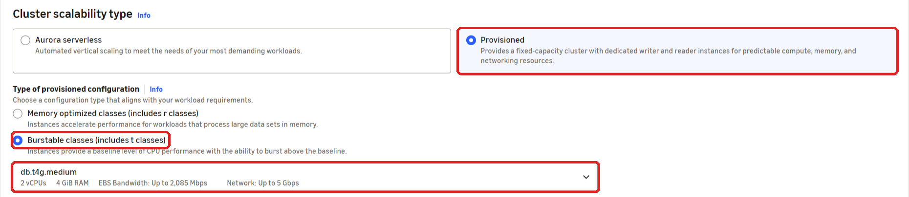

- Under the “Settings” section:
  - Keep the selected default version as the engine version. In 2026, the default is “Aurora MySQL 8.4.12 (compatible with MySQL 8.4.12).”

    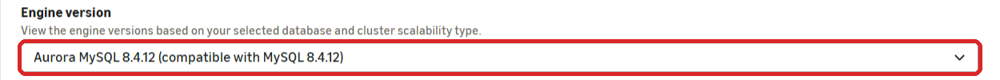

  - Name the Aurora cluster as aws-dbo-aurora. This identifier is used in the cluster’s endpoint.
  - Keep the value for the “Master username” as admin. This master username is used to get access to the database.
  - Select “Self managed” under “Credentials management” and uncheck “Auto generate password.” Enter a password in the “Master password” field that’ll be used for logging in to the database, and rewrite it in the “Confirm master password” field.
- Under the “Cluster storage configuration” section, keep “Aurora Standard” selected.
- Under the “Availability & durability” section, keep the “Don’t create an Aurora Replica” option selected.
- Under the “Connectivity” section:
  - For “Compute resource,” select the “Connect to an EC2 compute resource” option.
  - For “EC2 instance,” select the instance you created earlier.
  - Keep the remaining settings at their default.
- In the “Monitoring” section, keep “Database Insights - Standard,” expand “Additional monitoring settings” and uncheck the “Enable Enhanced Monitoring” option. For Aurora it is checked by default with “Create default role,” and the Learner Lab cannot create that IAM role, so the database creation fails if you leave it checked.
- Expand the “Additional configuration” section, and write educative_db in the “Initial database name” field. This is a name that Amazon will give to our database when the DB instance is created. The database will not be created if we don’t name it.
- Leave the remaining settings at their defaults and click the “Create database” button at the end of the page.

This process will take some time to complete. On the “Databases” dashboard, we’ll see the Aurora cluster. We’ll have to wait until the “Status” column for the cluster and the instance becomes Available. Once the database is ready, click the aws-dbo-aurora option and locate the AuroraDB writer and reader host endpoints in the “Endpoints” section. Be sure to save these, as we will use them later.

## Connect and Test the DB

Now that everything is set up, we’ll look at how to connect to the DB instance using EC2 and create a table to store the user information. After completing this task, the provisioned infrastructure will be as follows:


### Connect to the terminal

Follow the steps below to connect to the EC2 instance.

> **Note:** If the instance terminal that we used in the previous task is available, you can skip this part.

- Write “EC2” in the search bar of the AWS Management Console, and click the “EC2” service.
- Select “Instances” from the left panel, open your instance, and click the “Connect” button.
- On the “Connect to instance” page, under the “EC2 Instance Connect” tab, click the “Connect” button. Don’t change the default username, ubuntu in our case. It’ll open an EC2 instance terminal in a new browser tab.

### Connect to the database

Once the instance is connected, replace `{endpoint}` with the writer host endpoint of the DB instance we created and then execute the command:

```bash
mysql -h {endpoint} -P 3306 -u admin -p
```

- You’ll be asked to provide the password you set up while creating the instance.
- Your database will be connected upon providing the password, and you’ll see a welcome message.
- Execute the following command to use the educative_db database:

```sql
USE educative_db;
```

### Create the table

Execute the following command to create a table named users with three columns: email, password and username. Since, the email for each user should be different, so it is the primary key.

```sql
CREATE TABLE users (
    email VARCHAR(255) PRIMARY KEY,
    username VARCHAR(255),
    password VARCHAR(255)
);
```

- Now, execute the exit command to quit the SQL shell.

Now that we have created the database to store the user’s information, we will configure a DynamoDB to store the posts.

## Create a DynamoDB Table

DynamoDB stores data in tables, which contain datasets as items. In this task, we’ll create a table in DynamoDB. After completing this task, the provisioned infrastructure will be as follows:

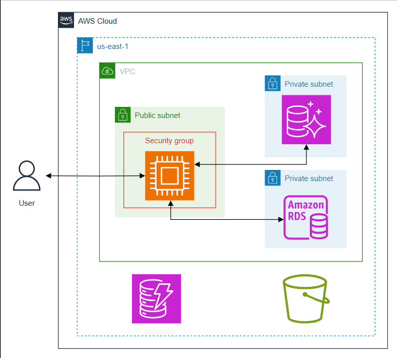

Let’s create a DynamoDB table using the AWS Management Console. Follow the steps below to create the table:

- Use the AWS Management Console search bar to search for “DynamoDB” and select “DynamoDB” from the search results. This redirects you to the DynamoDB dashboard.
- On the DynamoDB dashboard, click the “Create table” button to open the “Create table” page.
- On the “Create table” page, enter the following values:
  - Enter the table name as posts.
  - Add a partition key post_id and set its data type as “String.”
- Let the other settings remain as they are, and click the “Create table” button.

We’ll be redirected to the “Tables” page. Our new “posts” table should be visible in the list with the status “Creating.” This status should change to “Active” in a few seconds.

## Putting It All Together

In this task, we will update the configuration files of our application and start the application. Then, we’ll use the social media application to perform basic actions. After completing this task, the provisioned infrastructure will be as follows:


### Connect to the terminal

Follow the steps below to connect to the database:

- Write “EC2” in the search bar of the AWS Management Console, and click the “EC2” service.
- Select “Instances” from the left panel, open your instance, and click the “Connect” button.
- On the “Connect to instance” page, under the “EC2 Instance Connect” tab, click the “Connect” button. Don’t change the default username, ubuntu in our case. It’ll open an EC2 instance terminal in a new browser tab.

### Configure axiosConfig.js

First, we need to configure the axiosConfig.js file to ensure the backend calls are redirected to the server. Run the following command to put yourself into a root environment:

```bash
sudo su
```

To open the file in edit mode, use the following command:

```bash
sudo nano /DatabaseOptions/socialmedia/src/Pages/axiosConfig.js
```

Replace the `<Your_Instance_PublicIP>` placeholder on **line 3** with the public IP of the EC2 instance. The public IP address of the instance is visible at the bottom of the EC2 instance terminal.

```javascript
import axios from 'axios';
const instance = axios.create({
  baseURL: 'http://<Your_Instance_PublicIP>:8000', // Replace 'publicIP' with your backend's public IP address
});
export default instance;
```

Once the file is updated, you can save the changes by pressing ctrl + s keys and exit the file by pressing ctrl + x keys.

### Update backend.py

We need to update the backend.py file with the correct database configurations to ensure that our application works fine.

- Replace `<Your AuroraDB SQL Writer Host>`, `<Your AuroraDB SQL Reader Host>` with the endpoints we stored earlier, and `<Your AuroraDB SQL Password>` placeholders on **lines 1, 3,** and **6**, respectively, with the configuration of the Aurora DB cluster we set up earlier.
- Replace `<Your RDS SQL host>` and `<Your RDS SQL Password>` placeholders on **lines 11** and **13**, respectively, with the configurations of the RDS database we set up earlier.
- Replace `<Your Access Key>`, `<Your Secret Key>` and `<Your Session Token>` placeholders on **lines 16, 17** and **18**, respectively, with the `aws_access_key_id`, `aws_secret_access_key` and `aws_session_token` values shown under **AWS Details → AWS CLI → Show** in your AWS Academy Learner Lab. These values change every time the lab session restarts, so update them and restart the application when they expire. Do not put them in your report or screenshots.
- Replace the `<Your S3 Bucket Name>` placeholder on **line 21** with the bucket's name we created earlier.

```python
AURORA_WRITER_HOST='<Your AuroraDB SQL Writer Host>'
AURORA_WRITER_PORT='3306'
AURORA_READER_HOST='<Your AuroraDB SQL Reader Host>'
AURORA_USER='admin'
AURORA_READER_PORT='3306'
AURORA_PASSWORD='<Your AuroraDB SQL Password>'
AURORA_DATABASE='educative_db'


SQL_DB='educative_db'
SQL_HOST='<Your RDS SQL host>'
SQL_PORT='3306'
SQL_PASSWORD='<Your RDS SQL Password>'
SQL_USER='admin'

ACCESS_KEY='<Your Access Key>'
SECRET_KEY='<Your Secret Key>'
SESSION_TOKEN='<Your Session Token>'


S3_BUCKET = '<Your S3 Bucket Name>'


from fastapi import FastAPI, Request, Response, HTTPException
from fastapi.responses import JSONResponse
from fastapi.encoders import jsonable_encoder
from pydantic import BaseModel
from typing import Optional
import mysql.connector
from fastapi.middleware.cors import CORSMiddleware

from datetime import datetime
import boto3
from typing import List
app = FastAPI()
origins = ["*"]

app.add_middleware(
    CORSMiddleware,
    allow_origins=origins,
    allow_credentials=True,
    allow_methods=["*"],
    allow_headers=["*"],
)
session = boto3.Session(
    aws_access_key_id=ACCESS_KEY,
    aws_secret_access_key=SECRET_KEY,
    aws_session_token=SESSION_TOKEN,
    region_name='us-east-1'
)
s3 = boto3.client('s3', region_name='us-east-1', aws_access_key_id=ACCESS_KEY, aws_secret_access_key=SECRET_KEY, aws_session_token=SESSION_TOKEN)


# Initialize the DynamoDB resource
dynamodb = session.resource('dynamodb')
table = dynamodb.Table('posts')

class User(BaseModel):
    email: str
    username: str
    password: str

@app.post("/signup")
async def signup(request: Request, response: Response):
    data = await request.json()
    print(data)
    user = User(**data)
    print(user)

    try:
        # Insert the new user into the RDS database
        with mysql.connector.connect(
            user=AURORA_USER, password=AURORA_PASSWORD,
            host=AURORA_WRITER_HOST,
            database=AURORA_DATABASE
        ) as cnx:
            cursor = cnx.cursor()
            query = "INSERT INTO users (email, username, password) VALUES (%s, %s,%s)"
            values = (user.email, user.username, user.password)
            cursor.execute(query, values)
            cnx.commit()
        return JSONResponse(status_code=201, content={"message": "User created successfully"})
    except Exception as e:
        return JSONResponse(status_code=500, content={"message": "Error creating user"})

@app.post("/create_post")
async def addposttodb(request: Request, response: Response):
    data = await request.form()
    print(data)
    title = data.get('title')
    username: str = data.get('name')
    post_content = data.get('content')

    try:
        media = data.get('media')
        print("the media is: ",media)
    except Exception as e:
        print(e)
        media = None

    current_time = datetime.now().strftime('%H:%M:%S')
    id = str(username) + str(current_time)

    try:
        # Insert the new user into the RDS database
        with mysql.connector.connect(
            user=SQL_USER, password=SQL_PASSWORD,
            host=SQL_HOST,
            database=SQL_DB
        ) as cnx:
            cursor = cnx.cursor()
            query = "INSERT INTO user_post (id, username) VALUES (%s,%s)"
            values = (id, username)
            cursor.execute(query, values)
            cnx.commit()
        if media !=None and media !='undefined':
            s3_key = f"posts/{id}/{media.filename}"
            s3.upload_fileobj(media.file, S3_BUCKET, s3_key)
            media_url = f"https://{S3_BUCKET}.s3.{dynamodb.meta.client.meta.region_name}.amazonaws.com/{s3_key}"
            dynamo_response = table.put_item(
                Item={
                    'post_id': id,
                    'title': title,
                    'content': post_content,
                    'media': media_url,
                }
            )
        else:
            dynamo_response = table.put_item(
                Item={
                    'post_id': id,
                    'title': title,
                    'content': post_content,
                }
            )
        print(dynamo_response)

        return JSONResponse(status_code=201, content={"message": f"Post created successfully: {id}"})
    except Exception as e:
        print(e)
        return JSONResponse(status_code=500, content={"message": "Error creating Post"})

@app.get("/get_posts", response_model=List[dict])
async def get_posts(request: Request, response: Response):
    try:
        # Connect to the RDS Aurora SQL database
        cnx = mysql.connector.connect(
            user=SQL_USER, password=SQL_PASSWORD,
            host=SQL_HOST, database=SQL_DB
        )
        cursor = cnx.cursor(dictionary=True)
        cursor.execute("SELECT id, username FROM user_post")
        sql_posts = cursor.fetchall()
        print(sql_posts)
        posts = []
        for sql_post in sql_posts:
            post_id = sql_post['id']
            # Fetch post content from DynamoDB
            response = table.get_item(Key={'post_id': post_id})
            if 'Item' in response:
                post_content = response['Item']
                post_content['username'] = sql_post['username']
                posts.append(post_content)
            else:
                raise HTTPException(status_code=404, detail=f"Post with ID {post_id} not found in DynamoDB")

        return posts
    except Exception as e:
        print(e)
        raise HTTPException(status_code=500, detail="Error fetching posts")
    finally:
        cursor.close()
        cnx.close()
@app.post("/login")
async def login(request: Request, response: Response):
    data = await request.json()
    print(data)
    email = data.get('email')
    password = data.get('password')

    try:
        # Query the user from the RDS database
        cnx = mysql.connector.connect(user=AURORA_USER, password=AURORA_PASSWORD,
                                      host=AURORA_READER_HOST,
                                      database=AURORA_DATABASE)
        cursor = cnx.cursor()
        query = "SELECT * FROM users WHERE email = %s AND password = %s"
        values = (email, password)
        cursor.execute(query, values)
        results = cursor.fetchall()
        cnx.close()
        print ("The results are: ",results)

        if len(results) == 0:
            return JSONResponse(status_code=401, content={"message": "Invalid username or password"})
        else:
            return JSONResponse(status_code=200, content={"message": results[0]}) #"Login successful"
    except Exception as e:
        return JSONResponse(status_code=500, content={"message": "Error logging in user"})
@app.get("/")
def read_root():
    return {"Hello": "World"}

@app.get("/all")
def read_all():
    results = None
    try:
        # Query the user from the RDS database
        cnx = mysql.connector.connect(user=AURORA_USER, password=AURORA_PASSWORD,
                                      host=AURORA_READER_HOST,
                                      database=AURORA_DATABASE)
        cursor = cnx.cursor()
        query = "SELECT * FROM users"
        cursor.execute(query)
        results = cursor.fetchall()
        cnx.close()

        if len(results) == 0:
            return JSONResponse(status_code=401, content={"message": "Invalid"})
        else:
            return JSONResponse(status_code=200, content={"message": results})
    except Exception as e:
        return JSONResponse(status_code=500, content={"message": "Error"})

if __name__ == "__main__":
    import uvicorn
    uvicorn.run(app, host="0.0.0.0", port=8000)
```

Once the changes are done, copy the file, navigate to the EC2 instance terminal, and use the following command to update the contents of the file in the instance:

```bash
cat > /DatabaseOptions/backend.py
```

Now paste the copied code here using cmd + v on Mac or ctrl + v on Windows. Once the code is pasted, press return or enter key on your machine and then press ctrl + c to save the changes.

**In the backend.py file:**

- **Lines 1–7:** Define the connection details for the Aurora SQL database, including the writer and reader hosts, user credentials, and the database name.
- **Lines 10–14:** Define the connection details for an additional SQL database hosted on Amazon RDS.
- **Lines 16–21:** Store AWS credentials and the S3 bucket name for media storage.
- **Lines 24–26:** Import necessary modules from FastAPI, including request and response handling and JSON encoding.
- **Lines 27–34:** Import additional libraries for database connection, CORS handling, date and time, AWS Boto3 for S3 and DynamoDB, and typing.
- **Line 35:** Initialize the FastAPI application.
- **Lines 36–44:** Configure CORS middleware to allow requests from any origin.
- **Lines 45–51:** Initialize a Boto3 session and S3 client using the AWS credentials.
- **Lines 54–56:** Initialize the DynamoDB resource and reference the posts table.
- **Lines 58–61:** Define a model for user data validation.
- **Lines 63–84:** Define the /signup endpoint to handle user registration. We connect to the Aurora SQL database, insert new user details, and return a success or error response based on the outcome.
- **Lines 86–99:** Define the /create_post endpoint to handle post-creation. Also, extract post details and handle optional media file.
- **Lines 101–115:** Connect to the additional SQL database and insert the post metadata.
- **Lines 116–135:** Store media files in S3 (if provided) and post content in DynamoDB.
- **Lines 138–141:** Return a success or error response based on the outcome.
- **Lines 143–173:** Define the /get_posts endpoint to retrieve posts. First, we connect to the SQL database and fetch post metadata. Then, we fetch post content from DynamoDB and combine it with SQL metadata. At last, we return the list of posts or handle errors.
- **Lines 174–199:** Define the /login endpoint to handle user login. First, we connect to the Aurora SQL database, validate user credentials, and return a success or error response based on the outcome.
- **Lines 200–202:** Define a root endpoint returning a simple message.
- **Lines 204–223:** Define an endpoint to fetch all users from the Aurora SQL database.

### Start the application

You can use the following commands to start the application:

```bash
cd /DatabaseOptions && source venv/bin/activate
cd /DatabaseOptions/socialmedia && npm start
```

Once the application runs, you can access the application at `http://<Public_IP_of_EC2>:5173`.

> **Note:** The public IP of the instance is available at the bottom of the EC2 instance terminal page.

You can start using the application once you have signed up using the link provided in the application.

## Wrap Up

Let’s wrap up this lab with a summary of what we have learned.

We started the lab by creating the security group for setting up an EC2 instance. We also created an S3 bucket to store the images posted by the users in the application. Next, we moved on to setting up an RDS instance. We created a DB instance and linked it with our EC2 setup. Then, we connected to the EC2 instance shell and established a node server to connect to the database. We repeated a similar process to link up with Aurora and DynamoDB.

Congratulations on completing this Cloud Lab!

Thank you for following it to the end. We hope this was a fun, interactive, and helpful learning experience. We hope to see you again in another exciting Cloud Lab. From everyone here at Educative, we’re delighted to have you as a valuable member of our learning community.

## Submission

To complete this lab successfully, you will need to take screenshots at specific stages as evidence of your progress. Follow the instructions below to ensure you capture the required screenshots:

### 1. Security Group Creation

- **Where to go**:
  - AWS Management Console > EC2 Dashboard > Security Groups.
- **What to capture**:
  - Screenshot of the newly created security group (aws-database-options-security-group) showing the inbound and outbound rules.
  - Ensure the rules for SSH (port 22), Custom TCP (ports 8000 and 5173) are visible.

### 2. EC2 Instance Launch

- **Where to go**:
  - AWS Management Console > EC2 Dashboard > Instances.
- **What to capture**:
  - Screenshot of the running EC2 instance (aws-database-options-lab-instance).
  - Ensure the instance state shows "Running" and the security group (aws-database-options-security-group) is attached.

### 3. S3 Bucket Creation

- **Where to go**:
  - AWS Management Console > S3 Dashboard.
- **What to capture**:
  - Screenshot of the created S3 bucket (named `clab-imagestore-<unique-suffix>`).
  - Ensure the bucket's public access settings and permissions (bucket policy) are visible.

### 4. RDS DB Instance Creation

- **Where to go**:
  - AWS Management Console > RDS Dashboard > Databases.
- **What to capture**:
  - Screenshot of the RDS instance (aws-dbo-sql) with the status "Available".
  - Ensure the connectivity details (endpoint) are visible.

### 5. Aurora DB Instance Creation

- **Where to go**:
  - AWS Management Console > RDS Dashboard > Databases.
- **What to capture**:
  - Screenshot of the Aurora cluster (aws-dbo-aurora) with the status "Available".
  - Ensure the writer and reader endpoints are visible.

### 6. DynamoDB Table Creation

- **Where to go**:
  - AWS Management Console > DynamoDB Dashboard > Tables.
- **What to capture**:
  - Screenshot of the DynamoDB table (posts) with the status "Active".
  - Ensure the table's partition key (post_id) is visible.

### 7. Application Configuration and Testing

- **Where to go**:
  - EC2 Instance Terminal (after connecting via EC2 Instance Connect).
- **What to capture**:
  - Screenshot of the terminal showing the successful execution of the commands to start the application (e.g., npm start).
  - Screenshot of the application running in your browser at `http://<Public_IP_of_EC2>:5173`.
  - Optional: Screenshot of the application's signup/login page and a sample post creation.

### 8. Final Infrastructure

- **Where to go**:
  - AWS Management Console > EC2, RDS, S3, and DynamoDB dashboards.
- **What to capture**:
  - A collage or series of screenshots showing all the resources created:
    - EC2 instance.
    - Security group.
    - RDS and Aurora databases.
    - DynamoDB table.
    - S3 bucket.

### Submission Guidelines

1. Save all screenshots in a single document (e.g., PDF or Word file).
2. Label each screenshot clearly (e.g., "Security Group Rules" or "Aurora DB Status").
3. Ensure all critical details (resource names, statuses, endpoints, etc.) are visible in the screenshots.
4. Submit the document as instructed by your lab facilitator.

> **Note:** If you encounter any issues or error messages during the lab, include screenshots of those as well for troubleshooting purposes.
