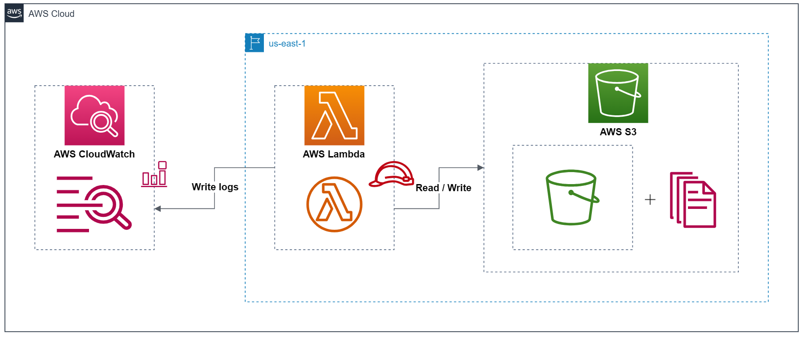
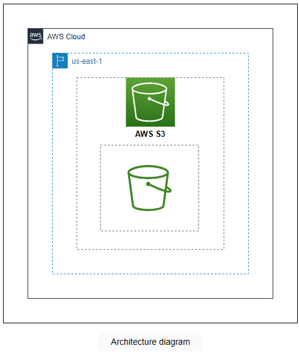
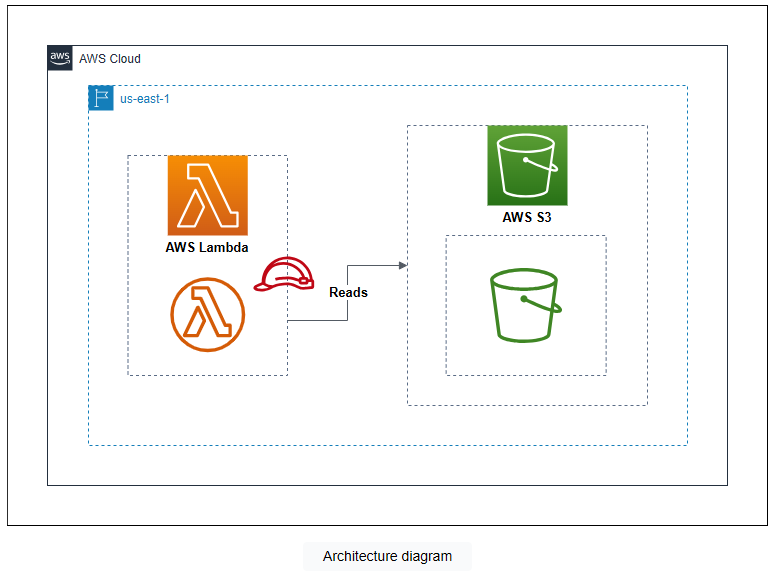
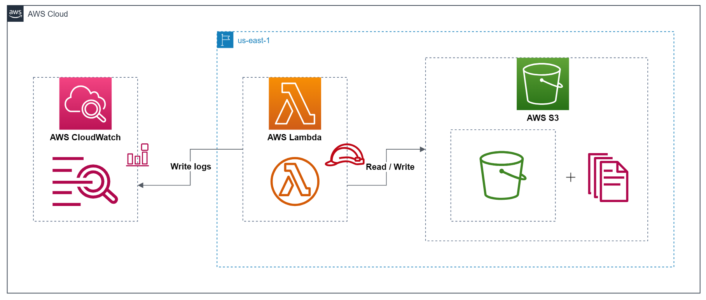

# Cloud Lab 5 — Processing Amazon S3 Events Using AWS Lambda (Hands-on)

| Item | Details |
|---|---|
| Work | Individual, in your own AWS Academy Learner Lab |
| Region | US East (N. Virginia) `us-east-1` |
| Technologies | AWS Lambda, Amazon S3, Amazon CloudWatch, AWS IAM |
| Submit | `cc-lab-YOUR_ID/lab5/` in your GitHub repository `CC-GIC-YOUR_ID`: `README.md`, `lambda_function.py` and 2 screenshots |

> **Overview:** In AWS, a **trigger** is an event that starts the execution of an AWS service or resource. Triggers are used in event-driven architectures to automate actions in response to events. In this lab you set up a trigger that invokes a Lambda function every time an object is added to an S3 bucket. The function moves the object into a folder named after its file type and writes a count of each file type to Amazon CloudWatch Logs.

## Lab Objectives

After this lab, you can:

1. Explain triggers in AWS and use one to invoke a Lambda function.
2. Create a Lambda function with an execution role.
3. Write a Lambda function that manipulates S3 bucket objects.
4. Write and read CloudWatch logs for a Lambda function.

The infrastructure you build in this lab:



## Screenshots in this lab

| File | What it shows |
|---|---|
| `01-s3-organized.png` | The S3 bucket with an uploaded file moved into its type folder (for example a `.png` file in `png/`) |
| `02-cloudwatch-logs.png` | The CloudWatch log events with the function output (for example `We have 1 png file(s).`) and their timestamps |

Every console screenshot must show your Learner Lab user name at the top-right.

## Getting Started

An AWS trigger starts a Lambda function when an event happens in another AWS service. **AWS Lambda** is a serverless compute service: you write and run code without managing the servers underneath. Lambda functions started by triggers can, for example, process files uploaded to an S3 bucket, watch log events in CloudWatch, or process messages from an SQS queue.

General guidelines:

- Work in **`us-east-1`**. Click the Region menu at the top-right next to your user name and select **US East (N. Virginia) us-east-1**.
- Use the **resource names** given in the lab. Other names may not be allowed.
- Your permissions are limited. Some console pages may show *insufficient privileges* messages; you can ignore them.

## Task 1 — Create an S3 Bucket

**Amazon S3** stores and manages data and lets you set who may access it. You create a bucket to hold objects; later, a Lambda function reorganizes the bucket and writes CloudWatch logs every time a new file is uploaded.

1. Search for **S3** and open it. Click **Create bucket**.
2. Name the bucket `my-bucket-<Account ID>`. You see your account ID when you click your user name at the top-right.

   > **Note:** Bucket names are globally unique, because a bucket can be reached by a public URL. Adding your account ID makes the name unique.

3. AWS Region: **US East (N. Virginia) us-east-1**.
4. Leave the other settings, scroll down and click **Create bucket**.
5. Click **View details** in the success message to open the bucket. Keep this tab open.



## Task 2 — Create a Lambda Function

**AWS Lambda** functions run code without servers to deploy or maintain. They are a core part of serverless design and charge only for the compute time used. Lambda supports several languages, including Python, Java, Go and Ruby.

1. Open **Lambda** in a new tab and click **Create function**.
2. Select **Author from scratch**.
3. Under **Basic information**:
   - Function name: `educative-lambda-function`
   - Runtime: **Python 3.12**
   - Architecture: **x86_64**
   - Expand **Change default execution role**: select **Use an existing role**, then **`LabRole`**.
4. Click **Create function**.

The function now has an execution role. Next you write its code: every time a file is uploaded, the function moves it to a folder named after its file type (a `.png` file goes to the folder `png`), then prints the number of files of each type to CloudWatch Logs.

In the **Code** tab, replace the content of `lambda_function.py` with this code:

```python
import os
import boto3

s3 = boto3.client('s3')

def lambda_handler(event, context):
    # Get the S3 bucket name and object key from the event
    s3_bucket = event['Records'][0]['s3']['bucket']['name']
    s3_key = event['Records'][0]['s3']['object']['key']

    # Check the file type
    file_type = os.path.splitext(s3_key)[1][1:].lower()  # get the file extension and convert to lowercase

    # Rename the file to its corresponding folder
    new_s3_key = file_type + '/' + s3_key.split('/')[-1]
    s3.copy_object(
        Bucket=s3_bucket,
        CopySource={'Bucket': s3_bucket, 'Key': s3_key},
        Key=new_s3_key
    )
    s3.delete_object(Bucket=s3_bucket, Key=s3_key)

    # Get the names of each folder with the number of files in them
    folder_names = []
    response = s3.list_objects_v2(Bucket=s3_bucket)
    if 'Contents' in response:
        # Loop through all the objects in the S3 bucket
        for obj in response['Contents']:
            # Skip folders
            if obj['Key'].endswith('/'):
                continue
            # Get the folder name
            folder_name = obj['Key'].split('/')[0]
            if folder_name not in [f[0] for f in folder_names]:
                num_files = sum(
                    1 for _ in s3.list_objects_v2(
                        Bucket=s3_bucket,
                        Prefix=folder_name + '/'
                    )['Contents']
                )
                folder_names.append((folder_name, num_files))

    # Print the count of each type of file
    for folder in folder_names:
        print('We have {} {} file(s).'.format(folder[1], folder[0]))

    return folder_names
```

| Lines | What they do |
|---|---|
| 8–9 | Read the bucket name and the object key from the event |
| 12 | Find the file type from the extension |
| 15–21 | Copy the file into its type folder, then delete the original (S3 has no "move") |
| 24–41 | Build a list of folders with the number of files in each |
| 44–45 | Print the count of each file type; `print` output goes to CloudWatch Logs |
| 47 | Return the list of folders and counts |

Click **Deploy** to deploy the code. Keep a copy of the code: you submit it as `lambda_function.py`.



## Task 3 — Create a Trigger

Common uses of triggers in AWS:

- **S3 bucket events:** notify services or run Lambda functions when an object is created, modified or deleted.
- **CloudWatch events:** respond to events such as an EC2 instance changing state or a failed AWS Batch job.
- **API Gateway:** run a Lambda function in response to an API request.
- **AWS Lambda event sources:** run a function when, for example, a message arrives in an SQS queue or a file is uploaded to S3.
- **AWS Step Functions:** start a workflow when an event happens in another service, such as a new record in a DynamoDB table.

You now create a trigger that invokes your function every time an object is uploaded to your bucket.

1. On the function page, under **Function overview**, click **Add trigger**.
2. Source: **S3**.
3. Bucket: your `my-bucket-<Account ID>` bucket.
4. Event types: unselect **All object create events** and select **PUT**.
5. Leave **Prefix** and **Suffix** empty.
6. Check the acknowledgment for **Recursive invocation**.
7. Click **Add**.

> **Why only PUT?** The function writes to the same bucket that triggers it. An upload is a *PUT* event; the function's `copy_object` is a *Copy* event. Because the trigger listens only to PUT, the function's own copy does not start the function again. With **All object create events**, every copy would trigger a new invocation: an endless loop.

## Task 4 — Test the Trigger

1. Switch to the S3 bucket tab and click **Upload**.
2. Click **Add files**, select one file, and click **Upload**.

   > **Note:** Upload one file at a time, and use a file name without spaces.

3. Click **Close**. Refresh the bucket: the file has moved into a folder named after its type.

Now check the logs:

1. Switch to the Lambda tab, open your function and click the **Monitor** tab.
2. Click **View CloudWatch logs**. The log group of your function opens in a new tab.
3. Under **Log streams**, click the refresh icon and open the newest stream.

   > **Note:** Check the **Last event time** to be sure you are looking at the newest stream. If it is not there yet, wait a few seconds and refresh.

4. The **Log events** page shows the function output.

Upload a few more files of different types, one at a time, and watch the counts change in new log events.

> 📸 **Screenshots:**
> - `01-s3-organized.png`: the bucket showing the type folders, opened on one folder with your uploaded file.
> - `02-cloudwatch-logs.png`: the log events with `We have ... file(s).` lines and their timestamps.

The final infrastructure:



## Clean Up

Take your screenshots **before** you clean up.

**Delete the Lambda function**

1. Open **Lambda → Functions** and select your function.
2. Click **Actions → Delete**, type `delete`, and click **Delete**. Click **Close**.

**Delete the S3 bucket**

1. Open **S3 → Buckets** and select your bucket. Click **Empty**, type `permanently delete`, click **Empty**, then **Exit**.
2. Select the bucket, click **Delete**, type the bucket name, and click **Delete bucket**.

## Wrap Up

You created an S3 bucket and a Lambda function that sorts files into folders by type. The function's role (`LabRole`) gives it access to S3 and lets it write logs to CloudWatch. A trigger invokes the function every time an object is uploaded, and you tested it by uploading files.

# Submission

1. Make the lab folder, copy your 2 screenshots into `images/`, and save the function code as `lambda_function.py`:

   ```bash
   mkdir -p ~/cc-gic-YOUR_ID/cc-lab-YOUR_ID/lab5/images
   ```

2. Copy the [report template](README.md) to `cc-lab-YOUR_ID/lab5/README.md` and fill it in.
3. Check the structure:

   ```text
   cc-lab-YOUR_ID/
   └── lab5/
       ├── README.md
       ├── lambda_function.py
       └── images/
           ├── 01-s3-organized.png
           └── 02-cloudwatch-logs.png
   ```

4. Commit and push:

   ```bash
   cd ~/cc-gic-YOUR_ID
   git add .
   git commit -m "Lab 5: S3 events with Lambda"
   git push
   ```
