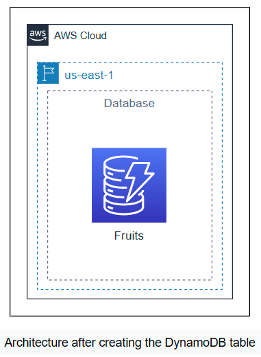
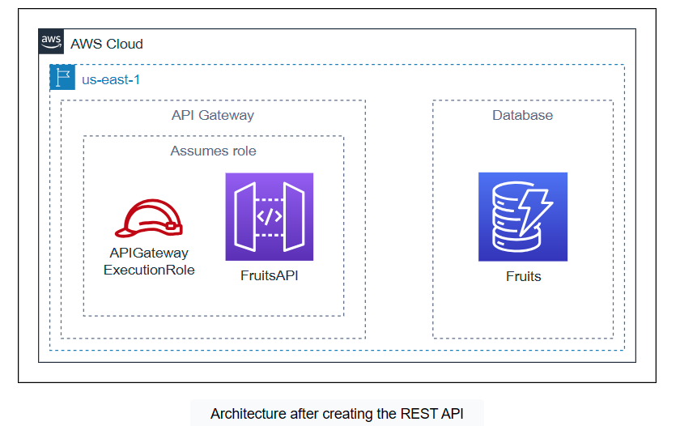
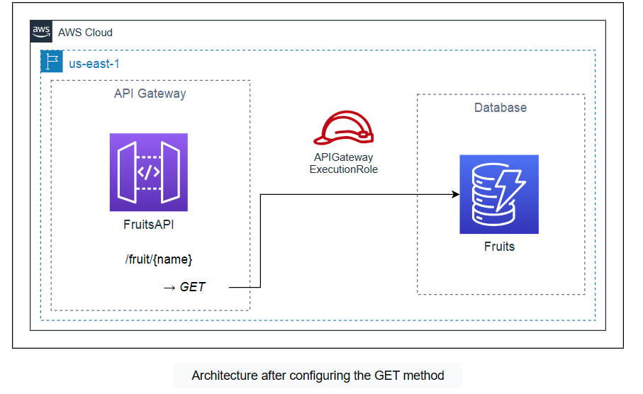
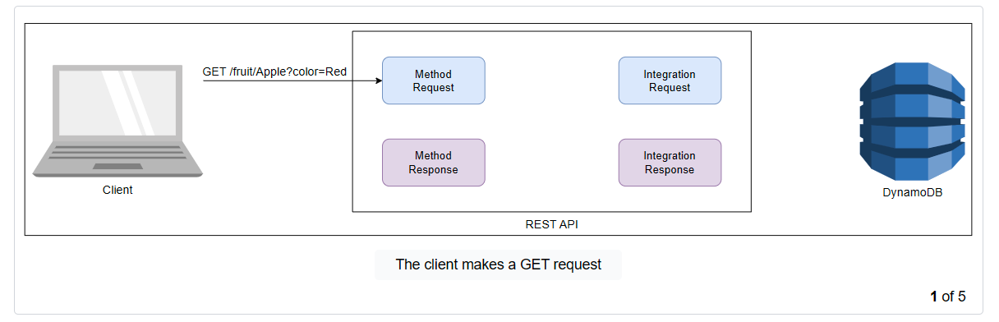
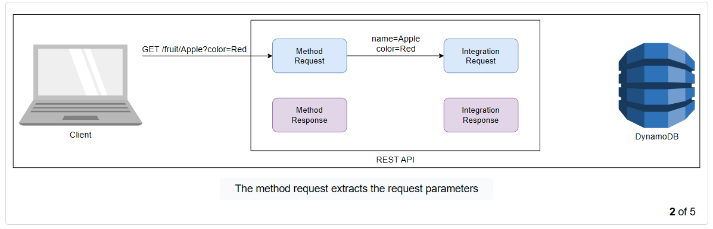
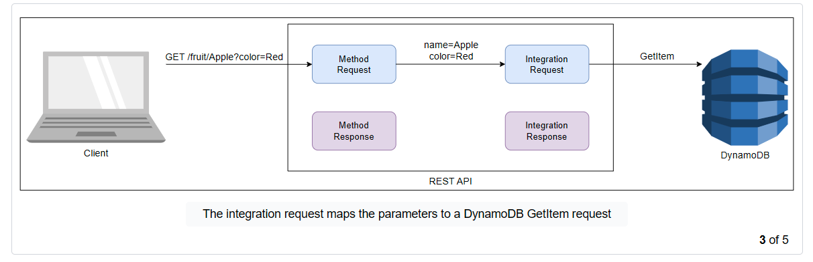
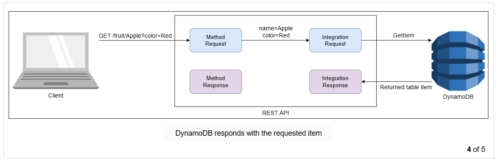
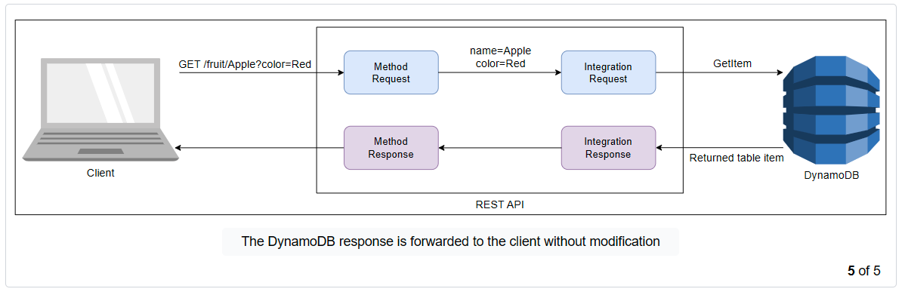
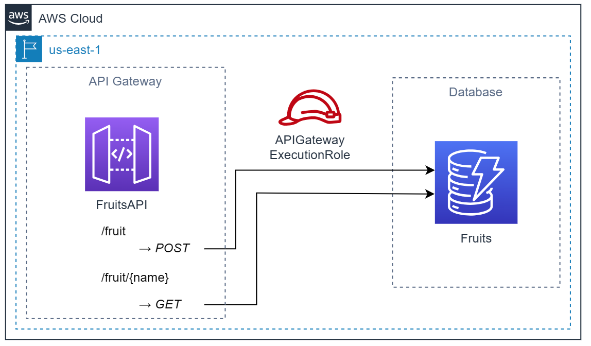
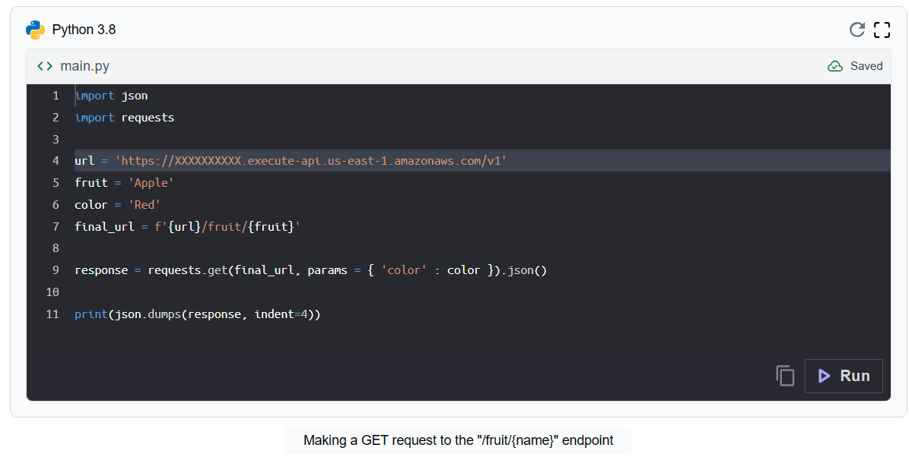

# Cloud Lab 6 — Developing RESTful Microservices with API Gateway and DynamoDB (Hands-on)

| Item | Details |
|---|---|
| Work | Individual, in your own AWS Academy Learner Lab |
| Region | US East (N. Virginia) `us-east-1` |
| Technologies | Amazon API Gateway, Amazon DynamoDB, AWS IAM, AWS CloudShell |
| Submit | `cc-lab-YOUR_ID/lab6/` in your GitHub repository `CC-GIC-YOUR_ID`: `README.md`, three Python scripts and 7 screenshots |

> **Overview:** API Gateway is an AWS service to create, manage and deploy APIs of several types, including HTTP, REST and WebSocket. In this lab you create a REST API with API Gateway and integrate it **directly** with a DynamoDB table, with no server and no Lambda function in between. The API exposes two endpoints:
>
> - `POST /fruit`: add a new fruit record.
> - `GET /fruit/{name}`: fetch the data of one fruit.

## Lab Objectives

After this lab, you can:

1. Create a DynamoDB table with a partition key and a sort key, and add items with the AWS SDK for Python (boto3).
2. Create a REST API with resources, path parameters and query parameters.
3. Integrate API methods directly with DynamoDB actions, using mapping templates and a model.
4. Deploy an API to a stage and call it from Python.

## Screenshots in this lab

| File | What it shows |
|---|---|
| `01-dynamodb-table.png` | The `Fruits` table: name, partition key `Name`, sort key `Color`, status *Active* |
| `02-dynamodb-items.png` | **Explore table items** with your items and their `Name`, `Color` and `Flavor` |
| `03-api-resources.png` | API Gateway **Resources** with `/fruit` (POST) and `/fruit/{name}` (GET) |
| `04-get-mapping-template.png` | The GET method's **Integration request** with the mapping template visible |
| `05-post-request.png` | A successful `POST /fruit` call adding *Grapes*, with the payload visible |
| `06-get-request.png` | A successful `GET /fruit/{name}` call returning a fruit's details |
| `07-stage.png` | The **Stages** page with stage `v1` and its **Invoke URL** |

Every console screenshot must show your Learner Lab user name at the top-right.

## Where to run the Python code

This lab runs three short Python scripts. Run them in **AWS CloudShell**: click the CloudShell icon (`>_`) in the console's top bar. CloudShell already has Python 3, boto3 and your Learner Lab credentials, so **you never type an access key**.

In CloudShell, create a file with `nano FILE.py`, paste the code, save with `Ctrl+O`, `Enter`, and leave with `Ctrl+X`. Run it with `python3 FILE.py`. If `requests` is missing, install it with `pip3 install --user requests`. You submit the three scripts: download each one with **Actions → Download file** in CloudShell.

> ⚠️ **Never write an access key, secret key or session token in a script.** Your scripts go to GitHub, and anyone could use the keys. If you run the scripts on your own computer instead of CloudShell, copy the credentials from **AWS Details → AWS CLI** into `~/.aws/credentials`, where boto3 finds them by itself.

# Part A — The Database

## Task 1 — Create a DynamoDB Table

The API needs a database to store and fetch fruit data. **DynamoDB** is a fully managed NoSQL database service. It also provides an API to read and update tables, which the REST API uses later.

Each item has three attributes, `Name`, `Color` and `Flavor`. `Name` is the **partition key** and `Color` the **sort key**.



### Create the Fruits table

1. Search for **DynamoDB** and open it. Click **Create table**.
2. Table name: `Fruits`.
3. Partition key: `Name`, type **String**. Sort key: `Color`, type **String**.
4. Scroll down and click **Create table**.

You did not define `Flavor`: a DynamoDB table only needs the attributes of its primary key. Other attributes are added with each item.

> 📸 **Screenshot `01-dynamodb-table.png`:** the `Fruits` table details with its keys and status *Active*.

### Populate the table

Wait until the table status is **Active**. Then, in CloudShell, create `populate_table.py` and run it:

```python
import boto3

# Initializing the DynamoDB client
# (credentials come from CloudShell or ~/.aws/credentials, never from this file)
dynamodb = boto3.client('dynamodb', region_name='us-east-1')

# Defining a function to insert items into the table using the put_item method
def insert_fruit(name, color, flavor):
    dynamodb.put_item(
        TableName='Fruits',
        Item={
            'Name': {'S': name},
            'Color': {'S': color},
            'Flavor': {'S': flavor}
        }
    )

# Inserting three items into the table
insert_fruit('Apple', 'Red', 'Sweet')
insert_fruit('Apple', 'Green', 'Sour')
insert_fruit('Lemon', 'Yellow', 'Sour')
print('Table populated successfully.')
```

| Lines | What they do |
|---|---|
| 5 | Create a DynamoDB client in `us-east-1` |
| 8–16 | Define `insert_fruit`, which calls DynamoDB's `put_item` to insert one item into `Fruits` |
| 19–21 | Insert three items |

Two items have the same `Name` but a different `Color`. The primary key is `Name` **and** `Color`, so they are separate items.

Check the items in the console: open the `Fruits` table and click **Explore table items**. The three items appear under **Items returned**.

> 📸 **Screenshot `02-dynamodb-items.png`:** the items with their `Name`, `Color` and `Flavor`.

# Part B — The REST API

## Task 2 — Create a REST API



1. Search for **API Gateway** and open it.
2. Find the **REST API** type and click **Build**.
3. Select **New API**.
4. API name: `FruitsAPI`. API endpoint type: **Regional**.
5. Click **Create API**.

### Configure the resources

**Resources** are like endpoints: each represents a part of the URL. The API needs two: `/fruit` and `/fruit/{name}`.

1. Under **Resources**, click **Create resource**. Resource name: `fruit`. Click **Create resource**.
2. Select the new `/fruit` resource and click **Create resource** again, to create a resource **under** `/fruit`.
3. Resource name: `{name}`. The curly braces make `name` a **path parameter**. Click **Create resource**.

## Task 3 — Configure the GET Method

A `GET` request on `/fruit/{name}` must return the fruit identified by the `{name}` path parameter. The method calls DynamoDB directly, so you also map the request's parameters to the payload DynamoDB expects.



### Find the ARN of LabRole

API Gateway needs a role that allows it to call DynamoDB. Open **IAM → Roles**, search for `LabRole`, open it, and copy its **ARN**. It looks like `arn:aws:iam::123456789012:role/LabRole`.

### Define the GET method

1. Select the `/fruit/{name}` resource and click **Create method**.
2. Method type: **GET**.
3. Integration type: **AWS service**. More options appear.
4. AWS Region: **us-east-1**. AWS service: **DynamoDB**.
5. HTTP method: **POST**. The API's `GET` is translated into a `POST` request to DynamoDB's `GetItem` action.
6. Action name: `GetItem`.
7. Execution role: paste the **ARN of LabRole**.
8. Leave the rest and click **Create method**.

### Add a request parameter

The `{name}` path parameter is already defined by the resource. You add a query parameter for the color.

1. Select the new **GET** method. Open the **Method request** tab and click **Edit**.
2. Expand **URL query string parameters** and click **Add query string**.
3. Name: `color`. Check **Required**.
4. Click **Save**.

### Define the mapping template

When the API receives a GET request, it must send a `GetItem` request to DynamoDB. The data passes through several parts of the API and can be changed on the way:











The format in which the API receives the data is not the format `GetItem` requires. A **mapping template** converts one into the other.

1. Open the GET method's **Integration request** tab and click **Edit**.
2. Expand **URL path parameters** and click **Add path parameter**. Name: `name`. Mapped from: `method.request.path.name`. This passes the `{name}` path parameter of the request to the integration.
3. Expand **URL query string parameters** and click **Add query string parameter**. Name: `color`. Mapped from: `method.request.querystring.color`.
4. Expand **Mapping templates** and click **Add mapping template**. Content type: `application/json`. Template body:

   ```json
   {
       "TableName": "Fruits",
       "Key": {
           "Name": {
               "S": "$input.params('name')"
           },
           "Color": {
               "S": "$input.params('color')"
           }
       }
   }
   ```

5. Click **Save**.

`GetItem` expects JSON with two root properties: `TableName`, the table to query, and `Key`, the primary key of the item to fetch. The function `$input.params()` reads a request parameter (path, query string or header): `$input.params('name')` is the `name` path parameter and `$input.params('color')` the `color` query parameter.

> 📸 **Screenshot `04-get-mapping-template.png`:** the GET method's **Integration request** with the mapping template visible.

## Task 4 — Configure the POST Method

A `POST` request on `/fruit` must add a new item to the table from the data in the request body. As for GET, you integrate directly with DynamoDB and map the body to the payload DynamoDB expects. You also define the expected format of the body.



### Define the POST method

1. Select the `/fruit` resource and click **Create method**.
2. Method type: **POST**. Integration type: **AWS service**.
3. AWS Region: **us-east-1**. AWS service: **DynamoDB**. HTTP method: **POST**.
4. Action name: `PutItem`.
5. Execution role: the **ARN of LabRole**.
6. Click **Create method**.

### Define the model schema

A **model** describes the expected structure of the request body.

1. In the left menu, click **Models**, then **Create model**.
2. Name: `AddFruit`. Content type: `application/json`.
3. Model schema:

   ```json
   {
     "$schema": "http://json-schema.org/draft-04/schema#",
     "title": "AddFruitModel",
     "type": "object",
     "properties": {
       "name": {
         "type": "string"
       },
       "color": {
         "type": "string"
       },
       "flavor": {
         "type": "string"
       }
     }
   }
   ```

4. Click **Create**.

The body is an object with three string properties, `name`, `color` and `flavor`. The schema's root properties:

| Property | Meaning |
|---|---|
| `$schema` | The version of JSON Schema used |
| `title` | A name for the model |
| `type` | The body is an object |
| `properties` | The names and types of the body's properties |

### Use the model for the request body

1. Click **Resources**, then the **POST** method under `/fruit`.
2. Open **Method request** and click **Edit**.
3. Expand **Request body** and click **Add model**. Content type: `application/json`. Model: `AddFruit`.
4. Click **Save**.

### Define the mapping template

1. Open the POST method's **Integration request** tab and click **Edit**.
2. Expand **Mapping templates** and click **Add mapping template**. Content type: `application/json`. Template body:

   ```text
   #set($inputRoot = $input.path('$'))
   {
       "TableName": "Fruits",
       "Item": {
           "Name": {"S": "$inputRoot.name"},
           "Color": {"S": "$inputRoot.color"},
           "Flavor": {"S": "$inputRoot.flavor"}
       }
   }
   ```

3. Click **Save**.

`PutItem` expects JSON with `TableName`, the table, and `Item`, the new item as key-value pairs. `$input.path('$')` returns the request body as JSON; the template stores it in `$inputRoot` and reads each property from it.

> 📸 **Screenshot `03-api-resources.png`:** the **Resources** tree showing `/fruit` with **POST** and `/fruit/{name}` with **GET**.

# Part C — Deploy and Test

## Task 5 — Deploy the API

1. Under **Resources**, select `/` and click **Deploy API**.
2. Stage: **\*New stage\***. Stage name: `v1`.
3. Click **Deploy**.

The **Stages** page opens and shows the API's **Invoke URL**.



> 📸 **Screenshot `07-stage.png`:** the **Stages** page with stage `v1` and its Invoke URL.

> **Note:** If you change a method after deploying, click **Deploy API** again, to stage `v1`. The changes are not live until you deploy.

## Task 6 — Invoke the API

### GET /fruit/{name}

Create `get_fruit.py` in CloudShell. Replace the URL on line 4 with **your** Invoke URL:

```python
import json
import requests

url = 'https://XXXXXXXXXX.execute-api.us-east-1.amazonaws.com/v1'
fruit = 'Apple'
color = 'Red'
final_url = f'{url}/fruit/{fruit}'

response = requests.get(final_url, params={'color': color}).json()

print(json.dumps(response, indent=4))
```

The script calls `GET /fruit/Apple?color=Red`. The API answers with the whole item as it is stored in DynamoDB.

> 📸 **Screenshot `06-get-request.png`:** the CloudShell terminal with `python3 get_fruit.py` and the item it returned.

### POST /fruit

Create `add_fruit.py`, again with your Invoke URL on line 4:

```python
import json
import requests

url = 'https://XXXXXXXXXX.execute-api.us-east-1.amazonaws.com/v1'
new_fruit = {
    'name': 'Grapes',
    'color': 'Green',
    'flavor': 'Sour'
}
final_url = f'{url}/fruit'

response = requests.post(final_url, json=new_fruit).json()
print(json.dumps(response, indent=4))

final_url = f'{url}/fruit/Grapes'
response = requests.get(final_url, params={'color': 'Green'}).json()
print(json.dumps(response, indent=4))
```

The script sends a `POST` with the new item in the body, then a `GET` to fetch the fruit it just added.

> 📸 **Screenshot `05-post-request.png`:** the terminal with `python3 add_fruit.py`, the payload in the script, and both responses. You may use Postman or `curl` instead, as long as the payload and the response are visible.

## Clean Up

Take all screenshots **before** you clean up. Delete in the reverse order of creation.

**Delete the REST API**

1. Open **API Gateway → APIs** and select `FruitsAPI`.
2. Click **Delete**, type `confirm`, and click **Delete**.

**Delete the table**

1. Open **DynamoDB → Tables** and select `Fruits`.
2. Click **Delete**, type `confirm`, and click **Delete**.

# Submission

1. Make the lab folder, copy your 7 screenshots into `images/` and the three scripts next to `README.md`:

   ```bash
   mkdir -p ~/cc-gic-YOUR_ID/cc-lab-YOUR_ID/lab6/images
   ```

2. Copy the [report template](README.md) to `cc-lab-YOUR_ID/lab6/README.md` and fill it in.
3. Check the structure, and check that **no script contains a key**:

   ```text
   cc-lab-YOUR_ID/
   └── lab6/
       ├── README.md
       ├── populate_table.py
       ├── get_fruit.py
       ├── add_fruit.py
       └── images/
           ├── 01-dynamodb-table.png
           ├── 02-dynamodb-items.png
           ├── 03-api-resources.png
           ├── 04-get-mapping-template.png
           ├── 05-post-request.png
           ├── 06-get-request.png
           └── 07-stage.png
   ```

4. Commit and push:

   ```bash
   cd ~/cc-gic-YOUR_ID
   git add .
   git commit -m "Lab 6: REST API with API Gateway and DynamoDB"
   git push
   ```
