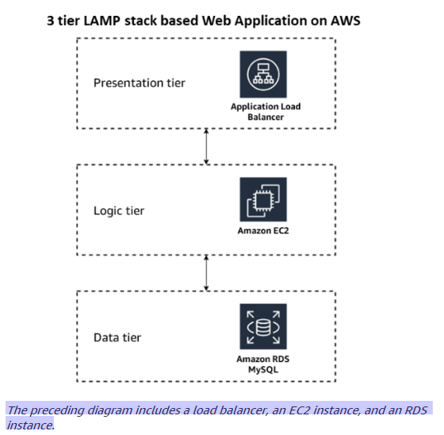
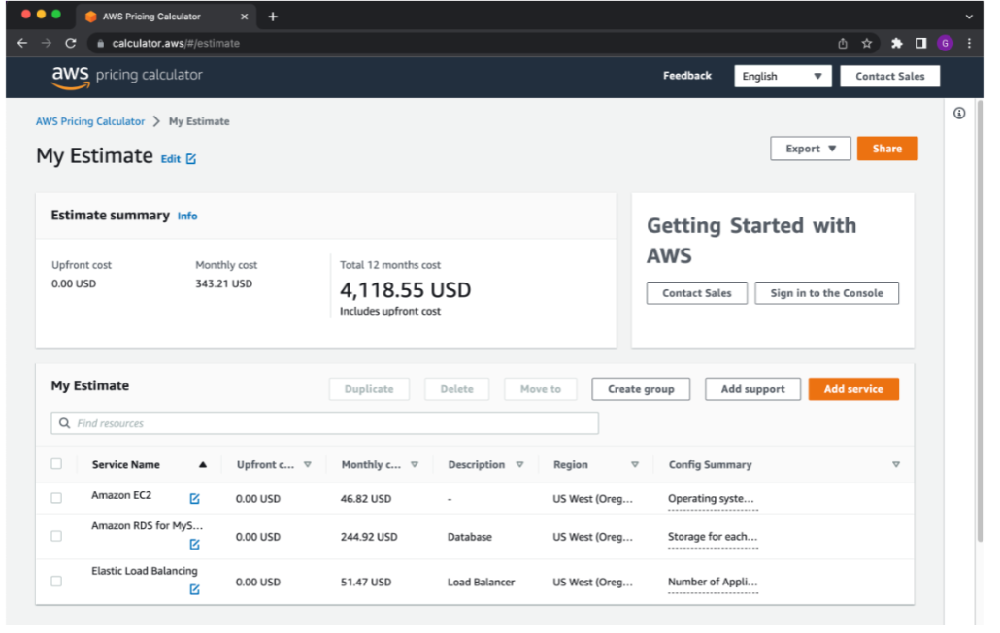

# Cloud Lab 8 — Getting Started with Cost Estimation (Hands-on)

| Item | Details |
|---|---|
| Work | Individual. No AWS account is needed: AWS Pricing Calculator is a public web page |
| Tool | [AWS Pricing Calculator](https://calculator.aws/#/) |
| Submit | `cc-lab-YOUR_ID/lab8/` in your GitHub repository `CC-GIC-YOUR_ID`: `README.md`, your exported CSV file, your public estimate link, and 6 screenshots |

> **Overview:** This lab shows you how to estimate the AWS cost of a workload before you deploy it. The workload is a **three-tier web application**: an Application Load Balancer, an Amazon EC2 instance, and an Amazon RDS database instance. You use AWS Pricing Calculator to build the estimate, export it, and share it.



## Lab Objectives

After this lab, you can:

1. Estimate AWS costs with AWS Pricing Calculator.
2. Configure the services of a three-tier architecture in an estimate.
3. Export an estimate to CSV and share it with a public link.

## Screenshots in this lab

| File | What it shows |
|---|---|
| `01-services-added.png` | **My Estimate** with Elastic Load Balancing, Amazon EC2 and Amazon RDS for MySQL all visible |
| `02-load-balancer.png` | The Elastic Load Balancing configuration: Region **US West (Oregon)**, Application Load Balancer, and the LCU section |
| `03-ec2.png` | The EC2 configuration: **t4g.small**, **On-Demand**, **Daily spike traffic**, **gp3 – 30 GB** |
| `04-summary.png` | **View summary** with the total estimated cost and the cost of ALB, EC2 and RDS |
| `05-csv-export.png` | **Export → CSV** with the export confirmation dialog, and the downloaded `.csv` file on your computer |
| `06-share-link.png` | The **Share** dialog with the message that the estimate is saved, and the public link |

## Task 1 — Launch AWS Pricing Calculator

1. Open a new browser tab.
2. Go to **https://calculator.aws/#/**.
3. Choose **Create estimate**.

## Task 2 — Add and Configure Services

You add the three services of the web application to the estimate.

### Task 2.1 — Elastic Load Balancing (Application Load Balancer)

1. On the **Select service** page, search for **Elastic Load Balancing** and choose **Configure**.
2. Description settings:
   - Description: `LoadBalancer`
   - Location type: **Region**
   - Region: **US West (Oregon)**
3. Turn on **Application Load Balancer**, and choose **Load Balancer in AWS Region**.
4. Number of Application Load Balancers: **1**.
5. **Load Balancer Capacity Units (LCUs)**. These values simulate the application's expected traffic:
   - Processed bytes (Lambda targets): skip
   - Processed bytes (EC2 targets): **0.36 GB per hour**
   - New connections: **100 per second**
   - Average connection duration: **3 minutes**
   - Requests per second: **400**
   - Rule evaluations per request: **20**
6. Click **Save and add service**.

> 📸 **Screenshot `02-load-balancer.png`:** take it before you save, or open the service again with the edit icon.

### Task 2.2 — Amazon EC2

1. Search for **EC2** and choose **Configure**.
2. Description settings:
   - Description: `EC2`
   - Location type: **Region**
   - Region: **US West (Oregon)**
3. Operating system: **Linux**.
4. Workload: choose **Daily spike traffic**.
   - Workload days: **Monday – Friday**
   - Baseline: **1** instance
   - Peak: **2** instances
   - Peak duration: keep the default

   The application normally runs on 1 instance and scales to 2 at peak time.
5. Instance type: **t4g.small**.
6. Pricing strategy: **On-Demand**.
7. Amazon EBS storage:
   - Volume type: **General Purpose SSD (gp3)**
   - Storage size: **30 GB**
   - Keep the default IOPS and throughput
8. Data transfer:
   - Inbound: **Internet (free)**, **50 GB per month**
   - Outbound: **Internet**, **200 GB per month**
9. Click **Save and add service**.

> 📸 **Screenshot `03-ec2.png`:** the EC2 configuration with the instance type, pricing model, workload and storage visible.

### Task 2.3 — Amazon RDS for MySQL

1. Search for **RDS** and choose **Configure** under **Amazon RDS for MySQL**.
2. Description settings:
   - Description: `Database`
   - Location type: **Region**
   - Region: **US West (Oregon)**
3. Database configuration:
   - Quantity: **1**
   - Instance type: **db.m6g.large**
   - Deployment option: **Multi-AZ**
   - Pricing model: keep the default
4. Storage:
   - Storage type: **General Purpose SSD (gp2)**
   - Storage amount: **100 GB**
   - Skip **RDS Proxy**, **Backup Storage** and **Snapshot Export**.
5. Click **Save and add service**.

> 📸 **Screenshot `01-services-added.png`:** **My Estimate** with all three services.

## Task 3 — Review and Download the Estimate

1. Click **View summary** and review the costs. AWS Pricing Calculator gives the cost of the first 12 months. You can edit or delete a service with the icons next to its name.

   > ⚠️ Prices change over time, so your numbers may differ from your classmates' if you do the lab on another day.

   

   > 📸 **Screenshot `04-summary.png`:** the summary with the total and the cost of each service.

2. Choose **Export → CSV**, click **OK**, and save the file to your computer. A CSV file opens in Excel or Google Sheets.

   > 📸 **Screenshot `05-csv-export.png`:** the export dialog and the downloaded `.csv` file.

## Task 4 — Save and Share the Estimate

1. Click **Share**, then **Agree and continue**.
2. Click **Copy public link**. You could send this link by email or a messaging app.

When you share an estimate, AWS Pricing Calculator saves it automatically and creates a URL for it. The saved estimate is kept for **3 years**.

> 📸 **Screenshot `06-share-link.png`:** the Share dialog with the saved message and the public link.

## Summary

You built a cost estimate with AWS Pricing Calculator: you added the components of a three-tier web application, set the size of each service, reviewed the yearly cost, exported it and shared a link to it. Estimating the cost of an architecture before you deploy it helps you control AWS costs and avoid unexpected or high monthly bills.

# Submission

1. Make the lab folder and copy your 6 screenshots into `images/`. Copy the exported CSV file into `lab8/` and rename it `estimate.csv`:

   ```bash
   mkdir -p ~/cc-gic-YOUR_ID/cc-lab-YOUR_ID/lab8/images
   ```

2. Copy the [report template](README.md) to `cc-lab-YOUR_ID/lab8/README.md`, fill it in, and **paste your public estimate link** in it.
3. Check the structure:

   ```text
   cc-lab-YOUR_ID/
   └── lab8/
       ├── README.md          # includes your public estimate link
       ├── estimate.csv
       └── images/
           ├── 01-services-added.png
           ├── 02-load-balancer.png
           ├── 03-ec2.png
           ├── 04-summary.png
           ├── 05-csv-export.png
           └── 06-share-link.png
   ```

4. Commit and push:

   ```bash
   cd ~/cc-gic-YOUR_ID
   git add .
   git commit -m "Lab 8: cost estimation"
   git push
   ```
