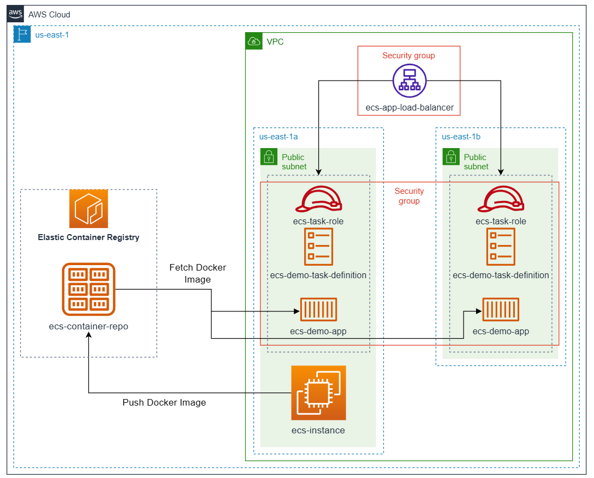

# Cloud Lab 9 — Getting Started with Amazon ECS (Hands-on)

| Item | Details |
|---|---|
| Work | Individual, in your own AWS Academy Learner Lab |
| Region | US East (N. Virginia) `us-east-1` |
| Technologies | Amazon ECR, Amazon ECS (AWS Fargate), Docker, Application Load Balancer, AWS Cloud9 |
| Submit | `cc-lab-YOUR_ID/lab9/` in your GitHub repository `CC-GIC-YOUR_ID`: `README.md`, `app/app.py`, `app/Dockerfile` and 6 screenshots |

> **Overview:** Amazon Elastic Container Service (ECS) is a fully managed container orchestration service. It deploys, manages and scales containerized applications on AWS, running Docker containers on EC2 instances or on AWS Fargate without you managing the servers. In this lab you write a small web application, build it into a Docker image, push the image to a private **Amazon ECR** repository, and run it as an **ECS service** on Fargate behind an **Application Load Balancer**, in two Availability Zones.

The infrastructure you build in this lab:



## Lab Objectives

After this lab, you can:

1. Create a private ECR repository, build a Docker image and push it to the repository.
2. Create security groups that let only the load balancer reach the containers.
3. Create an Application Load Balancer with an IP target group for Fargate.
4. Create an ECS cluster, a task definition and a service that runs two tasks behind the load balancer.
5. Check that traffic is spread across two Availability Zones.

## Screenshots in this lab

| File | Phase | What it shows |
|---|---|---|
| `01-ecr-image.png` | 2 | ECR repository `ecs-container-repo` with the `latest` image, your account ID in the URI, and the *Pushed at* time |
| `02-target-health.png` | 6 | Target group `ecs-target-group` → **Targets**: 2 IP addresses, port 5000, *Healthy* |
| `03-ecs-service.png` | 6 | Cluster `ecs-demo-cluster` → **Services**: `ecs-demo-service`, desired 2, running 2 |
| `04-load-balancer.png` | 6 | Load balancer `ecs-demo-alb` with its **DNS name** and security group `alb-sg` |
| `05-app-zone-a.png` | 7 | Browser with the ALB address and *Current Availability Zone: us-east-1a* |
| `06-app-zone-b.png` | 7 | Browser with the ALB address and *Current Availability Zone: us-east-1b* |

Every console screenshot must show your Learner Lab user name at the top-right.

## Prerequisites

- **Region:** work in **us-east-1** (N. Virginia).
- **IAM role:** you cannot create roles in the Learner Lab. ECS uses the existing role **`LabRole`**.
- **Credentials:** keep the Learner Lab's **AWS Details → AWS CLI** credentials at hand in case your terminal asks for them. Never save them in a file you commit.

# Phase 1 — Set Up the Development Environment (Cloud9)

You build the Docker image in **AWS Cloud9**, a cloud IDE with a terminal and Docker already installed.

1. Search for **Cloud9** in the console and click **Create environment**.
2. Name: `ecs-demo-ide`.
3. Instance type: **t2.micro** or **t3.micro**.
4. Platform: **Amazon Linux 2023**.
5. Network settings: **Secure Shell (SSH)**.
6. Click **Create**.
7. When the environment is ready, click **Open** in the **Cloud9 IDE** column. You see a file tree on the left and a terminal at the bottom.

> **If Cloud9 is not available in your account,** use an EC2 instance as the build machine (the *ecs-instance* in the diagram): launch an **Amazon Linux 2023** `t2.micro` instance in `us-east-1a` with a public IP and the IAM instance profile **`LabInstanceProfile`**, connect with **EC2 Instance Connect**, and install Docker:
>
> ```bash
> sudo dnf install -y docker
> sudo systemctl start docker
> sudo usermod -aG docker ec2-user
> ```
>
> Disconnect and connect again so the group change applies. Create the files of Phase 2 with `nano`. Terminate this instance in the Clean Up.

# Phase 2 — Create the App and Push It to ECR

Diagram: *Elastic Container Registry* and *Push Docker Image*.

## Step 1 — Create the ECR repository

1. In a new console tab, open **Amazon ECR** and click **Create repository**.
2. Visibility: **Private**. Name: `ecs-container-repo`.
3. Click **Create repository**.
4. Copy the repository **URI**, for example `123456789012.dkr.ecr.us-east-1.amazonaws.com/ecs-container-repo`. You need it several times.

## Step 2 — Write the application

In your Cloud9 IDE:

1. Right-click the folder in the file tree → **New File**, name it `app.py`, open it and paste:

   ```python
   from flask import Flask
   import requests
   import os

   app = Flask(__name__)

   def get_az():
       # ECS Task Metadata URI is automatically provided by AWS in the container
       metadata_url = os.environ.get('ECS_CONTAINER_METADATA_URI_V4')
       if metadata_url:
           try:
               # Query the task metadata endpoint
               response = requests.get(f"{metadata_url}/task")
               data = response.json()
               return data.get('AvailabilityZone', 'Unknown AZ')
           except Exception as e:
               return f"Error fetching AZ: {str(e)}"
       return "Not running in ECS (Local/Cloud9)"

   @app.route('/')
   def hello():
       az = get_az()
       return f"""
       <h1>Hello from ECS Demo App!</h1>
       <p><b>Current Availability Zone:</b> {az}</p>
       <p>Refresh the page to see if the Load Balancer switches you to another zone!</p>
       """

   if __name__ == '__main__':
       app.run(host='0.0.0.0', port=5000)
   ```

   Inside an ECS task, AWS sets the variable `ECS_CONTAINER_METADATA_URI_V4`. The app asks this metadata endpoint which Availability Zone the task runs in, and shows it on the page.

2. Create a new file named `Dockerfile` (capital *D*, no extension) and paste:

   ```dockerfile
   FROM python:3.9-slim
   WORKDIR /app
   COPY . .
   RUN pip install flask requests
   EXPOSE 5000
   CMD ["python", "app.py"]
   ```

   The image installs both libraries the app imports, `flask` and `requests`, and starts the app on port 5000.

Keep a copy of both files: you submit them.

## Step 3 — Build and push the Docker image

In the Cloud9 terminal, replace `<YOUR_ECR_URI>` with the URI you copied (without a `:latest` tag):

1. Log in to ECR:

   ```bash
   aws ecr get-login-password --region us-east-1 | docker login --username AWS --password-stdin <YOUR_ECR_URI>
   ```

2. Build the image:

   ```bash
   docker build -t ecs-container-repo .
   ```

3. Tag the image:

   ```bash
   docker tag ecs-container-repo:latest <YOUR_ECR_URI>:latest
   ```

4. Push it to ECR:

   ```bash
   docker push <YOUR_ECR_URI>:latest
   ```

> 📸 **Screenshot `01-ecr-image.png`:** *Amazon ECR → Repositories → ecs-container-repo* with the `latest` image, the URI (with your account ID) and the *Pushed at* time.

# Phase 3 — Security Groups

Diagram: the two *Security group* boxes.

Open **EC2 → Security Groups**.

1. **Load balancer security group:**
   - Name: `alb-sg`
   - Description: `Allow HTTP access from internet`
   - VPC: the **default VPC**
   - Inbound rule: **HTTP**, port 80, source **Anywhere-IPv4** (`0.0.0.0/0`)
   - Click **Create security group**.
2. **ECS task security group:**
   - Name: `ecs-task-sg`
   - Description: `Allow traffic from ALB only`
   - VPC: the **default VPC**
   - Inbound rule: **Custom TCP**, port **5000**, source **Custom** → select the ID of **`alb-sg`**
   - Click **Create security group**.

The containers accept traffic only from the load balancer, never directly from the internet.

# Phase 4 — Load Balancer (ALB)

Diagram: *ecs-app-load-balancer*.

1. Open **EC2 → Load Balancers → Create load balancer** and choose **Application Load Balancer**.
2. Name: `ecs-demo-alb`. Scheme: **Internet-facing**.
3. Network mapping: the default VPC, and **two subnets**: **us-east-1a** and **us-east-1b**.
4. Security groups: remove the default one and select `alb-sg`.
5. Listeners and routing: protocol **HTTP**, port **80**. Click **Create target group** (it opens a new tab):
   - Target type: **IP addresses**. Fargate tasks register by IP address, not by instance.
   - Name: `ecs-target-group`
   - Protocol **HTTP**, port **5000**
   - Health check path: `/`
   - Click **Next**. Do not register targets: ECS does this.
   - Click **Create target group**.
6. Back in the load balancer tab, refresh the target group list and select `ecs-target-group`.
7. Click **Create load balancer**.

# Phase 5 — ECS Cluster and Task Definition

Diagram: *ECS Cluster* and *Task Definition*.

## Step 1 — Create the cluster

1. Open **Amazon ECS → Clusters → Create cluster**.
2. Cluster name: `ecs-demo-cluster`.
3. Infrastructure: **AWS Fargate (serverless)**.
4. Click **Create**.

## Step 2 — Create the task definition

A **task definition** describes the containers of a task: the image, CPU and memory, ports and roles.

1. In the left menu, click **Task definitions → Create new task definition**.
2. Task definition family: `ecs-demo-task`.
3. Launch type: **AWS Fargate**. OS, Architecture: **Linux/X86_64**.
4. Task size: **0.5 vCPU**, **1 GB** memory.
5. Task role and task execution role: **`LabRole`** for both. The execution role lets ECS pull the image from ECR.
6. Container 1:
   - Name: `ecs-demo-container`
   - Image URI: `<YOUR_ECR_URI>:latest`
   - Container port: **5000**, protocol **TCP**
7. Click **Create**.

# Phase 6 — Deploy the Service

Diagram: the two *ecs-demo-app* boxes.

An ECS **service** keeps a number of tasks running and registers them with the load balancer.

1. Open **Clusters → `ecs-demo-cluster`**. In the **Services** tab, click **Create**.
2. Compute configuration: **Launch type → FARGATE**.
3. Deployment configuration: application type **Service**. Family: `ecs-demo-task`, revision **LATEST**.
4. Service name: `ecs-demo-service`. Desired tasks: **2**.
5. **Networking:**
   - VPC: the default VPC
   - Subnets: **us-east-1a** and **us-east-1b**
   - Security group: **Use an existing security group** → `ecs-task-sg` (remove the default one)
   - Public IP: **turned on**. The tasks need it to reach ECR and pull the image.
6. **Load balancing:**
   - Load balancer type: **Application Load Balancer**
   - Container: `ecs-demo-container 5000:5000`
   - Load balancer: **Use an existing load balancer** → `ecs-demo-alb`
   - Listener: **Use an existing listener** → `80:HTTP`
   - Target group: **Use an existing target group** → `ecs-target-group`
7. Click **Create**.

Wait 2 to 3 minutes for the two tasks to start and pass their health checks.

> 📸 **Screenshots:**
> - `02-target-health.png`: *EC2 → Target Groups → ecs-target-group → Targets*: two IP addresses on port 5000, both *Healthy*.
> - `03-ecs-service.png`: *ECS → Clusters → ecs-demo-cluster → Services*: `ecs-demo-service` with 2 desired and 2 running tasks.
> - `04-load-balancer.png`: *EC2 → Load Balancers → ecs-demo-alb*: the DNS name and the security group `alb-sg`.

# Phase 7 — Verify and Clean Up

## Verify

1. Open **EC2 → Load Balancers** and copy the **DNS name** of `ecs-demo-alb` (for example `ecs-demo-alb-xxxx.us-east-1.elb.amazonaws.com`).
2. Open it in your browser with `http://`.
3. You see **"Hello from ECS Demo App!"** and the Availability Zone of the task that answered.
4. Refresh, or use a private window or another browser, until the zone changes from `us-east-1a` to `us-east-1b` or the reverse. The load balancer spreads requests over the two tasks in the two subnets.

> 📸 **Screenshots:** `05-app-zone-a.png` and `06-app-zone-b.png`: the whole browser window, with the ALB address in the address bar, showing the two zones.

## Clean up

Take all screenshots **before** you clean up. Do not skip this: a running service and load balancer use your budget.

1. **ECS:** open the service, click **Delete service** (with **Force delete**), then delete the cluster `ecs-demo-cluster`.
2. **Load balancer:** delete `ecs-demo-alb`, then the target group `ecs-target-group`.
3. **Cloud9:** delete the environment `ecs-demo-ide` (this terminates its EC2 instance). If you used an EC2 build instance instead, terminate it.
4. **ECR:** delete the repository `ecs-container-repo`.
5. **Security groups:** when the tasks and the load balancer are gone, delete `ecs-task-sg`, then `alb-sg`.

# Submission

1. Make the lab folder, copy your 6 screenshots into `images/`, and your two application files into `app/`:

   ```bash
   mkdir -p ~/cc-gic-YOUR_ID/cc-lab-YOUR_ID/lab9/images ~/cc-gic-YOUR_ID/cc-lab-YOUR_ID/lab9/app
   ```

   In Cloud9, download a file with right-click → **Download**.

2. Copy the [report template](README.md) to `cc-lab-YOUR_ID/lab9/README.md` and fill it in.
3. Check the structure:

   ```text
   cc-lab-YOUR_ID/
   └── lab9/
       ├── README.md
       ├── app/
       │   ├── app.py
       │   └── Dockerfile
       └── images/
           ├── 01-ecr-image.png
           ├── 02-target-health.png
           ├── 03-ecs-service.png
           ├── 04-load-balancer.png
           ├── 05-app-zone-a.png
           └── 06-app-zone-b.png
   ```

4. Commit and push:

   ```bash
   cd ~/cc-gic-YOUR_ID
   git add .
   git commit -m "Lab 9: container on Amazon ECS"
   git push
   ```
